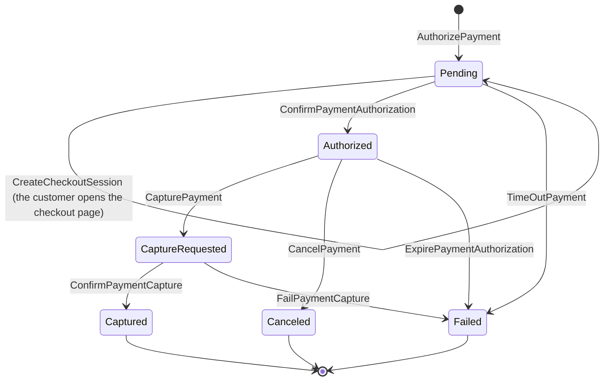
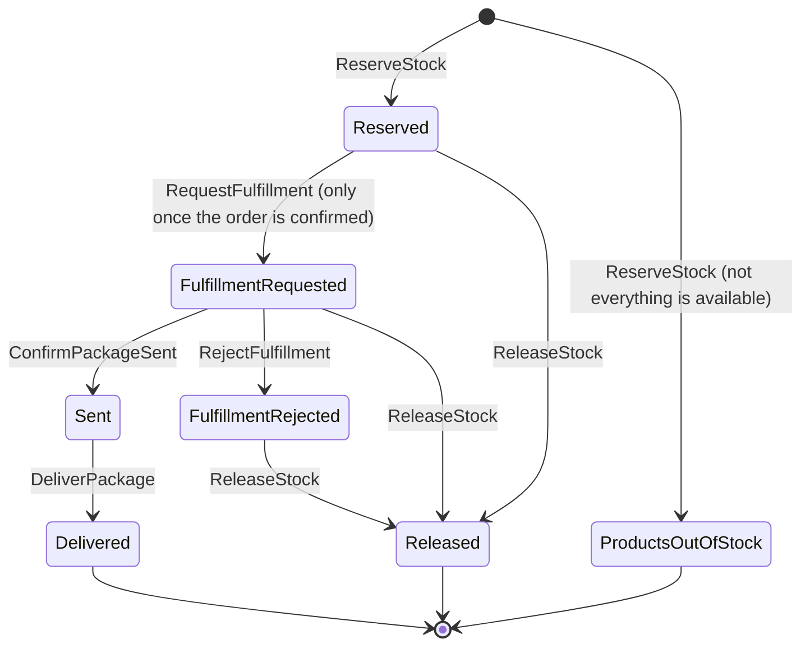
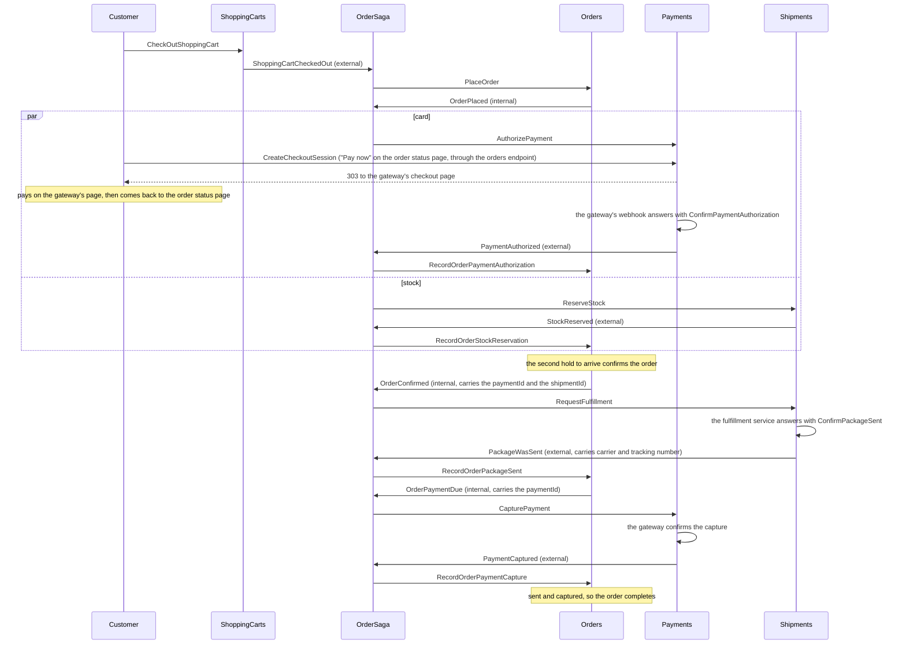
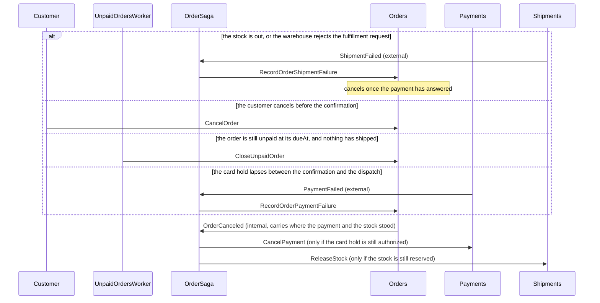
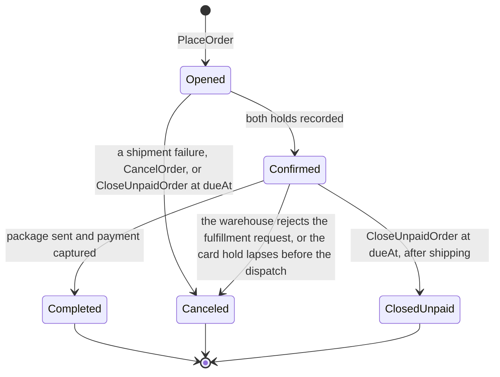

[](https://www.linkedin.com/in/oskardudycz/)  [](https://github.com/sponsors/oskardudycz/) [](https://event-driven.io/?utm_source=event_sourcing_jvm) [](https://www.architecture-weekly.com/?utm_source=event_sourcing_jvm) 

 

# Distributed process with Event Sourcing

- [Distributed process with Event Sourcing](#distributed-process-with-event-sourcing)
  - [Batch operations](#batch-operations)
  - [Cross-module processes with compensation](#cross-module-processes-with-compensation)
    - [Two holds, then two commits](#two-holds-then-two-commits)
    - [Where this flow comes from](#where-this-flow-comes-from)
    - [Compensation](#compensation)
    - [The order decides, the saga only translates](#the-order-decides-the-saga-only-translates)
    - [Why the saga stays stateless](#why-the-saga-stays-stateless)
    - [Internal and external events](#internal-and-external-events)
    - [The read side that feeds the external events](#the-read-side-that-feeds-the-external-events)
    - [The event store is the outbox](#the-event-store-is-the-outbox)
    - [Channels and queues](#channels-and-queues)
    - [The payment gateway and the fulfillment service](#the-payment-gateway-and-the-fulfillment-service)
    - [The web API and the shop](#the-web-api-and-the-shop)
    - [The API documentation](#the-api-documentation)
    - [When things go wrong](#when-things-go-wrong)
    - [Where the code lives](#where-the-code-lives)
    - [What this sample doesn't cover](#what-this-sample-doesnt-cover)

These samples show how to handle distributed processes with Event Sourcing. For more background, check my articles [Saga and Process Manager - distributed processes in practice](https://event-driven.io/en/saga_process_manager_distributed_transactions?utm_source=event_sourcing_jvm) and [No, it can never happen!](https://event-driven.io/en/no_it_can_never_happen/?utm_source=event_sourcing_jvm). 

An event-driven distributed process accepts that a two-phase commit across modules and databases is not possible. Instead of one big transaction, it runs a sequence of _microtransactions_. Each operation is handled by the module that's the source of truth and can make autonomous decisions. An event recorded and published in the system starts the process, e.g. shopping cart checked out. Then another module can subscribe to it and take it from there. It knows what should be the next operation, e.g. initiating the order process. It sends a command that is handled, and business logic creates another event. This event is the trigger for the next step of the workflow. Such _lasagne_ of event/command/event/command continues until the process is finished (with success or failure).


## Batch operations

A common example of a distributed process is a batch operation, for instance, the group checkout of hotel guests. Someone selects a set of guest accounts and clicks "check out". After that, the process tries to check out all of them. If the whole process fails, there's no compensation, but you could rerun the checkout after resolving the issues.

The group checkout saga can look like this:

```java
public class GroupCheckoutSaga {
  private final CommandBus commandBus;

  public GroupCheckoutSaga(CommandBus commandBus) {
    this.commandBus = commandBus;
  }

  public void on(GroupCheckoutInitiated groupCheckoutInitiated) {
    for (var guestAccountId : groupCheckoutInitiated.guestStayAccountIds()) {
      commandBus.schedule(
        new GuestStayAccountCommand.CheckOutGuest(guestAccountId, groupCheckoutInitiated.groupCheckoutId(), groupCheckoutInitiated.initiatedAt())
      );
    }
    commandBus.schedule(
      new RecordGuestCheckoutsInitiation(
        groupCheckoutInitiated.groupCheckoutId(),
        groupCheckoutInitiated.guestStayAccountIds(),
        groupCheckoutInitiated.initiatedAt()
      )
    );
  }

  public void on(GuestStayAccountEvent.GuestCheckedOut guestCheckoutCompleted) {
    if (guestCheckoutCompleted.groupCheckoutId() == null)
      return;

    commandBus.schedule(
      new RecordGuestCheckoutCompletion(
        guestCheckoutCompleted.groupCheckoutId(),
        guestCheckoutCompleted.guestStayAccountId(),
        guestCheckoutCompleted.completedAt()
      )
    );
  }

  public void on(GuestStayAccountEvent.GuestCheckoutFailed guestCheckoutFailed) {
    if (guestCheckoutFailed.groupCheckoutId() == null)
      return;

    commandBus.schedule(
      new RecordGuestCheckoutFailure(
        guestCheckoutFailed.groupCheckoutId(),
        guestCheckoutFailed.guestStayAccountId(),
        guestCheckoutFailed.failedAt()
      )
    );
  }
}
```

See more in [GroupCheckoutSaga.java](./src/main/java/io/eventdriven/distributedprocesses/hotelmanagement/saga/groupcheckout/GroupCheckoutSaga.java)

The saga schedules commands through a command bus. The bus stores them durably and uses the outbox pattern to make sure that they're delivered. A command bus on KurrentDB and its subscriptions can look like this:

```java
public class KurrentDBCommandBus implements CommandBus {
  private static final String commandStreamId = "_commands-all";
  private final KurrentDBClient kurrentDBClient;
  private final EventStore eventStore;
  private final RetryTemplate retryTemplate;
  private final Supplier<String> currentCorrelationId;
  private final Supplier<String> currentCausationId;

  public KurrentDBCommandBus(
    KurrentDBClient kurrentDBClient,
    EventStore eventStore,
    RetryTemplate retryTemplate,
    Supplier<String> currentCorrelationId,
    Supplier<String> currentCausationId
  ) {
    this.kurrentDBClient = kurrentDBClient;
    this.eventStore = eventStore;
    this.retryTemplate = retryTemplate;
    this.currentCorrelationId = currentCorrelationId;
    this.currentCausationId = currentCausationId;
  }

  @Override
  public <Command> EventStore.AppendResult schedule(Command command) {
    return retryTemplate.invoke(() -> {
      var result = eventStore.append(
        commandStreamId,
        new CommandEnvelope<>(command, new CommandMetadata(currentCorrelationId.get(), currentCausationId.get()))
      );

      if (result instanceof EventStore.AppendResult.UnexpectedFailure)
        throw new IllegalStateException("Unexpected failure while appending: %s".formatted(result));

      return result;
    });
  }

  @Override
  public void subscribe(Consumer<CommandEnvelope<Object>>... handlers) {
    subscribeToStream(kurrentDBClient, commandStreamId, (subscription, resolvedEvent) -> {
      var commandEnvelope = deserializeCommand(resolvedEvent);

      if (commandEnvelope.isEmpty()) {
        return;
      }

      for (var handler : handlers) {
        handler.accept(commandEnvelope.get());
      }
    });
  }
}
```

See more in [KurrentDBCommandBus.java](./src/main/java/io/eventdriven/distributedprocesses/core/commands/KurrentDBCommandBus.java)

The saga delegates the business logic to the group checkout decider. That gives a clear split between coordination (the saga) and business logic (the decider), so the saga stays lightweight. It is much easier to maintain than a process manager that does both.

See the [GroupCheckoutDecider](./src/main/java/io/eventdriven/distributedprocesses/hotelmanagement/saga/groupcheckout/GroupCheckoutDecider.java) and [GroupCheckout](./src/main/java/io/eventdriven/distributedprocesses/hotelmanagement/saga/groupcheckout/GroupCheckout.java) state.

We can check out the guest account if the balance is settled. If it's not, the decider returns a failure event: 

```java
private static GuestStayAccountEvent handle(CheckOutGuest command, CheckedIn state) {
  if (state.balance() != 0) {
    return new GuestCheckoutFailed(
      state.id(),
      GuestCheckoutFailed.Reason.BalanceNotSettled,
      command.groupCheckoutId(),
      command.now()
    );
  }

  return new GuestCheckedOut(
    command.guestStayAccountId(),
    command.groupCheckoutId(),
    command.now()
  );
}
```

See more in [GuestStayAccountDecider](./src/main/java/io/eventdriven/distributedprocesses/hotelmanagement/saga/gueststayaccount/GuestStayAccountDecider.java#L74).

The command handler (the application service) should use a retry policy, so that a transient error does not fail the command.

```java
public Optional<ETag> handle(CheckOutGuest command) {
  return retryTemplate.invoke(() -> handle(command.guestStayAccountId(), command));
}
```

See more in [GuestStayAccountService](./src/main/java/io/eventdriven/distributedprocesses/hotelmanagement/saga/gueststayaccount/GuestStayAccountService.java#L38)

As an alternative to the retry policy, the command handler could use [Pokémon exception handling](https://www.dodgycoder.net/2011/11/yoda-conditions-pokemon-exception.html) (catch every exception) and then publish the failure event.

The same group checkout is also implemented as:

- [process manager](./src/main/java/io/eventdriven/distributedprocesses/hotelmanagement/processmanager/), where [GroupCheckoutProcessManager](./src/main/java/io/eventdriven/distributedprocesses/hotelmanagement/processmanager/groupcheckout/GroupCheckoutProcessManager.java) keeps the process state and decides about the next steps,
- [choreography](./src/main/java/io/eventdriven/distributedprocesses/hotelmanagement/choreography/), where [GroupCheckoutService](./src/main/java/io/eventdriven/distributedprocesses/hotelmanagement/choreography/groupcheckout/GroupCheckoutService.java) reacts to events and schedules commands itself, without a separate saga.

## Cross-module processes with compensation

The group checkout has no compensation. If the checkout of one guest fails, the other checkouts stay done, and you can run the group checkout again after you fix the problem. A purchase can't work that way. If the shop can't ship the goods, it has to release the money that it blocked on the customer's card. If the customer doesn't pay, the shop has to put the reserved goods back on sale. Undoing the steps that already happened is called compensation.

The e-commerce sample shows such a process. One purchase goes through four modules: [shopping carts](./src/main/java/io/eventdriven/distributedprocesses/ecommerce/shoppingcarts/), [orders](./src/main/java/io/eventdriven/distributedprocesses/ecommerce/orders/), [payments](./src/main/java/io/eventdriven/distributedprocesses/ecommerce/payments/) and [shipments](./src/main/java/io/eventdriven/distributedprocesses/ecommerce/shipments/). The process runs in the orders module, in `OrderSaga`. The modules don't read each other's events directly. Each module records internal events for itself, and publishes separate external events for the other modules. [Internal and external events](#internal-and-external-events) explains why.

### Two holds, then two commits

A purchase needs the customer's money and the goods, and they are in two separate systems: the money at the payment provider, the goods in the warehouse. No single transaction covers both. So the shop can't take both at once, and if one step fails, nothing undoes the other step automatically.

Shops solve this in two steps. First, they set both aside without taking them. This is a *hold*, and a hold can still be released. Only when both holds are in place do they take what they set aside. This is the *commit*:

- on the card, the bank *authorizes* the amount: it blocks the money on the customer's account, but does not take it. Taking the money later is the *capture*;
- in the warehouse, the shop *reserves* the stock: the units are set aside for the order, and nobody else can buy them. Sending them to the customer is the *shipment*.

```
authorize the card  ──┐
                      ├──> both holds good ──> pick, pack, send ──> capture the funds
reserve the stock   ──┘
```

The two holds end differently. The bank keeps a card hold only for a limited time. Stripe says an online card authorization is "usually valid for 7 days", and if it expires before you capture, "the funds are released and the payment status changes to `canceled`". So the customer's money is never blocked forever, even if the shop never captures or cancels. For the shop, the expiry is a deadline: it has to capture before it. The stock hold has no timer. Shopify calls such stock **committed**, "units that are part of a placed order but aren't yet fulfilled". It stays committed until the order ships or is canceled.

The capture comes last on purpose. Shops that sell physical goods charge when the goods leave, not when the order is placed: Amazon charges the card when the item ships, and Shopify can capture on fulfillment. The customer is never charged for something that didn't ship, and an order that fails before shipping only has to drop its holds. No money moved, so there is nothing to refund.

If something fails before the package leaves, nothing has shipped, because nothing ships before both holds are in. So the shop only releases the stock and drops the card hold. A payment that fails after the package left is a different case, described in [When things go wrong](#when-things-go-wrong).

### Where this flow comes from

The names below come from the providers' own documentation. Each command matches an operation or a webhook of a real provider, and each state is one that a provider reports, so the diagrams line up with their docs.

**The cart.** The workshops in this repository start a cart with an `OpenShoppingCart` command. Real shops have no such step: in Shopify, WooCommerce, Amazon and Allegro, the first "Add to cart" starts the cart, so the first event in a cart's stream is `ProductItemAddedToShoppingCart`. The sample assumes that the customer is logged in, as on Allegro, where buying needs an account. Each cart is a short stream, `ShoppingCart-{customerId}-{n}`. A customer has at most one open cart, and the first product after a checkout starts cart `n + 1`. The [CustomerShoppingCarts](./src/main/java/io/eventdriven/distributedprocesses/ecommerce/shoppingcarts/CustomerShoppingCarts.java) view, a projection that the cart module reads, knows which cart is the current one. If two requests start the same new cart, the slower append finds the stream already there. It then retries, as described in [The order decides, the saga only translates](#the-order-decides-the-saga-only-translates), and adds the product to the cart that the other request started.

The customer chooses a product and a quantity, never a price. The price list gives the price when the product first enters the cart, and a later add of the same product keeps the line's price. The cart does not promise that price. Amazon's [cart](https://us.amazon.com/gp/cart/view.html) "reflects each item's most recent price", and Shopify's checkout can say ["Prices for these items have changed and are updated in your cart"](https://community.shopify.com/t/prices-for-these-items-have-changed-and-are-updated-in-your-cart/284837). So `CheckOutShoppingCart` reads the current prices. If one changed, the cart records `ProductItemPriceChanged` and stays open. Each change gives the cart a new version, and a checkout carries the version that the customer saw. So after a price change, the customer has to look at the new prices and check out again with the new version. If no price changed, the cart records `ShoppingCartCheckedOut`. The name is the one the shops use: "Proceed to checkout" on Amazon and WooCommerce, "Check out" on Shopify, "Go to checkout" on Allegro. No shop has a "cancel cart" action, so the sample has none: a customer leaves the cart, and nothing happens.

A price can still change between the check and the append. The shops accept that race: the price at the click is the price of the order. On Allegro, [the price stays as it was when the customer clicked "Buy now"](https://spolecznosc.allegro.pl/t5/dyskusje-kupuj%C4%85cych/pytanie/m-p/705830). Amazon handles a wrong price after the order, by its [terms of sale](https://www.pinsentmasons.com/out-law/guides/amazons-pricing-error): it may contact the buyer or cancel. Locking the price list during checkout would need one transaction across pricing and the cart, which is the two-phase commit this sample avoids. The sources for the cart are collected in [real-world-flow.md](./plans/saga-and-outbox/real-world-flow.md#7-cart).

**The card.** Payment services keep authorizing and capturing as two separate steps. Stripe calls this [place a hold on a payment method](https://docs.stripe.com/payments/place-a-hold-on-a-payment-method) and switches it on with `capture_method: manual`; Adyen calls the second step [capture](https://docs.adyen.com/online-payments/capture) and supports delaying it. Both let you drop the hold before any money moved: Stripe calls it canceling the PaymentIntent, its object for one payment, and this sample calls it `CancelPayment`. Two more names appear below: a Checkout Session is the gateway's payment page for one payment, and a webhook is the gateway's HTTP call back to the shop. **The payment page** below describes both.



| Ours | Stripe | Adyen |
|---|---|---|
| `CreateCheckoutSession` | create a Checkout Session with `capture_method: manual` | create a payment session |
| `ConfirmPaymentAuthorization` | the `payment_intent.amount_capturable_updated` webhook, with `capture_before` | the `AUTHORISATION` webhook |
| `TimeOutPayment` | expire the Checkout Session | no such operation |
| `CapturePayment` | capture the PaymentIntent | capture |
| `CancelPayment` | cancel the PaymentIntent | cancel |
| `ExpirePaymentAuthorization` | the authorization lapses and the funds are released | the transaction expires |

There's no single answer to how long the hold lasts. Stripe lists around 7 days for the common card-not-present case, and [Adyen's per-scheme table](https://docs.adyen.com/online-payments/adjust-authorisation) shows the spread: Mastercard 7 days for a final authorization and 30 for a pre-authorization, Visa 5 to 30 depending on the merchant category, JCB up to a year. That's why the gateway's webhook brings the deadline, Stripe's `capture_before`, and `captureBefore` travels on the event. The module records the deadline it was actually granted, rather than everyone downstream agreeing on a number that isn't true for every card.

**The payment page.** Only the customer can authorize the card: with 3-D Secure (the bank's own confirmation step), BLIK (a Polish mobile payment code) or a bank login, on the gateway's own page. Allegro shows how that looks to the customer. After "Buy and pay", Allegro [redirects the customer to a page where the payment is completed](https://allegro.pl/pomoc/dla-kupujacych/przelew-bankowy/jak-zaplacic-za-przedmiot-kupiony-na-allegro-YLKol7RVxI0). Back on Allegro, "My purchases" shows "Your payment is being processed" until the payment is settled. A customer who closes the page without paying can cancel the payment, and the purchase is then marked unpaid. "Pay" pays it later, and "Retry payment" retries a failed payment. The gateways behind such pages work the same way. When the customer clicks, the shop creates a session at the gateway and sends the customer there with an HTTP 303 redirect: Stripe's [Checkout Session](https://docs.stripe.com/checkout/quickstart), Adyen's payment session, PayPal's order with its `payer-action` link. The gateway sends the customer back to the shop's page, but that return decides nothing. Stripe says ["you can't rely on triggering fulfillment only from your checkout landing page"](https://docs.stripe.com/checkout/fulfillment?ui=full-page), because the customer can lose the connection before the page loads. The outcome comes in a webhook.

The sample follows Stripe. `AuthorizePayment` only records that the payment waits for the customer. "Pay now" on the order status page calls `PaymentFacade.createCheckoutSession`: the payments module asks the gateway for a Checkout Session that expires in 30 minutes and records `CheckoutSessionCreated` with the session's URL and expiry. A second click before the expiry gets the same page, so one payment can never hold the card twice. After the expiry, the next click creates a new session for the same payment, as Stripe's recovery link for an expired session does. A new payment comes only from "Retry payment". The gateway's webhook answers with `ConfirmPaymentAuthorization`, carrying `captureBefore`. A declined card is not an answer: Stripe's page shows the decline, and the customer tries again on the same page. A customer who never pays is timed out when the time for the payment runs out (`timesOutAt`, 24 hours in the running application). The order then waits for the customer to pay again, keeping its stock, until its `dueAt`, the date by which the order must be paid (see [When things go wrong](#when-things-go-wrong)).

**The stock.** The cart holds no stock: on Allegro, putting a product in the cart [does not reserve it](https://spolecznosc.allegro.pl/t5/dyskusje-kupuj%C4%85cych/zmiana-cen-po-dodaniu-do-koszyka/td-p/657648). Placing the order takes the stock. Shopify's [inventory states](https://help.shopify.com/en/manual/products/inventory/managing-inventory-quantities/inventory-states) separate *available* from *committed*, and placing an order moves units from one to the other. WooCommerce [creates the order when the customer clicks "Place order"](https://wordpress.org/support/?p=10149006), before the payment, and takes its stock. The committed stock has no timer of its own. WooCommerce's "Hold stock (minutes)" is a timer on the unpaid order: [when it runs out, the order is canceled and the stock goes back](https://www.businessbloomer.com/woocommerce-automatically-cancel-orders/). The sample does the same with the order's `dueAt`: an order still unpaid at that date is canceled, and the stock is released.

Shipping is a request to a warehouse service, which answers later. Shopify's [fulfillment request](https://help.shopify.com/en/manual/fulfillment/fulfilling-orders/app-fulfillment) is accepted or rejected by the service; a rejected one sends the order back to "Unfulfilled". This sample has no merchant step after a rejection, so a rejected request cancels the order.



Both diagrams end up with the same shape: a hold, a commit, and a way to let the hold go. The order sits on top of them and waits until each side has answered.

The diagram below shows a whole purchase. `OrderSaga`, in the orders module, connects the modules: it reacts to events and sends commands. *External* marks an event that a module publishes for the others, and *internal* an event that stays in its module, as described in [Internal and external events](#internal-and-external-events).



The order completes once the package was sent and the payment captured, which is what Shopify and commercetools call fulfilled and paid; neither waits for the delivery. The shipment still records `PackageWasDelivered`, but nothing outside it reacts. The goods move before the money does: `recordPaymentCapture` acts only once the package was sent, and `recordPackageSent` only while the card hold is still `Authorized`, so nothing leaves the warehouse against a hold that has already lapsed.

The orders module publishes no external events, because no other module reacts to the order's events. See [Internal and external events](#internal-and-external-events).

### Compensation



A failed payment doesn't cancel the order on its own. Before the confirmation the customer can still pay again, so the order records the failure, keeps its stock and waits until its `dueAt`. A failed shipment cancels the order, but only once the payment has answered, because whether a card hold needs canceling depends on that answer. The same wait covers the happy path, where both modules answer at once: the two holds can arrive in either order, and the order comes out the same.

The order, not the saga, decides what to undo. The internal `OrderCanceled` carries `paymentStatus` and `shipmentStatus`, and the saga only reads them:

| status | the saga sends |
|---|---|
| `paymentStatus = Authorized` | `CancelPayment` |
| `shipmentStatus = Reserved` | `ReleaseStock` |
| anything else | nothing, because there is no hold to undo |

There's no refund in that table, because an order can only be canceled before it ships, and nothing is captured before it ships. Once the parcel has left, canceling is a return, and returns are a process of their own, refund included. A chargeback is another reversal, but the shop cannot start it: the customer's bank starts it when the customer disputes the payment.

Read more about why compensation matters in [What texting your Ex has to do with Event-Driven Design?](https://event-driven.io/en/what_texting_ex_has_to_do_with_event_driven_design?utm_source=event_sourcing_jvm).

### The order decides, the saga only translates

`Order` holds one status per participant, just as `GroupCheckout` holds one status per guest stay:

| Participant | Statuses |
|---|---|
| payment | `Pending` → `Authorized` → `Captured` (only after `Sent`), or `Failed`; a retry goes from `Failed` to `Retrying` and then `Authorized`, before the confirmation or after `Sent` |
| shipment | `Pending` → `Reserved` → `Sent`, or `Failed` (out of stock), or `Rejected` (the stock is still held) |

The order itself goes through these statuses:



The record that completes a step appends a second event in the same batch: `OrderConfirmed` once both holds are in, `OrderCompleted` once the payment is captured after the dispatch, and `OrderCanceled` when a failure ends the order. Recording the dispatch also appends `OrderPaymentDue`, which names the payment to capture. There's no `CompleteOrder` or `ConfirmOrder` command, because nobody outside the order is in a position to know that the order moved on.

Every method is idempotent. A command that arrives twice, or too late, appends nothing and returns:

```java
public void recordPaymentAuthorization(PaymentId paymentId, OffsetDateTime authorizedAt) {
  if (status == Status.Opened && payment == PaymentProgress.Pending) {
    enqueue(new OrderPaymentAuthorized(id, paymentId, authorizedAt));

    progress(authorizedAt);
    return;
  }

  if (payment != PaymentProgress.Retrying || !paymentId.equals(this.paymentId))
    return;

  // the authorization of a payment made again, see "Paying again" below
}
```

Idempotency also keeps the process moving. A handler that throws inside an asynchronous process blocks it: the message is delivered again, fails again, and the messages behind it wait. So orders, payments and shipments ignore a message they can't use: the method returns and appends nothing. `ShoppingCart` still throws, because its commands come from a person over HTTP, where a rejected action has to reach the caller as an error instead of vanishing. The order also gets two commands from a person, `CancelOrder` and `RetryOrderPayment`, but it ignores them too, because the same order is in the middle of the process. The web API answers both with 202 Accepted, and the customer sees the result on the order page, as Allegro shows it in "My purchases".

Two handlers can also append to the same stream at the same moment. A message handler passes no expected version, so `AggregateStore` retries the conflict: it reads the stream again and decides again, up to three times. That is safe because the aggregates are idempotent. Without the retry, the handler would throw, and the event store would deliver the event again only on its next append, which may never come. A cart command from a person passes the version the person saw, so its conflict is not retried. It goes back to the caller.

### Why the saga stays stateless

The whole process is one class, [OrderSaga](./src/main/java/io/eventdriven/distributedprocesses/ecommerce/orders/OrderSaga.java), with its handlers grouped by phase: hold, commit and compensation. It only translates: it waits for an event and sends a command built from that event's data alone. That takes some care, because an event doesn't always carry what the next command needs.

`PackageWasSent` doesn't know which payment is waiting on it, and it shouldn't: the shipments module has never heard of a payment. Looking the payment up inside the saga would work, at the price of giving it a store and a state to keep. The sample routes it through the order instead: the saga records the dispatch, and the order answers with its own `OrderPaymentDue`, carrying the `paymentId` it already knows. That's the event the capture is sent from, and the same event comes again when the customer pays a second time:

```java
public void on(ShipmentExternalEvent.PackageWasSent event) {
  messageBus.publish(List.of(
    new RecordOrderPackageSent(
      new OrderId(event.referenceId()),
      event.carrier(),
      event.trackingNumber(),
      event.sentAt()
    )
  ));
}

// The shipment does not know the payment. The order does, and names it here.
public void on(OrderEvent.OrderPaymentDue event) {
  messageBus.publish(List.of(new PaymentCommand.CapturePayment(event.paymentId())));
}
```

`OrderPaymentDue` is an internal event. The saga belongs to the orders module, so it reads the order's own events straight from its store and the other modules' external events from the message bus. A module that drove its own process through its external events would have to publish whatever that process needs, such as a `paymentId` here, a `shipmentId` there and the internal states on a cancellation, and its external events would turn into a dump of its internals.

The saga ends up with no state, no store, no clock and no id supplier; its only field is the message bus. Identifiers are derived rather than generated: the order id comes from the cart id, the payment and shipment ids from the order id, and a payment made again from the order id and the attempt number. Handling the same event twice therefore sends two identical commands, and the modules no-op on the second.

### Internal and external events

If a module exposed its internal events, every other module would depend on its internal names and data. That is the leaking abstraction described in [Events should be as small as possible, right?](https://event-driven.io/en/events_should_be_as_small_as_possible?utm_source=event_sourcing_jvm). So each module that others react to has [internal and external events](https://event-driven.io/en/internal_external_events/?utm_source=event_sourcing_jvm), and a forwarder, a subscriber of the module's internal events, publishes the external ones:

| Module | What it publishes | Who it is for |
|---|---|---|
| shopping carts | `ShoppingCartCheckedOut` | orders |
| payments | `PaymentAuthorized`, `PaymentCaptured`, `PaymentFailed` | orders, through a `referenceId` |
| shipments | `StockReserved`, `PackageWasSent`, `ShipmentFailed` | orders, through a `referenceId` |

Each of them declares its external events as a `sealed interface <Module>ExternalEvent`, so a consumer can switch over all of them exhaustively.

Payments and shipments are generic services: they know a `referenceId` and an amount or a list of items, never an order. Their external events carry what any client of such a service needs. The orders module publishes no external events: no module in this sample reacts to the order's events, and an external event that nobody reads is only a guess at what someone might need. The order's events are read only by its own saga and its own views.

Two of those names cover more than one internal event. `PaymentFailed` stands for `PaymentTimedOut`, `PaymentAuthorizationExpired` and `PaymentCaptureFailed`, and carries no reason, because the order treats all three the same. `ShipmentFailed` stands for `ProductWasOutOfStock` and `FulfillmentRejected`, and carries which one it was, because the order cancels with a different reason and, after a rejection, still has stock to release. Internally those stay separate events, because the module needs to tell them apart.

Each external event carries only what its consumer reads. The order needs the `referenceId` to find itself, the ids it passes on, the time and, for a shipment, the carrier and tracking number. Amounts, items and deadlines stay inside the module that owns them.

An external event usually needs more than the internal event that triggered it. The internal `ShoppingCartCheckedOut` carries the cart id and a timestamp, but the external `ShoppingCartCheckedOut` has to carry the customer, the items and the total, because the order module cannot call back into the cart to ask. The same is true of `PaymentAuthorized`: internally it has no `referenceId`, and the order needs one.

So the forwarder needs that data from somewhere. It could load the aggregate, but then the aggregate would have to expose its state. Each module keeps a projection instead:

```java
public void onCheckedOut(EventEnvelope<ShoppingCartEvent.ShoppingCartCheckedOut> envelope) {
  var event = envelope.data();
  var cart = get(event.shoppingCartId(), envelope.metadata().streamPosition());

  var externalEvent = new ShoppingCartExternalEvent.ShoppingCartCheckedOut(
    event.shoppingCartId(),
    cart.getCustomerId(),
    cart.getProductItems(),
    cart.getTotalPrice(),
    event.checkedOutAt()
  );

  messageBus.publish(List.of(externalEvent));
}

private ShoppingCartSummary get(ShoppingCartId shoppingCartId, long streamPosition) {
  return summaries.get(shoppingCartId)
    .filter(summary -> summary.getVersion() >= streamPosition)
    .orElseThrow(() -> new IllegalStateException(
      "Summary of shopping cart '%s' has not reached position %d yet".formatted(shoppingCartId.value(), streamPosition)
    ));
}
```

The aggregate's job is to decide, and it keeps only the state that its decisions need. If a forwarder read the aggregate, every field of an external event would become a field that the aggregate has to expose. `Order` exposes no state at all.

Some internal events have no external event at all: `PaymentCanceled` and `StockReleased` end compensations that no module waits for.

### The read side that feeds the external events

Each projection extends [Projection](./src/main/java/io/eventdriven/distributedprocesses/core/projections/Projection.java), in the same shape as the projections in the [event-driven architecture](../../workshops/event-driven-architecture/) workshop. It says which events it handles, which document each event belongs to, and how the event changes that document. Returning no document deletes it:

```java
public class PaymentSummaries extends Projection<PaymentSummary> {
  @Override
  public List<Class<?>> canHandle() {
    return List.of(PaymentAuthorizationRequested.class);
  }

  @Override
  protected EntityId getDocumentId(Object event) {
    return switch (event) {
      case PaymentAuthorizationRequested e -> e.paymentId();
      default -> throw new IllegalArgumentException("Unexpected event %s".formatted(event));
    };
  }

  @Override
  protected @Nullable PaymentSummary evolve(@Nullable PaymentSummary current, Object event) {
    return switch (event) {
      case PaymentAuthorizationRequested e -> new PaymentSummary(e.referenceId());
      default -> current;
    };
  }
}
```

The base class reads and stores the document, so no projection touches the database. The stream position comes along because a subscriber of the event store gets an `EventEnvelope`, not a bare event. The document records the position it last applied, so an event delivered twice is skipped rather than counted twice.

A summary keeps only what its forwarder adds to the internal events, and handles only the events that change it: `PaymentSummary` holds the `referenceId`, because only the authorization request carries it. The shipments module needs no summary, because its internal events carry the `referenceId` themselves.

The projection and the forwarder are separate subscribers, and each keeps its own checkpoint. If the projection fails on an event and the forwarder does not, the forwarder would enrich from a view that has not seen that event. So the forwarder checks that the view has what it needs. If it does not, the forwarder throws: the store keeps its checkpoint and delivers the event again on the next append, after the projection has caught up. For payments, the reference is fixed once it is there, so the forwarder only checks that the summary exists. The cart's items change with every add, remove and price change, so the cart forwarder also checks that the summary's version has reached the event's stream position.

Besides the summaries, the modules keep views that exist to answer a question nobody can answer from an aggregate, because the question spans many of them:

| View | Answers |
|---|---|
| `PendingPayments` | which authorization requests are still unanswered at their `timesOutAt` |
| `AuthorizedPayments` | which card holds have passed `captureBefore` |
| `OrdersAwaitingPayment` | which orders with a failed payment are still unpaid at their `dueAt` |
| `PendingOrders` | which orders are still in flight |
| `CustomerShoppingCarts` | which cart is the customer's current one, and how many carts the customer has had |

`PendingPayments`, `AuthorizedPayments` and `OrdersAwaitingPayment` are to-do lists, as the workshop calls them: projections that list the work a worker has to do. `PendingOrders` has no worker. `ShoppingCartFacade` reads `CustomerShoppingCarts` to choose the cart for the customer's next product. Each view answers one question for one reader. The customer's pages get views of their own, described in [The web API and the shop](#the-web-api-and-the-shop).

### The event store is the outbox

Appending only writes: to the stream, and to one global log. Every subscriber (the projections, the forwarders, the saga, the gateway clients and the fulfillment service client) reads that log from its own checkpoint. [InMemoryEventStore](./src/main/java/io/eventdriven/distributedprocesses/core/kurrentdb/InMemoryEventStore.java) delivers once the outermost append is done, entry by entry, to every subscriber that is behind. An event appended by a subscriber is delivered after the one it is handling, never in the middle of it.

A subscriber that throws keeps its checkpoint. It gets nothing more in that run, and the next append delivers the same event to it again, before anything newer. The append itself does not fail: the event is stored, and it is the subscriber that has to catch up. That is at-least-once delivery, and it is why every handler has to be idempotent.

A facade that stored an event and then published a message on a bus would have a gap: a crash between the two steps would lose the message, or publish one for an event that was never stored. Here a facade only appends to the store, and the subscribers publish from there, so there is no such gap. Against KurrentDB, [KurrentDBEventStore](./src/main/java/io/eventdriven/distributedprocesses/core/kurrentdb/KurrentDBEventStore.java) subscribes to `$all`, filtered by event type. It starts from the beginning every time; a production version would store the checkpoint.

Commands and external events travel on one [MessageBus](./src/main/java/io/eventdriven/distributedprocesses/core/messaging/MessageBus.java), through the channels described in [Channels and queues](#channels-and-queues). A command and an event differ in intent, not in transport. Only forwarders publish events on it, so no module sees another module's internal events. The bus carries the messages between modules, and each module's own commands from the saga, the workers, the capture client and the providers. A person's commands come through the [web API](#the-web-api-and-the-shop), which calls the facades directly. The order saga listens to both sides: to the order's own events from the store, and to the other modules' external events from the bus.

[ECommerceConfig](./src/main/java/io/eventdriven/distributedprocesses/ecommerce/ECommerceConfig.java) is the composition root. It configures the four modules on one store and one bus, then wires the order saga last. The store delivers each event to its subscribers in the order they subscribed, so each module's forwarder runs before the saga, and an external event goes out before the steps it causes. [ECommerceTests](./src/test/java/io/eventdriven/distributedprocesses/ecommerce/ECommerceTests.java) drives whole orders through it and checks the commands and the external events in the order they happen.

### Channels and queues

Each module owns its channels, and names them `<module>-<purpose>`. The purposes come from [Internal and external events](https://event-driven.io/en/internal_external_events/?utm_source=event_sourcing_jvm) and [Predictable identifiers](https://event-driven.io/en/predictable-identifiers-enabling/?utm_source=event_sourcing_jvm): `internal` for the module's own commands, `external` for the events it publishes to anyone, `requests` for the commands other modules send it, and `responses` for its answers to them.

| Channel | Carries | Who sends | Queue that reads it |
|---|---|---|---|
| `shopping_carts-external` | `ShoppingCartCheckedOut` | the cart forwarder | `orders-shopping_carts-external`, owned by orders |
| `orders-internal` | `PlaceOrder`, the `RecordOrder...` commands, `CloseUnpaidOrder` | the saga, `UnpaidOrdersWorker` | `orders-internal` |
| `payments-requests` | `AuthorizePayment`, `CapturePayment`, `CancelPayment` | the saga | `payments-requests` |
| `payments-responses` | `PaymentAuthorized`, `PaymentCaptured`, `PaymentFailed` | the payment forwarder | `orders-payments-responses`, owned by orders |
| `payments-internal` | `ConfirmPaymentAuthorization`, `ConfirmPaymentCapture`, `FailPaymentCapture`, `TimeOutPayment`, `ExpirePaymentAuthorization` | the payment workers, the capture client, the gateway (the sandbox or a test double) | `payments-internal` |
| `shipments-requests` | `ReserveStock`, `ReleaseStock`, `RequestFulfillment` | the saga | `shipments-requests` |
| `shipments-responses` | `StockReserved`, `PackageWasSent`, `ShipmentFailed` | the shipment forwarder | `orders-shipments-responses`, owned by orders |
| `shipments-internal` | `ConfirmPackageSent`, `RejectFulfillment`, `DeliverPackage` | the warehouse (the sandbox or a test double) | `shipments-internal` |

A channel carries many message types. The type only picks the handler inside the queue, so adding a message adds no channel.

Each module's `Config` tells the bus three things, with [MessageRoutes](./src/main/java/io/eventdriven/distributedprocesses/core/messaging/MessageRoutes.java) taken from the [event-driven architecture](../../workshops/event-driven-architecture/) workshop:

```java
messageBus
  .routes(new MessageRoutes()
    .routeTarget(AuthorizePayment.class, command -> requests)
    .routeTarget(CapturePayment.class, command -> requests)
    .routeTarget(CancelPayment.class, command -> requests)
    .route(PaymentExternalEvent.class, event -> new RoutingTarget(responses, Urns.routingKeyOf(event.referenceId())))
    .routeTarget(MessageRoutes.inPackage(PaymentsConfig.class.getPackageName()), internal))
  .bind(requests, requests, "#")
  .bind(internal, internal, "#")
  .subscribe(requests, AuthorizePayment.class, facade::authorizePayment)
  // ...
```

- the routes decide the channel and the routing key of each message the module publishes;
- `bind` connects a queue to a channel for the keys that match a pattern, as a topic exchange does: `*` matches one word, `#` any number of words;
- `subscribe` registers a handler for one message type that reaches the queue.

A response goes back to whoever asked, without payments knowing who that is. Its routing key comes from the `referenceId`, which is a URN: `urn:ecommerce:order:42-1` becomes `ecommerce.order.42-1`. Orders binds its queue to `payments-responses` with `ecommerce.order.*`, so it gets the answers about orders and nothing else. Another client of payments would bind its own queue with its own prefix. The requester owns the queue that reads the responses, as orders owns `orders-payments-responses`.

[InMemoryMessageBus](./src/main/java/io/eventdriven/distributedprocesses/core/messaging/InMemoryMessageBus.java) does the matching itself. RabbitMQ's topic exchanges match the same patterns. Kafka has no such matching, so with Kafka a consumer has to read the channel's topic and route by key itself. That consumer is the next step of [the plan](./plans/saga-and-outbox/plan.md).

### The payment gateway and the fulfillment service

The payment gateway and the fulfillment service each sit behind an interface:

```java
public interface PaymentGateway {
  CheckoutSession createCheckoutSession(
    PaymentId paymentId, double amount, URI successUrl, URI cancelUrl, OffsetDateTime expiresAt
  );
  void expireCheckoutSession(PaymentId paymentId);
  void capture(PaymentId paymentId, double amount);
  void cancel(PaymentId paymentId);
}

public interface FulfillmentService {
  void request(ShipmentId shipmentId, ProductItem[] productItems);
}
```

The Checkout Session is created while the customer waits, in the request behind "Pay now". `CheckoutSession` carries the page's URL and its expiry. The request brings the `successUrl` and the `cancelUrl`, both the order status page, as Stripe's API takes them for each session, so payments still knows nothing about orders. If the gateway fails to create the session, the request fails and nothing is recorded: the customer can click again, and `PaymentTimeoutWorker` covers a customer who gives up.

The rest of the gateway is called by small clients that react to the payment's own internal events. The [authorization](./src/main/java/io/eventdriven/distributedprocesses/ecommerce/payments/authorization/AuthorizationGatewayClient.java) client cancels a canceled payment at the gateway, and expires the open Checkout Session of a payment that timed out, so the customer cannot pay what the shop no longer waits for. The [capture](./src/main/java/io/eventdriven/distributedprocesses/ecommerce/payments/capture/CaptureGatewayClient.java) client asks for the capture. In production the gateway answers the authorization and the capture later through a webhook. In the sample the test double, or the test standing for the customer on the gateway's page, sends the command the webhook would cause: `ConfirmPaymentAuthorization` with `captureBefore`, and `ConfirmPaymentCapture`. So the result always arrives as a command, as from a real webhook, and never as the return value of the call. Canceling does not answer back: a hold that is not canceled lapses on its own.

The fulfillment service is the warehouse company that ships the order. [FulfillmentServiceClient](./src/main/java/io/eventdriven/distributedprocesses/ecommerce/shipments/fulfillment/FulfillmentServiceClient.java) sends it the request when the shipment records `FulfillmentRequested`. The service answers later, in the sample by sending a command back: `ConfirmPackageSent` with the carrier and the tracking number, or `RejectFulfillment`, and later `DeliverPackage`. If the call itself fails, nothing is recorded, and the order is canceled when the card hold expires.

### The web API and the shop

The web API has an endpoint only for what a person does. The saga, the workers and the gateway clients talk through the message bus, so their commands have no endpoint. The gateway's and the warehouse's answers would be webhooks in production, but no person calls them: when the application runs, the sandbox gateway and the sandbox warehouse send those commands, and in the tests the test doubles do, as described in [The payment gateway and the fulfillment service](#the-payment-gateway-and-the-fulfillment-service). Each endpoint calls its module's facade or view directly, and the customer is known from the URL, as in the samples of [Emmett](https://event-driven-io.github.io/emmett/), my Node.js library for Event Sourcing:

| Endpoint | Module | Does |
|---|---|---|
| `GET /customers/{customerId}/shopping-carts/current` | shopping carts | reads the `Carts` view |
| `POST /customers/{customerId}/shopping-carts/current/product-items` | shopping carts | `AddProductItemToShoppingCart` |
| `DELETE /customers/{customerId}/shopping-carts/current/product-items?productId=&quantity=` | shopping carts | `RemoveProductItemFromShoppingCart`, with `If-Match` |
| `POST /customers/{customerId}/shopping-carts/current/checkout` | shopping carts | `CheckOutShoppingCart`, with `If-Match` |
| `GET /customers/{customerId}/orders` | orders | reads the `CustomerOrders` view |
| `GET /customers/{customerId}/orders/{orderId}` | orders | reads the `OrderStatuses` view |
| `POST /customers/{customerId}/orders/{orderId}/cancel` | orders | `CancelOrder`, 202 Accepted |
| `POST /customers/{customerId}/orders/{orderId}/retry-payment` | orders | `RetryOrderPayment`, 202 Accepted |
| `POST /customers/{customerId}/orders/{orderId}/payments/{paymentId}/checkout-session` | orders, calling payments | `CreateCheckoutSession`, then 303 See Other to the gateway's page |

The ids in the URLs are the tails of the URNs: an order's id is `{customerId}-{n}`, the same as its cart's, because the saga derives the order id from the cart id.

The cart answers every command with its new version as an `ETag`. Removing a product and checking out need the version the customer saw, in `If-Match`. A checkout that goes through answers 202 Accepted with `Location`, the order status: the saga places the order after the cart's event. A checkout that finds a changed price answers 409 Conflict with the new version in `ETag`, and the customer reads the cart again. A version conflict answers 412 Precondition Failed, a broken rule 409 Conflict, a cart, order or payment that does not exist 404 Not Found, and a gateway that cannot open the checkout 502 Bad Gateway. [ApiExceptionHandler](./src/main/java/io/eventdriven/distributedprocesses/ecommerce/ApiExceptionHandler.java) maps them to problem details.

The customer's pages read views made only for them, named after Shopify's pages:

| View | Shopify's page | Shows |
|---|---|---|
| `Carts` | Cart | the lines with their unit prices, the total, and the cart's version |
| `CustomerOrders` | Orders | the customer's orders: when each was placed, its total and its progress |
| `OrderStatuses` | Order status page | the items, the total, the progress, the carrier and tracking number, the current payment, and what the customer can do now |

`OrderStatus` is also the page the gateway returns the customer to, as both the `successUrl` and the `cancelUrl`. It offers "Pay now" while the payment waits for the customer, with the id of that payment: the first one is derived from the order id, as the saga derives it, and a retry's comes in `OrderPaymentRetried`. The checkout-session endpoint sits under the order, so it builds both URLs from its own path and needs no lookup. "Cancel order" shows until the order is confirmed. "Retry payment" shows when a payment failed and the order can still be paid: before the confirmation, or after shipping. The view only shows what the order would accept; the order still decides.

**The shop.** [ShopPages](./src/main/java/io/eventdriven/distributedprocesses/ecommerce/shop/ShopPages.java) serves the same flow as server-rendered pages, with Thymeleaf: Products, Cart, Orders and Order status, under `/shop/customers/{customerId}/...`. A few demo products stand in for a catalog. The pages call the same facades and views as the JSON API, and "Pay now" posts to the checkout-session endpoint, so the browser goes to the gateway's page and comes back to Order status.

**The sandbox.** When the application runs, [SandboxPaymentGateway](./src/main/java/io/eventdriven/distributedprocesses/ecommerce/payments/sandbox/SandboxPaymentGateway.java) plays the provider. It serves its own checkout page, laid out like Stripe Checkout, and takes Stripe's test cards: 4242 4242 4242 4242 pays, and 4000 0000 0000 0002 is declined and stays on the page, so the customer can try again. Paying sends `ConfirmPaymentAuthorization` with a 7-day `captureBefore`, as the webhook would, and sends the browser to the `successUrl`. A capture is confirmed at once. [SandboxFulfillmentService](./src/main/java/io/eventdriven/distributedprocesses/ecommerce/shipments/sandbox/SandboxFulfillmentService.java) plays the warehouse: it sends every package at once, with the carrier "Sandbox Express". So a paid order completes while the customer is still on the gateway's page.

**Running it.** `./gradlew bootRun` starts the application on port 8080, in memory, with no database or broker. Open <http://localhost:8080/shop> for the shop, and <http://localhost:8080/swagger-ui/index.html> for the JSON API. [ECommerceApplicationConfig](./src/main/java/io/eventdriven/distributedprocesses/ecommerce/ECommerceApplicationConfig.java) wires it: 7 days to pay (`PaymentTerms.within`, Shopify's "Within 7 days"), 24 hours for a payment (`PaymentValidity`), and the three workers scheduled every minute.

**Testing it.** The tests in [ecommerce/api](./src/test/java/io/eventdriven/distributedprocesses/ecommerce/api/) start the application on a random port and call it over HTTP, one test class per endpoint. They use [ApiSpecification](./src/test/java/io/eventdriven/testing/ApiSpecification.java), the given/when/then helper from the [introduction to Event Sourcing](../../workshops/introduction-to-event-sourcing/) workshop, on Spring's `RestTestClient`:

```java
@Test
public void cancelOrder_succeeds_withAcceptedAndCancelsTheUnpaidOrder() {
  var order = PurchaseRestBuilder.of(restTestClient, port)
    .build(purchase -> purchase.withCustomerId(customerId).withProduct(UUID.randomUUID(), 1).checkedOut());

  given(() -> null)
    .when(POST("/%s/orders/%s/cancel".formatted(customerId, order.orderId())))
    .then(ACCEPTED);

  assertEquals("Canceled", progressOf(order.orderId()));
}
```

`PurchaseRestBuilder` brings the order to the state the test needs, through the same endpoints: checked out, or paid on the sandbox's checkout page. [PurchaseOverHttpTests](./src/test/java/io/eventdriven/distributedprocesses/ecommerce/api/PurchaseOverHttpTests.java) runs the whole purchase, from the first product to the completed order.

The application and almost all tests run in memory. Only [KurrentDBEventStoreTests](./src/test/java/io/eventdriven/distributedprocesses/core/kurrentdb/KurrentDBEventStoreTests.java) and [ShoppingCartTests](./src/test/java/io/eventdriven/distributedprocesses/shoppingcarts/ShoppingCartTests.java) need KurrentDB. They start it with [Testcontainers](https://testcontainers.com/), so running them needs only Docker. While `docker compose --profile kurrentdb up` runs, the tests use its KurrentDB instead of starting their own. Any compose file from this repository works, because they all define the same `eventsourcing` project.

### The API documentation

Each module's API is documented from the code, so the documents cannot drift from it:

- **OpenAPI**, for the web API. springdoc writes one document per module: `/v3/api-docs/shopping_carts` and `/v3/api-docs/orders`. The `@Tag` on each controller names its module, for example "Orders".
- **AsyncAPI 3.1.0**, for the channels. [Springwolf](https://www.springwolf.dev/) reads the `@AsyncListener` and `@AsyncPublisher` annotations on the facades, the forwarders and the saga, and writes one document per module: `/springwolf/docs/{module}`, with a viewer at <http://localhost:8080/springwolf/asyncapi-ui.html>.

Springwolf looks for annotations on Spring beans, and our bus wires its subscribers in the modules' `Config` classes, so [MessageBusClassScanner](./src/main/java/io/eventdriven/distributedprocesses/ecommerce/MessageBusClassScanner.java) tells it which classes are on the bus. An operation belongs to the module whose package declares it: [ModuleOperations](./src/main/java/io/eventdriven/distributedprocesses/ecommerce/ModuleOperations.java) marks each operation with its module, and [ModuleGroupingService](./src/main/java/io/eventdriven/distributedprocesses/ecommerce/ModuleGroupingService.java) keeps in each document only that module's operations and the channels they use. So `AuthorizePayment` shows twice: in orders' document as a message the saga sends to `payments-requests`, and in payments' document as a message the facade receives there.

[EventCatalog](https://www.eventcatalog.dev/) turns the six documents into one browsable catalog in [eventcatalog](./eventcatalog/): the e-commerce domain, its four services, every message, who sends it and who receives it, and diagrams of how they connect. EventCatalog tells a command from an event or a query by the `x-eventcatalog-message-type` extension. `EventCatalogMessageTypes` marks the records of `OrderCommand`, `PaymentCommand` and `ShipmentCommand` as commands and the rest as events. In the web API, a `GET` is a query and every other method a command.

To refresh and browse it, with Node.js installed:

```shell
./gradlew generateOpenApiDocs   # starts the application on port 18086 and writes eventcatalog/specs
cd eventcatalog
npm install
npx playwright install chromium
npm run generate                # writes the catalog's pages from the specs to domains/
npm run build
npm run preview                 # http://localhost:3000
npm test
```

The catalog is docs-as-code: the pages that `npm run generate` writes to [domains](./eventcatalog/domains/) are kept in the repository, next to the [teams](./eventcatalog/teams/) and [users](./eventcatalog/users/) that own the services. Each service's `owners` in [eventcatalog.config.js](./eventcatalog/eventcatalog.config.js) names its team. The generators update the pages from the specs, but keep what the pages already have: each service's owners, each message's badges, and messages that are no longer in the specs. So after you change a service's `owners` or a controller's `@Tag`, or rename or remove a message, delete `domains/` and run `npm run generate` again.

`npm test` opens the built catalog in Chromium with [Playwright](https://playwright.dev/) and checks that each service lists what it sends and receives and shows its team, that the listings have every command, event and query, that each specification page shows its endpoints or channels, and that the browser reports no errors.

### When things go wrong

Four things keep the process from getting stuck.

**1. Failure events instead of exceptions.** `CaptureGatewayClient` calls the gateway inside a try/catch and sends `FailPaymentCapture(UnexpectedError)` if it throws. A charge that didn't go through is a business outcome; rethrowing it would only leave the payment pending forever.

**2. Timeouts, as three workers.** Nothing in the process is allowed to wait indefinitely:

| Worker | Watches | Sends |
|---|---|---|
| `PaymentTimeoutWorker` | `timesOutAt` on the authorization request: a customer who never pays on the gateway's page, or a gateway that never answers | `TimeOutPayment` |
| `AuthorizationExpiryWorker` | `captureBefore` on the card hold | `ExpirePaymentAuthorization` |
| `UnpaidOrdersWorker` | `dueAt` on an order whose payment failed | `CloseUnpaidOrder` |

The first watches a request, the second a hold, the third the customer. The payment workers end at the order as `PaymentFailed`, so the order is never left waiting for a message that isn't coming. Each worker has `handle(now)` and a `Scheduled` variant whose `@Scheduled handleAll()` calls it with the current time, as in the workshop's to-do lists. The modules expose the `Scheduled` variant; tests move the clock and call `handleAll()`.

The workers keep no rules. A to-do list holds only which aggregate to wake up and when, and the aggregate decides. `Payment` keeps `timesOutAt` from `PaymentAuthorizationRequested` and `captureBefore` from `PaymentAuthorized`. `Order` keeps `dueAt` from its first `OrderPaymentFailed`. A wake-up that comes too early, or twice, appends nothing.

The deadlines come from policies that the facades run, because they are the shop's rules and change more often than the process. `PaymentValidity` gives `PaymentFacade` the `timesOutAt` of a new authorization request. `PaymentTerms`, Shopify's name for when an order must be paid, gives `OrderFacade` the `dueAt` of a failed payment. The aggregates get only the date. The card hold's `captureBefore` is the gateway's and not the shop's, so it gets no policy: the webhook brings it.

**3. Canceling by request.** `CancelOrder(orderId, Requested)` from the web API cancels an order that is not confirmed yet, an unpaid one included, through the same `Order` as every other cancellation, with no special path to maintain. The `OrderCanceled` that follows carries where each participant stood, so the money and the goods come back through the same commands as every other cancellation. Once the order is confirmed, `CancelOrder` does nothing: the fulfillment request is on its way to the warehouse, as Shopify allows canceling only before fulfillment starts.

**4. Paying again.** A payment can fail before the order is confirmed, when the customer never pays on the gateway's page and the payment times out. It can also fail after the parcel left, when the card hold lapses before the capture went through, or the capture itself fails. Both arrive as `PaymentFailed`, and in both cases the order records `OrderPaymentFailed` and stays open. Before the confirmation it keeps its stock, as an unpaid purchase waits on Allegro. After shipping it can't cancel, because the goods are gone, and it can't complete, because nobody was charged. The customer pays again:

- `RetryOrderPayment` makes the order record `OrderPaymentRetried` with a new `paymentId`, derived from the order id and the attempt number, because the failed `Payment` ignores every command;
- the saga sends `AuthorizePayment` for it, the order status page shows "Pay now" for the new payment, and the customer pays on a new Checkout Session;
- before the confirmation, the authorization confirms the order once the stock is reserved; after shipping, it makes the order record `OrderPaymentDue`, so the capture follows at once;
- a failed retry waits for the customer again.

Only a card hold that lapses between the confirmation and the dispatch cancels the order: the stock is released, and no money moved.

The first failure gives the customer a `dueAt`, and a retry that fails again keeps it. If the order is still unpaid at `dueAt`, `UnpaidOrdersWorker` sends `CloseUnpaidOrder`, and the order decides: one that never shipped is canceled and its stock released, and one that shipped ends with `OrderClosedUnpaid`, Shopify's order close. Collecting the money after that is outside the sample.

### Where the code lives

Each module keeps its aggregate, its events, its commands, its facade and its `Config` at the top of its package, and the orders module keeps `OrderSaga` there too. The `sealed` interfaces have to stay there, since without a `module-info.java` a sealed type's records must share its package. Everything else is grouped by what it does in the business:

| Module | Packages |
|---|---|
| orders | `api` (`CustomerOrders`, `OrderStatuses`, the endpoints, the checkout-session endpoint included), `pending` (`PendingOrders`, the orders still in flight), `unpaid` (the orders waiting for the customer to pay again) |
| payments | `authorization` (the gateway calls around the Checkout Session, the timeout and the hold expiry), `capture`, `external`, `sandbox` (the provider when the application runs) |
| shipments | `fulfillment` (the fulfillment service), `external`, `sandbox` (the warehouse when the application runs) |
| shopping carts | `api` (`Carts`, the endpoints), `pricing`, `productitems`, `external` |

`external` holds the module's external events, its forwarder and the summary projection the forwarder reads, since that projection exists only to feed the external events. `api` holds the module's endpoints and the views that only the customer's pages read. The `shop` package, next to the modules, holds the pages and the demo products: it is the shop's user interface, and it calls several modules. Shipments has no `api`, because no person sends it a command: the customer sees the carrier and the tracking number on the order status page. The `ecommerce` package itself holds the composition roots, `ApiExceptionHandler`, and the classes that shape the [API documentation](#the-api-documentation).

### What this sample doesn't cover

- **There is no sign-in.** The customer id comes from the URL. A real shop takes it from the signed-in account.
- **There is no delivery and payment form.** On Shopify, the customer chooses the delivery and the payment method after "Check out", and the order is placed only at "Pay now". Here `CheckOutShoppingCart` places the order at once, and the gateway's page offers the payment methods.
- **There are no webhook endpoints.** The gateway and the warehouse answer through the sandbox when the application runs, and through test doubles in the tests, sending the commands their webhooks would cause.
- **Carts are never anonymous.** The customer is logged in from the first product, as on Allegro. Shopify and WooCommerce also let a guest fill a cart and merge it into the account's cart at login.
- **A rejected fulfillment request cancels the order.** A real shop gives the order back to the merchant, who can try another warehouse.
- **The order does not wait for the delivery.** A delivery that never happens has no consequence for the order.
- **A sent package has no return path.** Returns and refunds are a process of their own.
- **Partial reservations do not exist.** A reservation covers every line or none.
- **The infrastructure is in memory.** The KurrentDB implementations exist but are not wired, and the JPA auto-configuration is switched off, because no read model uses a database yet. The projection `Database` is a `HashMap` behind a store/get/delete/find API, so swapping it for a real one is a change in one class. None of it is thread-safe: the application is for one person trying the flow, not for concurrent load.
- **A view can be resurrected by a replay.** `Projection.handle` skips an event a stored document has already applied, but a deleted document keeps no version. Replay an `OrderPaymentFailed` after its `OrderCompleted` and the order is listed as awaiting payment again. Nothing breaks downstream, because the worker wakes the order at its `dueAt` and a completed order appends nothing. But a versioned delete would keep it off the list.
- **`core/messaging` duplicates the older `core/commands` and `core/events`.** Both stay, because `hotelmanagement` still depends on the older pair.

Each module could instead publish its external events to a dedicated event store stream, such as `shopping_carts__external-events`, and the others could subscribe to it. This is close to Kafka's topics.
