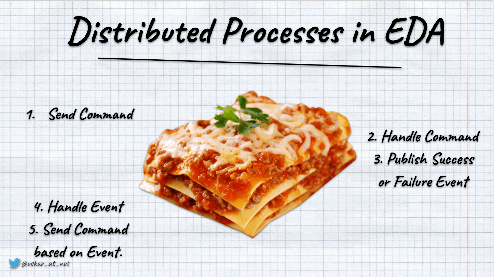
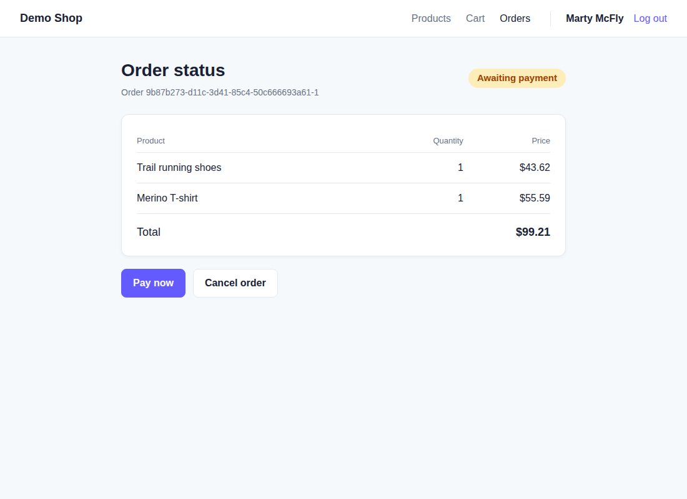
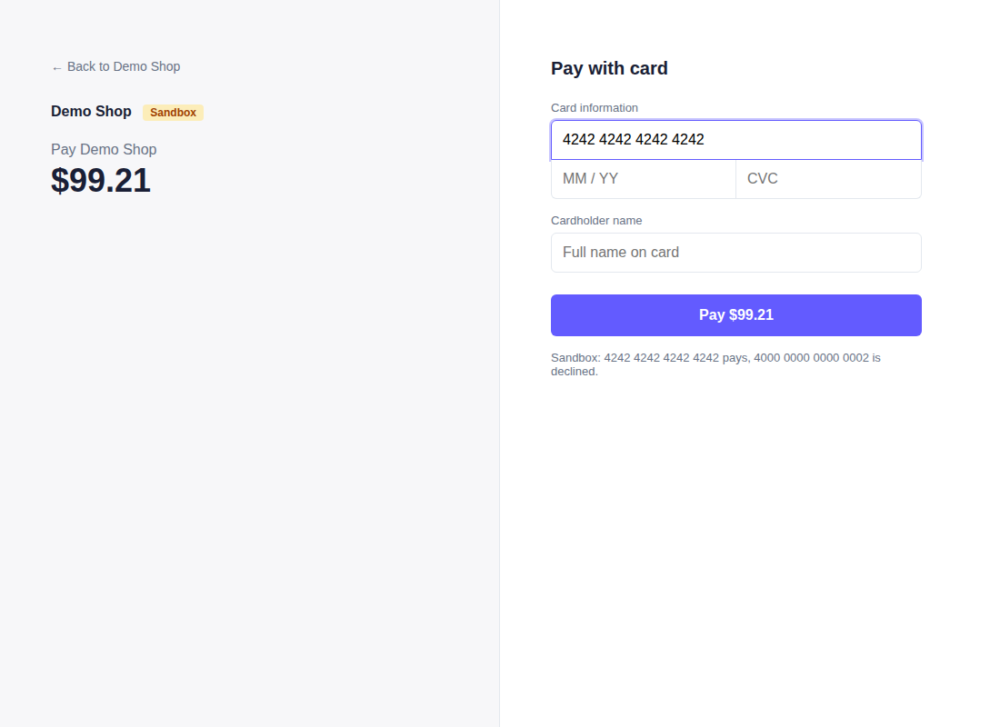
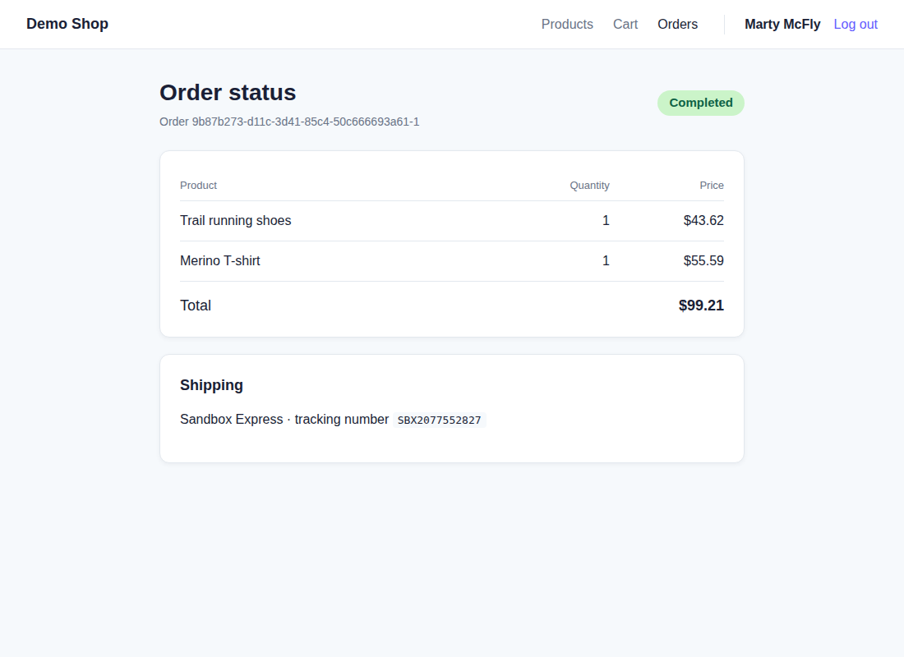
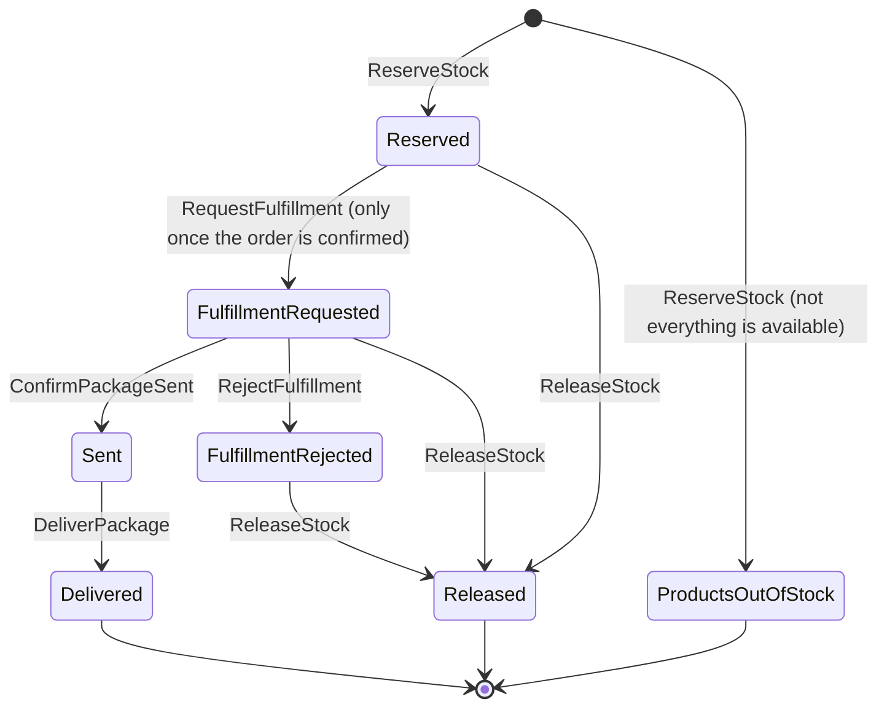
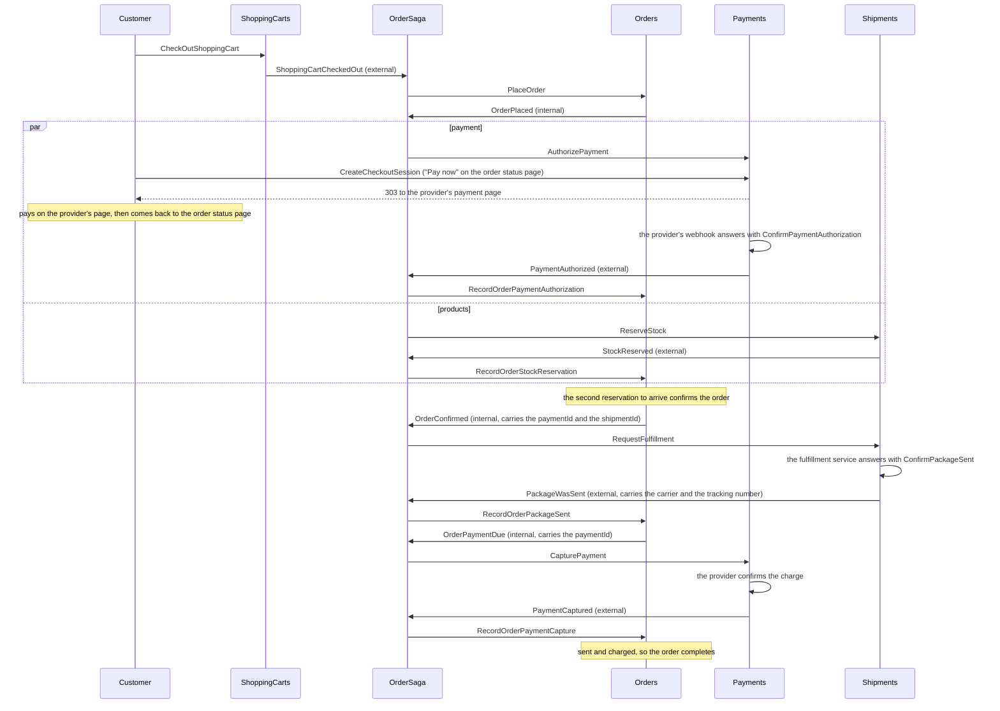
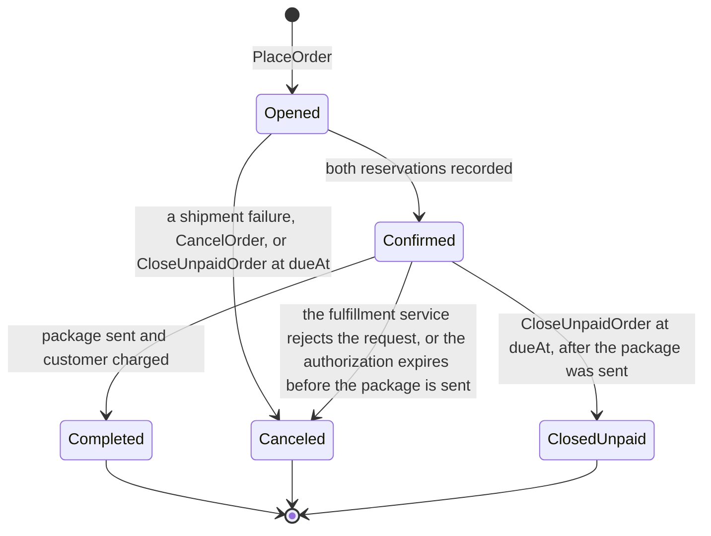
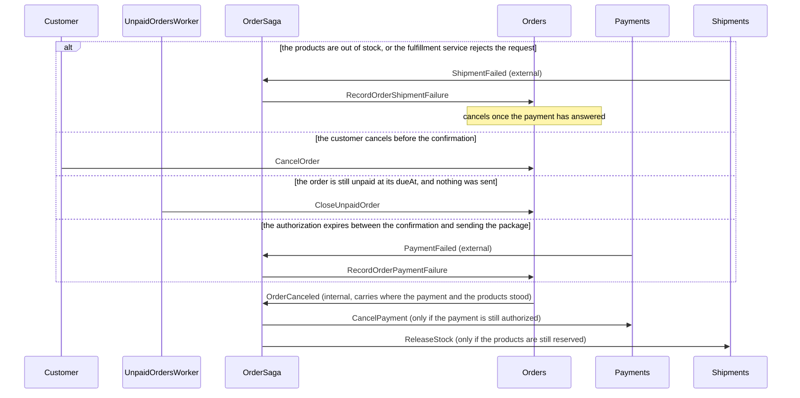
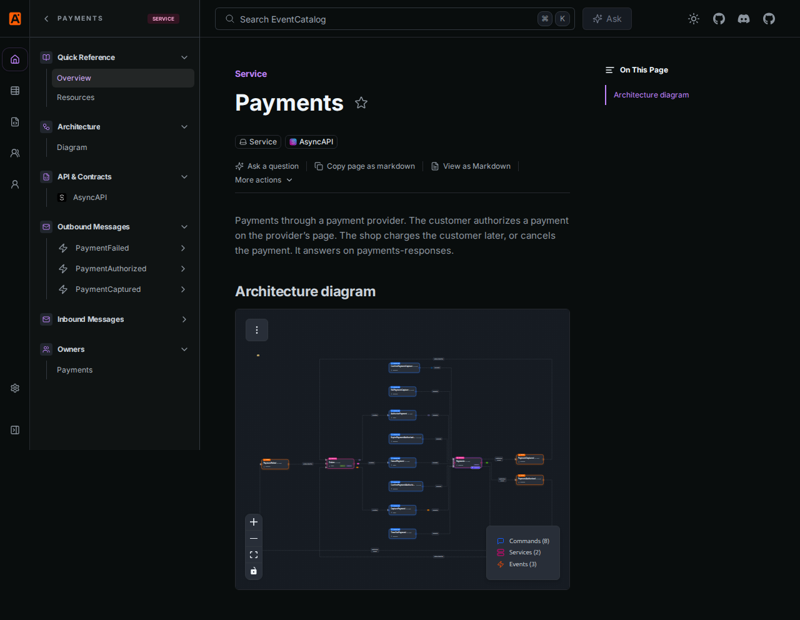

[](https://www.linkedin.com/in/oskardudycz/)  [](https://github.com/sponsors/oskardudycz/) [](https://event-driven.io/?utm_source=event_sourcing_jvm) [](https://www.architecture-weekly.com/?utm_source=event_sourcing_jvm) 

 

# Distributed process with Event Sourcing

- [Distributed process with Event Sourcing](#distributed-process-with-event-sourcing)
  - [Batch operations](#batch-operations)
  - [Cross-module processes with compensation](#cross-module-processes-with-compensation)
    - [A purchase, from the customer's side](#a-purchase-from-the-customers-side)
    - [Reserve first, charge last](#reserve-first-charge-last)
    - [Where the steps come from](#where-the-steps-come-from)
    - [The whole purchase](#the-whole-purchase)
    - [The order decides, the saga only translates](#the-order-decides-the-saga-only-translates)
    - [When a step fails](#when-a-step-fails)
    - [Messages between modules](#messages-between-modules)
    - [Delivering messages reliably](#delivering-messages-reliably)
    - [The payment provider and the fulfillment service](#the-payment-provider-and-the-fulfillment-service)
    - [The web API and the shop](#the-web-api-and-the-shop)
    - [Documenting the messages](#documenting-the-messages)
    - [Where the code lives](#where-the-code-lives)
    - [What this sample doesn't cover](#what-this-sample-doesnt-cover)

These samples show how to handle distributed processes with Event Sourcing. For more background, check my articles [Saga and Process Manager - distributed processes in practice](https://event-driven.io/en/saga_process_manager_distributed_transactions?utm_source=event_sourcing_jvm) and [No, it can never happen!](https://event-driven.io/en/no_it_can_never_happen/?utm_source=event_sourcing_jvm). 

An event-driven distributed process accepts that one transaction across modules and databases, a *two-phase commit*, is not possible. Instead of one big transaction, it runs a sequence of _microtransactions_. Each operation is handled by the module that's the source of truth and can make autonomous decisions. An event recorded and published in the system starts the process, e.g. shopping cart checked out. Then another module can subscribe to it and take it from there. It knows what should be the next operation, e.g. initiating the order process. It sends a command that is handled, and business logic creates another event. This event is the trigger for the next step of the workflow. Such _lasagne_ of event/command/event/command continues until the process is finished (with success or failure).



The samples show:

- one action on many records: checking out a group of hotel guests, built in three styles that the first part compares;
- a purchase in an online shop, where a later step can fail after earlier steps have finished, and the finished steps have to be undone;
- how modules send each other commands and events, and why each module keeps the events it shares apart from its own;
- how to deliver messages without losing them when the application crashes, and without breaking anything when a message arrives twice;
- how to document the messages, so that other teams can find and use them.

To try the online shop yourself, follow [HOWTO.md](./HOWTO.md).

## Batch operations

A common example of a distributed process is a batch operation, for instance, the group checkout of hotel guests. Someone selects a set of guest accounts and clicks "check out". After that, the process tries to check out all of them. If the whole process fails, nothing undoes the checkouts that already succeeded, but you could rerun the checkout after resolving the issues.

The first style is a *saga*: a class that reacts to each event of the process and sends the next command, without business rules of its own. The group checkout saga can look like this:

```java
public class GroupCheckoutSaga {
    private final CommandBus commandBus;

    public GroupCheckoutSaga(CommandBus commandBus) {
        this.commandBus = commandBus;
    }

    public void on(GroupCheckoutInitiated groupCheckoutInitiated) {
        for (var guestAccountId : groupCheckoutInitiated.guestStayAccountIds()) {
            commandBus.schedule(new GuestStayAccountCommand.CheckOutGuest(
                    guestAccountId, groupCheckoutInitiated.groupCheckoutId(), groupCheckoutInitiated.initiatedAt()));
        }
        commandBus.schedule(new RecordGuestCheckoutsInitiation(
                groupCheckoutInitiated.groupCheckoutId(),
                groupCheckoutInitiated.guestStayAccountIds(),
                groupCheckoutInitiated.initiatedAt()));
    }

    public void on(GuestStayAccountEvent.GuestCheckedOut guestCheckoutCompleted) {
        if (guestCheckoutCompleted.groupCheckoutId() == null) return;

        commandBus.schedule(new RecordGuestCheckoutCompletion(
                guestCheckoutCompleted.groupCheckoutId(),
                guestCheckoutCompleted.guestStayAccountId(),
                guestCheckoutCompleted.completedAt()));
    }

    public void on(GuestStayAccountEvent.GuestCheckoutFailed guestCheckoutFailed) {
        if (guestCheckoutFailed.groupCheckoutId() == null) return;

        commandBus.schedule(new RecordGuestCheckoutFailure(
                guestCheckoutFailed.groupCheckoutId(),
                guestCheckoutFailed.guestStayAccountId(),
                guestCheckoutFailed.failedAt()));
    }
}
```

See more in [GroupCheckoutSaga.java](./src/main/java/io/eventdriven/distributedprocesses/hotelmanagement/saga/groupcheckout/GroupCheckoutSaga.java)

The saga sends commands through a *command bus* ([CommandBus.java](./src/main/java/io/eventdriven/distributedprocesses/core/commands/CommandBus.java)). The bus first stores each command and only then delivers it, so a crash between the two steps can't lose a command. That is the *outbox pattern*, described in [Delivering messages reliably](#delivering-messages-reliably).

The saga delegates the business logic to the group checkout *decider*: a function that takes a command and the current state, checks the business rules and returns the resulting events. That gives a clear split between coordination (the saga) and business logic (the decider), so the saga stays lightweight. It is much easier to maintain than a process manager that does both.

See the [GroupCheckoutDecider](./src/main/java/io/eventdriven/distributedprocesses/hotelmanagement/saga/groupcheckout/GroupCheckoutDecider.java) and [GroupCheckout](./src/main/java/io/eventdriven/distributedprocesses/hotelmanagement/saga/groupcheckout/GroupCheckout.java) state.

We can check out the guest account if the balance is settled. If it's not, the decider returns a failure event: 

```java
private static GuestStayAccountEvent handle(CheckOutGuest command, CheckedIn state) {
    if (state.balance() != 0) {
        return new GuestCheckoutFailed(
                state.id(), GuestCheckoutFailed.Reason.BalanceNotSettled, command.groupCheckoutId(), command.now());
    }

    return new GuestCheckedOut(command.guestStayAccountId(), command.groupCheckoutId(), command.now());
}
```

See more in [GuestStayAccountDecider](./src/main/java/io/eventdriven/distributedprocesses/hotelmanagement/saga/gueststayaccount/GuestStayAccountDecider.java#L51).

The command handler (the application service) should use a retry policy, so that a transient error does not fail the command.

```java
public Optional<ETag> handle(CheckOutGuest command) {
    return retryTemplate.invoke(() -> handle(command.guestStayAccountId(), command));
}
```

See more in [GuestStayAccountService](./src/main/java/io/eventdriven/distributedprocesses/hotelmanagement/saga/gueststayaccount/GuestStayAccountService.java#L35)

As an alternative to the retry policy, the command handler could use [Pokémon exception handling](https://www.dodgycoder.net/2011/11/yoda-conditions-pokemon-exception.html) (catch every exception) and then publish the failure event.

The same group checkout is also implemented as:

- [process manager](./src/main/java/io/eventdriven/distributedprocesses/hotelmanagement/processmanager/), where [GroupCheckoutProcessManager](./src/main/java/io/eventdriven/distributedprocesses/hotelmanagement/processmanager/groupcheckout/GroupCheckoutProcessManager.java) keeps the process state and decides about the next steps,
- [choreography](./src/main/java/io/eventdriven/distributedprocesses/hotelmanagement/choreography/), where [GroupCheckoutService](./src/main/java/io/eventdriven/distributedprocesses/hotelmanagement/choreography/groupcheckout/GroupCheckoutService.java) reacts to events and schedules commands itself, without a separate saga.

## Cross-module processes with compensation

The group checkout undoes nothing. If the checkout of one guest fails, the other checkouts stay done, and you can run the group checkout again after you fix the problem. A purchase can't work that way. If the shop can't send the goods, it has to cancel the customer's payment. If the customer doesn't pay, the shop has to put the goods it set aside back on sale. Undoing the steps that already happened is called *compensation*.

The e-commerce sample shows such a process. One purchase goes through four modules: [shopping carts](./src/main/java/io/eventdriven/distributedprocesses/ecommerce/shoppingcarts/), [orders](./src/main/java/io/eventdriven/distributedprocesses/ecommerce/orders/), [payments](./src/main/java/io/eventdriven/distributedprocesses/ecommerce/payments/) and [shipments](./src/main/java/io/eventdriven/distributedprocesses/ecommerce/shipments/). Each module has its own data, and the modules talk only through messages.

A message is a command or an event. A *command* asks a module to do something, such as `CapturePayment`. The module decides, and it can ignore the command. An *event* records something that already happened, such as `PaymentCaptured`. Each module takes its commands through its *facade*: one class, such as `PaymentFacade`, with one method for each command.

The modules use Event Sourcing: they store every change as an event, in an *event store*, instead of storing the current state. A module keeps its business rules in a *decider*, such as `OrderDecider` or `PaymentDecider`: a function that takes a command and the current state, checks the rules and returns the new events. The state is an immutable *entity*, such as `Order` or `Payment`, and its `evolve` function applies one event to it. Each entity's events form one *stream*, an ordered list, and adding events to it is called *appending*. To handle the next command, a `CommandHandler` reads the stream, rebuilds the entity's state from its events with `evolve`, calls the decider and appends the events that the decider returns.

To try the purchase yourself, follow [HOWTO.md](./HOWTO.md). It takes you through the shop, the web API, the messages and the catalog, step by step, with screenshots.

### A purchase, from the customer's side

The customer logs in, adds products to the cart and clicks **Check out**. The shop shows the new order, which waits for the payment:



The customer clicks **Pay now**, and the shop sends them to the payment provider's page, as Stripe or Adyen do. In the sample, a *sandbox* plays the payment provider: a small stand-in, built into the application, that shows a page like Stripe's and accepts Stripe's test cards.



After the payment, the provider sends the customer back to the shop. A second sandbox plays the warehouse and sends every package at once, so the order is already completed, with a carrier and a tracking number:



The customer saw three pages. Behind them, more than fifteen messages went between the modules: the cart told the orders module about the checkout, the orders module asked the payments module for a payment and the shipments module for the products, each of them answered, and so on until the order completed. The rest of this part explains those messages: what they are, why the process needs each of them, and how the modules handle them when something fails.

### Reserve first, charge last

A purchase needs two things: the customer's money and the goods. They are in two separate systems: the money at the payment provider, the goods in the warehouse. No single transaction covers both. So the shop can't take both at once, and if one step fails, nothing undoes the other step automatically.

Shops solve this in two steps. First, they reserve both, without taking either:

- the customer *authorizes* the payment on the provider's page. The provider checks that the customer can pay and keeps the amount for the shop, but doesn't charge the customer yet;
- the warehouse *reserves* the products: it sets them aside for the order, so that nobody else can buy them.

Only when both reservations are in place does the shop take what it reserved: the warehouse sends the package, and the shop *charges* the customer. The payment providers call the charge a *capture*.

```
authorize the payment ──┐
                        ├──> both reserved ──> send the package ──> charge the customer
reserve the products  ──┘
```

The two reservations end differently. An authorization lasts only for a limited time. Stripe says that an online card authorization is "usually valid for 7 days", and if it expires before the capture, "the funds are released and the payment status changes to `canceled`". So the customer is never charged for an order that the shop forgot. For the shop, the expiry is a deadline: it has to charge before it. The reserved products have no timer. Shopify calls them **committed**: "units that are part of a placed order but aren't yet fulfilled". They stay committed until the order ships or is canceled.

The charge comes last on purpose. Shops that sell physical goods charge when the goods leave, not when the order is placed: Amazon charges the card when the item ships, and Shopify can charge when the order is fulfilled, that is, sent. So the customer is never charged for something that didn't ship. And an order that fails before the package leaves only has to release its two reservations. Nobody was charged, so there is nothing to refund. A payment that fails after the package left is a different case, described in [When a step fails](#when-a-step-fails).

### Where the steps come from

The names in the sample come from the providers' own documentation. Each command matches an operation of a real provider, or a *webhook*: an HTTP call from the provider to the shop, and each state is one that a provider reports, so you can compare the diagrams below with their docs. The sources are collected in [real-world-flow.md](./plans/saga-and-outbox/real-world-flow.md).

**The cart.** The workshops in this repository start a cart with an `OpenShoppingCart` command. Real shops have no such step: in Shopify, WooCommerce, Amazon and Allegro, the first "Add to cart" starts the cart, so the first event in a cart's stream is `ProductItemAddedToShoppingCart`. The sample assumes that the customer is logged in, as on Allegro, where buying needs an account. Each cart is a short stream, `ShoppingCart-{customerId}-{n}`. A customer has at most one open cart, and the first product after a checkout starts cart `n + 1`. The [CustomerShoppingCarts](./src/main/java/io/eventdriven/distributedprocesses/ecommerce/shoppingcarts/CustomerShoppingCarts.java) *projection* knows which cart is the current one. A projection is a read model, like a table kept for queries, that a module builds from its events and updates with each new one. This README also calls it a *view*. If two requests start the same new cart, the slower append finds the stream already there. It then retries, as described in [The order decides, the saga only translates](#the-order-decides-the-saga-only-translates), and adds the product to the cart that the other request started.

The customer chooses a product and a quantity, never a price. The price list gives the price when the product first enters the cart, and a later add of the same product keeps the line's price. The cart does not promise that price. Amazon's [cart](https://us.amazon.com/gp/cart/view.html) "reflects each item's most recent price", and Shopify's checkout can say ["Prices for these items have changed and are updated in your cart"](https://community.shopify.com/t/prices-for-these-items-have-changed-and-are-updated-in-your-cart/284837). So `CheckOutShoppingCart` reads the current prices. If one changed, the cart records `ProductItemPriceChanged` and stays open. Each change gives the cart a new version, and a checkout carries the version that the customer saw. So after a price change, the customer has to look at the new prices and check out again. If no price changed, the cart records `ShoppingCartCheckedOut`. The name is the one the shops use: "Proceed to checkout" on Amazon and WooCommerce, "Check out" on Shopify, "Go to checkout" on Allegro. No shop has a "cancel cart" action, so the sample has none: a customer leaves the cart, and nothing happens.

A price can still change between the check and the append. The shops accept that: the price at the click is the price of the order. On Allegro, [the price stays as it was when the customer clicked "Buy now"](https://spolecznosc.allegro.pl/t5/dyskusje-kupuj%C4%85cych/pytanie/m-p/705830). Amazon handles a wrong price after the order, by its [terms of sale](https://www.pinsentmasons.com/out-law/guides/amazons-pricing-error): it may contact the buyer or cancel. Locking the price list during checkout would need one transaction across pricing and the cart, which is the two-phase commit this sample avoids.

**The payment.** Payment providers keep authorizing and charging as two separate steps. Stripe calls this [place a hold on a payment method](https://docs.stripe.com/payments/place-a-hold-on-a-payment-method) and switches it on with `capture_method: manual`. Adyen calls the second step [capture](https://docs.adyen.com/online-payments/capture) and supports delaying it. Both let the shop cancel an authorized payment before the customer is charged: Stripe calls it canceling the PaymentIntent, its object for one payment, and this sample calls it `CancelPayment`. Stripe's payment page for one payment is a *Checkout Session*, described in **The payment page** below.


| Ours | Stripe | Adyen |
|---|---|---|
| `CreateCheckoutSession` | create a Checkout Session with `capture_method: manual` | create a payment session |
| `ConfirmPaymentAuthorization` | the `payment_intent.amount_capturable_updated` webhook, with `capture_before` | the `AUTHORISATION` webhook |
| `TimeOutPayment` | expire the Checkout Session | no such operation |
| `CapturePayment` | capture the PaymentIntent | capture |
| `CancelPayment` | cancel the PaymentIntent | cancel |
| `ExpirePaymentAuthorization` | the authorization lapses and the funds are released | the transaction expires |

There's no single answer to how long an authorization lasts. Stripe lists around 7 days for online card payments, and [Adyen's table for each card network](https://docs.adyen.com/online-payments/adjust-authorisation) shows the spread: Mastercard 7 days for a final authorization and 30 for a pre-authorization, Visa 5 to 30 depending on the kind of shop, JCB up to a year. That's why the provider's answer brings the deadline, Stripe's `capture_before`, and `captureBefore` travels on the event. The payments module records the deadline that the provider gave, instead of a number that isn't true for every card.

**The payment page.** Only the customer can authorize a payment: with 3-D Secure (an extra confirmation of a card payment), BLIK (a Polish mobile payment code) or a transfer, on the provider's own page. When the customer clicks "Pay", the shop asks the provider for a payment page and sends the customer there with an HTTP 303 redirect: Stripe's [Checkout Session](https://docs.stripe.com/checkout/quickstart), Adyen's payment session, PayPal's order with its `payer-action` link. The provider sends the customer back to the shop's page, but that return decides nothing. Stripe says ["you can't rely on triggering fulfillment only from your checkout landing page"](https://docs.stripe.com/checkout/fulfillment?ui=full-page), because the customer can lose the connection before the page loads. The outcome comes in a webhook.

Allegro shows how that looks to the customer. After "Buy and pay", Allegro [redirects the customer to a page where the payment is completed](https://allegro.pl/pomoc/dla-kupujacych/przelew-bankowy/jak-zaplacic-za-przedmiot-kupiony-na-allegro-YLKol7RVxI0). Back on Allegro, "My purchases" shows "Your payment is being processed" until the payment is settled. A customer who closes the page without paying can cancel the payment, and the purchase is then marked unpaid. "Pay" pays it later, and "Retry payment" retries a failed payment.

The sample follows Stripe. `AuthorizePayment` only records that the payment waits for the customer. "Pay now" on the order status page calls `PaymentFacade.createCheckoutSession`: the payments module asks the provider for a Checkout Session that expires in 30 minutes, and records `CheckoutSessionCreated` with the session's URL and expiry. A second click before the expiry gets the same page, so one payment can never be authorized twice. After the expiry, the next click creates a new session for the same payment, as Stripe's recovery link for an expired session does. A new payment comes only from "Retry payment". The provider's webhook answers with `ConfirmPaymentAuthorization`, carrying `captureBefore`. A declined card is not an answer: Stripe's page shows the decline, and the customer tries again on the same page. A customer who never pays is timed out when the time for the payment runs out (`timesOutAt`, 24 hours in the running application).

**The products.** The cart reserves nothing: on Allegro, putting a product in the cart [does not reserve it](https://spolecznosc.allegro.pl/t5/dyskusje-kupuj%C4%85cych/zmiana-cen-po-dodaniu-do-koszyka/td-p/657648). Placing the order reserves the products. Shopify's [inventory states](https://help.shopify.com/en/manual/products/inventory/managing-inventory-quantities/inventory-states) separate *available* from *committed*, and placing an order moves units from one to the other. WooCommerce [creates the order when the customer clicks "Place order"](https://wordpress.org/support/?p=10149006), before the payment, and reserves its products. WooCommerce's "Hold stock (minutes)" is a timer on the unpaid order: [when it runs out, the order is canceled and the products go back on sale](https://www.businessbloomer.com/woocommerce-automatically-cancel-orders/). The sample does the same with the order's `dueAt`: an order still unpaid at that date is canceled, and its products are released.

Sending the package is a request to a fulfillment service, the company that runs the warehouse, which answers later. Shopify's [fulfillment request](https://help.shopify.com/en/manual/fulfillment/fulfilling-orders/app-fulfillment) is accepted or rejected by the service. This sample has no merchant step after a rejection, so a rejected request cancels the order.



Both diagrams have the same shape: a reservation, a step that takes what was reserved, and a way to release the reservation.

### The whole purchase

The diagram below shows the messages of one purchase. `OrderSaga`, in the orders module, connects the modules: it reacts to events and sends commands. *External* marks an event that a module publishes for the other modules, and *internal* an event that stays in its module, as described in [Internal and external events](#internal-and-external-events).



The order completes once the package was sent and the customer was charged, which is what Shopify and commercetools call fulfilled and paid. Neither waits for the delivery. The shipment still records `PackageWasDelivered`, but nothing outside it reacts. The goods move before the money does: `recordPaymentCapture` acts only once the package was sent, and `recordPackageSent` only while the payment is still authorized, so nothing leaves the warehouse after the authorization expired.

### The order decides, the saga only translates

The process has two parts. `Order` decides: it knows where the payment and the shipment stand, and it decides when the order is confirmed, completed or canceled. `OrderSaga` only translates: it passes messages between the order and the other modules. This section explains both, starting with the order.

`Order` holds one status for the payment and one for the shipment, just as `GroupCheckout` holds one status for each guest stay:

| Participant | Statuses |
|---|---|
| payment | `Pending` → `Authorized` → `Captured` (only after `Sent`), or `Failed`; paying again goes from `Failed` to `Retrying` and then `Authorized`, before the confirmation or after `Sent` |
| shipment | `Pending` → `Reserved` → `Sent`, or `Failed` (out of stock), or `Rejected` (the products are still reserved) |

The order itself goes through these statuses:



The command that completes a step appends a second event in the same batch: `OrderConfirmed` once both reservations are in, `OrderCompleted` once the customer is charged after the package was sent, and `OrderCanceled` when a failure ends the order. Recording the sent package also appends `OrderPaymentDue`, which names the payment to charge. There's no `CompleteOrder` or `ConfirmOrder` command, because only the order knows when it moved on.

Every decision is idempotent: a command that arrives twice, or too late, decides no events, so nothing is appended.

```java
private OrderEvent[] recordPaymentAuthorization(RecordOrderPaymentAuthorization command, Order state) {
    var authorized = new OrderPaymentAuthorized(state.id(), command.paymentId(), command.authorizedAt());

    if (state.status() == Status.Opened && state.payment() == PaymentProgress.Pending)
        return withProgress(state, command.authorizedAt(), authorized);

    if (state.payment() != PaymentProgress.Retrying || !command.paymentId().equals(state.paymentId()))
        return noEvents;

    // ... the authorization of a payment made again, see "Paying again" below
}
```

Idempotency also keeps the process moving. A handler that throws inside an asynchronous process blocks it: the message is delivered again, fails again, and the messages behind it wait. So orders, payments and shipments ignore a message they can't use: the method returns and appends nothing. `ShoppingCart` still throws, because its commands come from a person over HTTP, where a rejected action has to reach the caller as an error. The order also gets two commands from a person, `CancelOrder` and `RetryOrderPayment`, but it ignores them too, because the same order is in the middle of the process. The web API answers both with 202 Accepted, and the customer sees the result on the order page.

Two handlers can also append to the same stream at the same moment. `CommandHandler` reads the stream, folds it into the current state with `evolve`, lets the decider decide, and appends only if the stream is still at the version it read. Otherwise the append fails with a conflict. For a message handler, `CommandHandler` retries the conflict through Spring's `RetryTemplate`: it reads the stream again and decides again, up to three attempts in all. That is safe because the deciders are idempotent. Without the retry, the handler would throw, and the event store would deliver the event again only on its next append, which may never come. A cart command from a person carries the version that the person saw, the *expected version*, so its conflict is not retried. It goes back to the caller.

The whole process is one class, [OrderSaga](./src/main/java/io/eventdriven/distributedprocesses/ecommerce/orders/OrderSaga.java). Each handler is named after the event it reacts to, and it only translates: it takes an event and sends a command built from that event's data alone. That takes some care, because an event doesn't always carry what the next command needs. `PackageWasSent` doesn't know which payment to charge, and it shouldn't: the shipments module has never heard of a payment. So the saga records the sent package on the order, and the order answers with its own `OrderPaymentDue`, which carries the `paymentId`. The saga sends the charge from that event:

```java
public void onPackageWasSent(ShipmentExternalEvent.PackageWasSent event) {
    messageBus.publish(List.of(new RecordOrderPackageSent(
            new OrderId(event.referenceId()), event.carrier(), event.trackingNumber(), event.sentAt())));
}

// The shipment does not know the payment. The order does, and names it here.
public void onOrderPaymentDue(OrderEvent.OrderPaymentDue event) {
    messageBus.publish(List.of(new PaymentCommand.CapturePayment(event.paymentId())));
}
```

`OrderPaymentDue` is an internal event. The saga belongs to the orders module, so it reads the order's own events straight from the event store, and the other modules' external events from the message bus. A module that drove its own process through its external events would have to publish whatever that process needs, such as a `paymentId` here, a `shipmentId` there and the internal statuses on a cancellation. Its external events would turn into a dump of its internals.

The saga has no state, no store, no clock and no id generator. Its only field is the message bus. Identifiers are derived instead of generated: the order id comes from the cart id, the payment and shipment ids from the order id, and the id of a payment made again from the order id and the attempt number. So handling the same event twice sends two identical commands, and the modules ignore the second one.

### When a step fails

Four kinds of failure cancel an order. In each of them, the order decides what to release:



A failed payment doesn't cancel the order on its own. Before the confirmation the customer can still pay again, so the order records the failure, keeps its products reserved and waits until its `dueAt`. A failed shipment cancels the order, but only once the payment has answered, because whether the payment needs canceling depends on that answer. The same wait covers the normal path, where both modules answer at the same time: the two reservations can arrive in either order, and the order ends up the same.

The order, not the saga, decides what to release. The internal `OrderCanceled` carries `paymentStatus` and `shipmentStatus`, and the saga only reads them:

| Status | The saga sends |
|---|---|
| `paymentStatus = Authorized` | `CancelPayment` |
| `shipmentStatus = Reserved` | `ReleaseStock` |
| anything else | nothing, because there is nothing to release |

There's no refund in that table, because an order can only be canceled before the package leaves, and nobody is charged before that. Once the package has left, canceling is a return, and returns are a process of their own, refund included. A chargeback is another reversal, but the shop can't start it: it starts when the customer disputes the payment. Read more about why compensation matters in [What texting your Ex has to do with Event-Driven Design?](https://event-driven.io/en/what_texting_ex_has_to_do_with_event_driven_design?utm_source=event_sourcing_jvm).

**Paying again.** A payment can fail before the order is confirmed, when the customer never pays on the provider's page. It can also fail after the package left, when the authorization expires before the charge, or the charge itself fails. Both arrive as `PaymentFailed`, and in both cases the order records `OrderPaymentFailed` and stays open. Before the confirmation it keeps its products reserved, as an unpaid purchase waits on Allegro. After the package left, it can't cancel, because the goods are gone, and it can't complete, because nobody was charged. In both cases, the customer pays again:

- `RetryOrderPayment` makes the order record `OrderPaymentRetried` with a new `paymentId`, derived from the order id and the attempt number, because the failed `Payment` ignores every command;
- the saga sends `AuthorizePayment` for it, the order status page shows "Pay now" for the new payment, and the customer pays on a new Checkout Session;
- before the confirmation, the authorization confirms the order once the products are reserved. After the package left, it makes the order record `OrderPaymentDue`, so the charge follows at once;
- a payment made again that fails waits for the customer again;
- `RecordOrderPaymentFailure` and `RecordOrderPaymentCapture` carry the `paymentId`, and the order ignores them for any payment other than its current one, so a late answer about the first payment can't change an order that already moved to the second.

Only an authorization that expires between the confirmation and sending the package cancels the order: the products are released, and nobody was charged.

**Deadlines and workers.** Nothing in the process may wait forever. Three *workers*, background jobs that run on a schedule, watch the deadlines:

| Worker | Watches | Sends |
|---|---|---|
| `PaymentTimeoutWorker` | `timesOutAt` on a payment that waits for the customer: a customer who never pays, or a provider that never answers | `TimeOutPayment` |
| `AuthorizationExpiryWorker` | `captureBefore` on an authorized payment | `ExpirePaymentAuthorization` |
| `UnpaidOrdersWorker` | `dueAt` on an order whose payment failed | `CloseUnpaidOrder` |

The payment workers end at the order as `PaymentFailed`, so the order never waits for a message that isn't coming. Each worker reads a to-do list, as the [event-driven architecture](../../workshops/event-driven-architecture/) workshop calls it: a projection that lists which order or payment to wake up and when. The worker keeps no rules. The decider decides, and a wake-up that comes too early, or twice, appends nothing. Each worker has `handle(now)`. Its `Scheduled` variant calls it every minute with the current time, through `handleAll()`. Tests move the clock and call `handleAll()` themselves.

The deadlines come from policies that the facades run, because they are the shop's rules and change more often than the process. `PaymentValidity` gives `PaymentFacade` the `timesOutAt` of a new payment. `PaymentTerms`, Shopify's name for when an order must be paid, gives `OrderFacade` the `dueAt` of a failed payment. The authorization's `captureBefore` comes from the provider, not from the shop, so it has no policy.

If the order is still unpaid at `dueAt`, `UnpaidOrdersWorker` sends `CloseUnpaidOrder`, and the order decides: an order whose package never left is canceled and its products released, and one whose package left ends with `OrderClosedUnpaid`, Shopify's order close. Collecting the money after that is outside the sample.

**Failure events instead of exceptions.** `CaptureGatewayClient`, the class that asks the payment provider for the charge, calls the provider inside a try/catch and sends `FailPaymentCapture(UnexpectedError)` if the call throws. A charge that didn't go through is a business outcome. Rethrowing it would only leave the payment pending forever.

**Canceling by request.** `CancelOrder(orderId, Requested)` from the web API cancels an order that is not confirmed yet, through the same `Order` as every other cancellation. Once the order is confirmed, `CancelOrder` does nothing: the fulfillment request is on its way to the warehouse, as Shopify allows canceling only before fulfillment starts.

### Messages between modules

Commands and events travel on one [MessageBus](./src/main/java/io/eventdriven/distributedprocesses/core/messaging/MessageBus.java), because they differ in intent, not in transport. A person's commands don't use the bus: they come through the [web API](#the-web-api-and-the-shop), which calls the modules' facades directly.

#### Internal and external events

Each module records events for itself: these are its *internal* events. If a module exposed them to the other modules, every other module would depend on its internal names and data. That is the leaking abstraction described in [Events should be as small as possible, right?](https://event-driven.io/en/events_should_be_as_small_as_possible?utm_source=event_sourcing_jvm). So each module that others react to also has [external events](https://event-driven.io/en/internal_external_events/?utm_source=event_sourcing_jvm), made for the other modules. A *forwarder*, a subscriber of the module's internal events, publishes the external ones:

| Module | External events | Read by |
|---|---|---|
| shopping carts | `ShoppingCartCheckedOut` | orders |
| payments | `PaymentAuthorized`, `PaymentCaptured`, `PaymentFailed` | orders |
| shipments | `StockReserved`, `PackageWasSent`, `ShipmentFailed` | orders |

Each of them declares its external events as a `sealed interface <Module>ExternalEvent`, so a consumer can switch over all of them.

Payments and shipments are generic services: they know an amount or a list of products, and a `referenceId`, the id of whatever the client pays or ships for, never an order. For the orders module, the `referenceId` is the order id. Their external events carry what any client of such a service needs. The orders module publishes no external events: no module in this sample reacts to the order's events, and an external event that nobody reads is only a guess at what someone might need. The order's events are read only by its own saga and its own views.

Two external events cover more than one internal event. `PaymentFailed` stands for `PaymentTimedOut`, `PaymentAuthorizationExpired` and `PaymentCaptureFailed`, and carries no reason, because the order handles all three the same. `ShipmentFailed` stands for `ProductWasOutOfStock` and `FulfillmentRejected`, and carries which one it was, because the order cancels with a different reason, and after a rejection it still has products to release. Inside the module they stay separate events, because the module needs to tell them apart.

Each external event carries only what its reader uses: the `referenceId`, the ids it passes on, the time and, for a shipment, the carrier and tracking number. Amounts, products and deadlines stay inside the module that owns them. Some internal events have no external event at all: `PaymentCanceled` and `StockReleased` end compensations that no module waits for.

#### The projections behind the external events

An external event often needs more than the internal event that triggered it. The internal `ShoppingCartCheckedOut` carries the cart id and a timestamp, but the external `ShoppingCartCheckedOut` has to carry the customer, the products and the total, because the orders module can't call back into the cart to ask. The same is true of `PaymentAuthorized`: internally it has no `referenceId`, and the order needs one.

The forwarder could rebuild the entity from its stream, but then the entity would have to hold this data. The entity keeps only the state that the decider's rules need. `ShoppingCart` holds its products and their prices, but not the customer id or the total that the external event needs. So each module keeps a projection for its forwarder, called a *summary*, and the forwarder reads it:

```java
public void onCheckedOut(EventEnvelope<ShoppingCartEvent.ShoppingCartCheckedOut> envelope) {
    var event = envelope.data();
    var cart = get(event.shoppingCartId(), envelope.metadata().streamPosition());

    var externalEvent = new ShoppingCartExternalEvent.ShoppingCartCheckedOut(
            event.shoppingCartId(),
            cart.getCustomerId(),
            cart.getProductItems(),
            cart.getTotalPrice(),
            event.checkedOutAt());

    messageBus.publish(List.of(externalEvent));
}

private ShoppingCartSummary get(ShoppingCartId shoppingCartId, long streamPosition) {
    return summaries
            .get(shoppingCartId)
            .filter(summary -> summary.getVersion() >= streamPosition)
            .orElseThrow(
                    () -> new IllegalStateException("Summary of shopping cart '%s' has not reached position %d yet"
                            .formatted(shoppingCartId.value(), streamPosition)));
}
```

Each projection extends [Projection](./src/main/java/io/eventdriven/distributedprocesses/core/projections/Projection.java), in the same shape as the projections in the [event-driven architecture](../../workshops/event-driven-architecture/) workshop. It says which events it handles, which *document* each event belongs to (the stored record of the view, such as one `PaymentSummary`), and how the event changes that document. Returning no document deletes it:

```java
public class PaymentSummaries extends Projection<PaymentSummary, PaymentId> {
    @Override
    public List<Class<?>> canHandle() {
        return List.of(PaymentAuthorizationRequested.class);
    }

    @Override
    protected PaymentId getDocumentId(Object event) {
        return switch (event) {
            case PaymentAuthorizationRequested e -> e.paymentId();
            default -> throw new IllegalArgumentException("Unexpected event %s".formatted(event));
        };
    }

    @Override
    protected @Nullable PaymentSummary evolve(@Nullable PaymentSummary current, Object event) {
        return switch (event) {
            case PaymentAuthorizationRequested e -> new PaymentSummary(e.paymentId(), e.referenceId());
            default -> current;
        };
    }
}
```

The base class reads and stores the document through the view's Spring Data repository, so no projection touches the database. Each document is a JPA entity. Each document records the stream position it last applied, so an event delivered twice is skipped instead of counted twice. A summary keeps only what its forwarder adds to the internal events: `PaymentSummary` holds the `referenceId`, because only the authorization request carries it. `ShipmentSummary` does the same for shipments: the requester's id is stored once, in `StockReserved` or `ProductWasOutOfStock`, the events that record the request, and the later shipment events don't repeat it.

The projection and the forwarder are separate subscribers, and each keeps its own *checkpoint*: the position of the last event it handled. If the projection fails on an event and the forwarder does not, the forwarder would read a view that has not seen that event yet. So the forwarder checks that the view has what it needs. If it does not, the forwarder throws: the store keeps its checkpoint and delivers the event again on the next append, after the projection has caught up. The cart's products change with every add, remove and price change, so the cart forwarder also checks that the summary's version has reached the event's stream position.

Besides the summaries, the modules keep views that answer a question that no single stream can answer, because the question spans many of them:

| View | Answers |
|---|---|
| `PendingPayments` | which payments still wait for the customer at their `timesOutAt` |
| `AuthorizedPayments` | which authorized payments have passed `captureBefore` |
| `OrdersAwaitingPayment` | which orders with a failed payment are still unpaid at their `dueAt` |
| `PendingOrders` | which orders are still in progress |
| `CustomerShoppingCarts` | which cart is the customer's current one, and how many carts the customer has had |

The first three are the workers' to-do lists. `PendingOrders` has no worker. `ShoppingCartFacade` reads `CustomerShoppingCarts` to choose the cart for the customer's next product. The customer's pages get views of their own, described in [The web API and the shop](#the-web-api-and-the-shop).

#### Channels and queues

A *channel* is a named place where a module publishes messages. A *queue* is where a module receives them: it is bound to one or more channels. Each message also gets a *routing key*, a dotted text such as `ecommerce.order.42-1`, and a queue gets only the messages whose key matches the pattern it was bound with. Each module owns its channels and names them `<module>-<purpose>`. The purposes come from [Internal and external events](https://event-driven.io/en/internal_external_events/?utm_source=event_sourcing_jvm) and [Predictable identifiers](https://event-driven.io/en/predictable-identifiers-enabling/?utm_source=event_sourcing_jvm): `internal` for the module's own commands, `external` for the events it publishes to anyone, `requests` for the commands that other modules send it, and `responses` for its answers to them.

| Channel | Carries | Who sends | Queue that reads it |
|---|---|---|---|
| `shopping_carts-external` | `ShoppingCartCheckedOut` | the cart forwarder | `orders-shopping_carts-external`, owned by orders |
| `orders-internal` | `PlaceOrder`, the `RecordOrder...` commands, `CloseUnpaidOrder` | the saga, `UnpaidOrdersWorker` | `orders-internal` |
| `payments-requests` | `AuthorizePayment`, `CapturePayment`, `CancelPayment` | the saga | `payments-requests` |
| `payments-responses` | `PaymentAuthorized`, `PaymentCaptured`, `PaymentFailed` | the payment forwarder | `orders-payments-responses`, owned by orders |
| `payments-internal` | `ConfirmPaymentAuthorization`, `ConfirmPaymentCapture`, `FailPaymentCapture`, `TimeOutPayment`, `ExpirePaymentAuthorization` | the payment workers, the capture client, the payment provider (the sandbox or a test double) | `payments-internal` |
| `shipments-requests` | `ReserveStock`, `ReleaseStock`, `RequestFulfillment` | the saga | `shipments-requests` |
| `shipments-responses` | `StockReserved`, `PackageWasSent`, `ShipmentFailed` | the shipment forwarder | `orders-shipments-responses`, owned by orders |
| `shipments-internal` | `ConfirmPackageSent`, `RejectFulfillment`, `DeliverPackage` | the fulfillment service (the sandbox or a test double) | `shipments-internal` |

A channel carries many message types. The type only picks the handler inside the queue, so adding a message adds no channel.

Each module has its own Spring configuration, such as [PaymentsConfig](./src/main/java/io/eventdriven/distributedprocesses/ecommerce/payments/PaymentsConfig.java). It declares its routes, its channels and its queues as beans, so the bus can be built before the module, with [MessageRoutes](./src/main/java/io/eventdriven/distributedprocesses/core/messaging/MessageRoutes.java) taken from the [event-driven architecture](../../workshops/event-driven-architecture/) workshop:

```java
@Configuration
public class PaymentsConfig {
    public static final String requests = "payments-requests";
    public static final String responses = "payments-responses";
    public static final String internal = "payments-internal";

    @Bean("paymentsMapping")
    public static MessageMapping mapping() {
        return new MessageMapping()
                .trust(PaymentsConfig.class.getPackageName(), PaymentExternalEvent.class.getPackageName());
    }

    @Bean
    public static MessageRoutes paymentsRoutes() {
        return new MessageRoutes()
                .routeTarget(AuthorizePayment.class, command -> requests)
                .routeTarget(CapturePayment.class, command -> requests)
                .routeTarget(CancelPayment.class, command -> requests)
                .route(
                        PaymentExternalEvent.class,
                        event -> new RoutingTarget(responses, Urns.routingKeyOf(event.referenceId())))
                .routeTarget(MessageRoutes.inPackage(PaymentsConfig.class.getPackageName()), internal)
                .routeKey(
                        PaymentCommand.class,
                        command -> Urns.routingKeyOf(command.paymentId().value()));
    }

    @Bean
    public static MessageChannel paymentsRequestsChannel() {
        return new MessageChannel(requests);
    }

    // ...

    @Bean
    public static MessageQueue paymentsRequestsQueue() {
        return new MessageQueue(requests, requests, "#");
    }

    // ...

    @Bean
    public PaymentFacade paymentFacade(
            EventStore eventStore,
            MessageContext messageContext,
            MessageBus messageBus,
            PaymentGateway paymentGateway,
            PaymentValidity paymentValidity,
            Supplier<OffsetDateTime> now) {
        var decider = new PaymentDecider(paymentValidity, now);
        var commandHandler = new CommandHandler<PaymentId, Payment, PaymentCommand, PaymentEvent>(
                eventStore,
                messageContext,
                PaymentFacade::mapToStreamId,
                Payment::initial,
                Payment::evolve,
                decider::handle);

        var facade = new PaymentFacade(commandHandler, paymentGateway, now);

        messageBus
                .subscribe(requests, AuthorizePayment.class, facade::authorizePayment)
                .subscribe(requests, CapturePayment.class, facade::capturePayment)
                .subscribe(requests, CancelPayment.class, facade::cancelPayment)
                .subscribe(internal, ConfirmPaymentAuthorization.class, facade::confirmPaymentAuthorization)
                .subscribe(internal, ConfirmPaymentCapture.class, facade::confirmPaymentCapture)
                .subscribe(internal, FailPaymentCapture.class, facade::failPaymentCapture)
                .subscribe(internal, TimeOutPayment.class, facade::timeOutPayment)
                .subscribe(internal, ExpirePaymentAuthorization.class, facade::expirePaymentAuthorization);

        return facade;
    }

    // ...
}
```

- the `MessageMapping` bean tells the serializers which packages hold the module's messages, and gives a message an explicit name or maps an old name to the current class (see [Type names](#type-names));
- the routes decide the channel and the routing key of each message that the module publishes. A message with no route, or one routed to a channel that nobody declared, fails the publish with an error that names the message type or the channel;
- a `MessageChannel` bean declares a channel that messages can be published to;
- a `MessageQueue` bean connects a queue to a channel for the routing keys that match a pattern: `*` matches one word, `#` any number of words. A queue can be bound to another module's channel, as orders binds its queues to `payments-responses`, using that module's public channel name;
- `subscribe` registers a handler for one message type that reaches the queue. The module's beans call it when Spring creates them.

The bus gets the lists of all `MessageRoutes`, `MessageChannel` and `MessageQueue` beans in its constructor. It creates all channels first and all queues after them, so the order of the modules doesn't matter. No module configuration uses another module's beans: the modules share only the bus, the store and the other modules' public channel names and external event classes.

#### Type names

Every message and stored event carries the name of its type, so the reader knows which class to create. The name is the Java class name that Spring writes (`Class.getName()`): `io.eventdriven.distributedprocesses.ecommerce.payments.external.PaymentExternalEvent$PaymentAuthorized`, with a `$` for a nested record. On Kafka and RabbitMQ it is the `__TypeId__` header, written by Spring's JSON serializers. The event stores write the same name next to the event.

A module does not trust every class name it reads. Its `MessageMapping` lists the packages that hold its messages, one by one, and a reader creates only classes from those packages. A name from another package, such as `java.lang.ProcessBuilder`, is not read: the bus dead-letters the message, and a stream read fails and names the type. Orders trusts the packages of the external events that it receives from the carts, payments and shipments.

A mapping can also give a class an explicit name with `register(name, Class)`, or map the name of an older version to the current class with a transformation, so an old message is read as the current class: `register(oldName, OldClass, CurrentClass, transform)` for a transformation from the old class, and `register(oldName, CurrentClass, jsonTransform)` for one from the JSON. [MessageSerializerTests](./src/test/java/io/eventdriven/distributedprocesses/core/messaging/versioning/MessageSerializerTests.java) shows both.

[MessageTypeMapper](./src/main/java/io/eventdriven/distributedprocesses/core/messaging/versioning/MessageTypeMapper.java) merges the mappings of all modules; two classes under one explicit name stop the application from starting. [MessageSerializer](./src/main/java/io/eventdriven/distributedprocesses/core/messaging/versioning/MessageSerializer.java) uses it to write and read the messages of the three event stores, so a message round-trips the same way everywhere. A store subscription takes the events with the names of its classes: the current, the explicit and the old ones.

A response goes back to whoever asked, without payments knowing who that is. Its routing key comes from the `referenceId`, which is a *URN*: a standard text id made of a namespace, a type and a value, such as `urn:ecommerce:order:42-1`. That URN becomes the key `ecommerce.order.42-1`. Orders binds its queue to `payments-responses` with `ecommerce.order.*`, so it gets the answers about orders and nothing else. Another client of payments would bind its own queue with its own prefix. The requester owns the queue that reads the responses, as orders owns `orders-payments-responses`.

[InMemoryMessageBus](./src/main/java/io/eventdriven/distributedprocesses/core/messaging/InMemoryMessageBus.java) does the matching itself, with the rules of [RoutingPattern](./src/main/java/io/eventdriven/distributedprocesses/core/messaging/RoutingPattern.java). RabbitMQ's topic exchanges match the same patterns. Kafka has no such matching, so with Kafka a consumer has to read the channel's topic and route by key itself. With real infrastructure, [KafkaMessageBus](./src/main/java/io/eventdriven/distributedprocesses/core/messaging/KafkaMessageBus.java) and [RabbitMQMessageBus](./src/main/java/io/eventdriven/distributedprocesses/core/messaging/RabbitMQMessageBus.java) carry the channels, the `<module>-internal` channels included. `messaging.bus` chooses the bus.

### Delivering messages reliably

A module that stores an event and then publishes a message has a problem: a crash between the two steps loses the message, or publishes a message for an event that was never stored. Two writes to two systems can't be made atomic without a distributed transaction. The *outbox pattern* solves this: the module writes the message to its own database in the same transaction as its data, and a separate process publishes it from there.

With Event Sourcing, the event store already is that outbox. A facade only appends events. The subscribers (the projections, the forwarders, the saga, and the clients that call the payment provider and the fulfillment service) read the stored events and publish from there. Appending writes to the stream and to one global log, and every subscriber reads that log from its own checkpoint. [InMemoryEventStore](./src/main/java/io/eventdriven/distributedprocesses/core/eventstore/InMemoryEventStore.java) delivers once the outermost append is done, entry by entry, to every subscriber that is behind. An event appended by a subscriber is delivered after the one it is handling, never in the middle of it. Against KurrentDB, [KurrentDBEventStore](./src/main/java/io/eventdriven/distributedprocesses/core/eventstore/kurrentdb/KurrentDBEventStore.java) subscribes to `$all`, KurrentDB's stream of all events, filtered by event type. Each subscription stores a checkpoint, the log position of the last event it handled, in the projections database (`processor_checkpoints`), and continues after it when the application starts. A projection saves its document change and its checkpoint in one transaction, so a failed checkpoint rolls the change back too. A forwarder publishes first and then stores the checkpoint, so a crash between the two publishes the message again, which the idempotent handlers absorb. A subscription whose handler fails stops and subscribes again from its checkpoint after a back-off delay. `eventstore.type=kurrentdb` selects this store. [PostgreSQLEventStore](./src/main/java/io/eventdriven/distributedprocesses/core/eventstore/postgresql/PostgreSQLEventStore.java) keeps the events in the `messages` table and the streams' versions in the `streams` table, and polls `messages`. An append is one call of the SQL function `append_to_stream`: it moves the stream's version only if it still equals the expected one, then writes all events with one insert, so one append is one round trip. Each message row stores the ID of the transaction that wrote it (`pg_current_xact_id()`). The poller reads only rows from transactions older than the oldest running one (`pg_snapshot_xmin(pg_current_snapshot())`), ordered by transaction ID and then global position, so it never passes a transaction that has not committed yet. Its checkpoint holds the transaction ID and the position, and compares the transaction ID first. `eventstore.type=postgresql` selects this store; it connects with its own `eventstore.postgresql.url`, `.username` and `.password`, so it also runs with the projections on H2. With H2 as the projections database the checkpoints are lost on restart, so the subscriptions read the whole log again.

A subscriber that throws keeps its checkpoint. It gets nothing more in that run, and the next append delivers the same event to it again, before anything newer. The append itself does not fail: the event is stored, and the subscriber has to catch up. So each event reaches each subscriber at least once, and maybe more than once. That is called *at-least-once delivery*, and it is why every handler has to be idempotent.

Only forwarders publish events on the bus, so no module sees another module's internal events. The order saga listens to both sides: to the order's own events from the store, and to the other modules' external events from the bus.

[ECommerceApplicationConfig](./src/main/java/io/eventdriven/distributedprocesses/ecommerce/ECommerceApplicationConfig.java) is the *composition root* for the infrastructure the modules share: the store, the bus, the projections database, the serializer and observability. Each module's own configuration adds its facade, projections, forwarder and workers as beans, and subscribes them to the store and the bus when Spring creates them. The order saga subscribes last, from a `SmartInitializingSingleton` bean that Spring calls once all other beans exist. The store delivers each event to its subscribers in the order they subscribed, so each module's forwarder runs before the saga, and an external event goes out before the steps it causes. [ECommerceTests](./src/test/java/io/eventdriven/distributedprocesses/ecommerce/ECommerceTests.java) drives whole orders through the same bean methods, called as plain Java, and checks the commands and the external events in the order they happen.

#### Waiting for a bus or a subscription to catch up

Tests don't wait a fixed time to see that nothing more happens. `MessageBus.awaitCaughtUp(timeout)` returns once the queues the bus consumes have handled or dead-lettered every message published before the call, and fails with the queue or the consumer group name after the timeout. In memory it returns at once, because `publish` delivers before it returns. Kafka compares each consumer group's committed offsets with the end offsets of its topic, and RabbitMQ sends a probe through each queue. `EventStore.subscribe` returns a `Subscription` with `awaitProcessed(checkpoint, timeout)`, which returns once the subscription has handled the event at that checkpoint or a later one. A test that proves an event was not delivered appends one more event of the subscribed type, waits for its checkpoint, and then asserts once.

### The payment provider and the fulfillment service

The payment provider and the fulfillment service are outside systems. Each sits behind an interface:

```java
public interface PaymentGateway {
    CheckoutSession createCheckoutSession(
            PaymentId paymentId, double amount, URI successUrl, URI cancelUrl, OffsetDateTime expiresAt);

    void expireCheckoutSession(PaymentId paymentId);

    void capture(PaymentId paymentId, double amount);

    void cancel(PaymentId paymentId);
}

public interface FulfillmentService {
    void request(ShipmentId shipmentId, ProductItem[] productItems);
}
```

The Checkout Session is created while the customer waits, in the request behind "Pay now". `CheckoutSession` carries the page's URL and its expiry. The request brings the `successUrl` and the `cancelUrl`, both the order status page, as Stripe's API takes them for each session, so payments still knows nothing about orders. If the provider fails to create the session, the request fails and nothing is recorded: the customer can click again, and `PaymentTimeoutWorker` covers a customer who gives up.

The rest of the provider's API is called by small clients that react to the payment's own internal events. The [authorization](./src/main/java/io/eventdriven/distributedprocesses/ecommerce/payments/authorization/AuthorizationGatewayClient.java) client cancels a canceled payment at the provider, and expires the open Checkout Session of a payment that timed out, so the customer can't pay what the shop no longer waits for. The [capture](./src/main/java/io/eventdriven/distributedprocesses/ecommerce/payments/capture/CaptureGatewayClient.java) client asks for the charge. In production, the provider answers the authorization and the charge later, through a webhook. So the result always arrives as a command, as from a real webhook, and never as the return value of the call. Canceling does not answer back: an authorization that is not canceled expires on its own.

[FulfillmentServiceClient](./src/main/java/io/eventdriven/distributedprocesses/ecommerce/shipments/fulfillment/FulfillmentServiceClient.java) sends the request to the fulfillment service when the shipment records `FulfillmentRequested`. The service answers later by sending a command back: `ConfirmPackageSent` with the carrier and the tracking number, or `RejectFulfillment`, and later `DeliverPackage`. If the call itself fails, nothing is recorded, and the order is canceled when the authorization expires.

**The sandboxes.** When the application runs, sandboxes play both outside systems, so that you can go through a purchase without an account at a real provider. [SandboxPaymentGateway](./src/main/java/io/eventdriven/distributedprocesses/ecommerce/payments/sandbox/SandboxPaymentGateway.java) serves its own payment page, laid out like Stripe Checkout, and takes Stripe's test cards: 4242 4242 4242 4242 pays, and 4000 0000 0000 0002 is declined and stays on the page, so the customer can try again. Paying sends `ConfirmPaymentAuthorization` with a 7-day `captureBefore`, as the webhook would, and sends the browser to the `successUrl`. A charge is confirmed at once. [SandboxFulfillmentService](./src/main/java/io/eventdriven/distributedprocesses/ecommerce/shipments/sandbox/SandboxFulfillmentService.java) plays the fulfillment service: it sends every package at once, with the carrier "Sandbox Express". In the tests, test doubles play both systems and send the same commands.

### The web API and the shop

The web API has an endpoint only for what a person does. The saga, the workers and the clients of the payment provider and the fulfillment service talk through the message bus, so their commands have no endpoint. The answers of the payment provider and the fulfillment service would be webhooks in production, and the sandboxes send them as commands instead. Each endpoint calls its module's facade or view directly. There is no real sign-in, so the customer id is part of the URL:

| Endpoint | Module | Does |
|---|---|---|
| `GET /customers/{customerId}/shopping-carts/current` | shopping carts | reads the `Carts` view |
| `POST /customers/{customerId}/shopping-carts/current/product-items` | shopping carts | `AddProductItemToShoppingCart` |
| `DELETE /customers/{customerId}/shopping-carts/current/product-items?productId=&quantity=` | shopping carts | `RemoveProductItemFromShoppingCart`, with `If-Match` |
| `POST /customers/{customerId}/shopping-carts/current/checkout` | shopping carts | `CheckOutShoppingCart`, with `If-Match` |
| `GET /customers/{customerId}/orders` | orders | reads the `CustomerOrders` view |
| `GET /customers/{customerId}/orders/{orderId}` | orders | reads the `OrderStatuses` view |
| `POST /customers/{customerId}/orders/{orderId}/cancel` | orders | `CancelOrder`, 202 Accepted |
| `POST /customers/{customerId}/orders/{orderId}/retry-payment` | orders | `RetryOrderPayment`, 202 Accepted |
| `POST /customers/{customerId}/orders/{orderId}/payments/{paymentId}/checkout-session` | orders, calling payments | `CreateCheckoutSession`, then 303 See Other to the provider's page |

The ids in the URLs are the last parts of the URNs: an order's id is `{customerId}-{n}`, the same as its cart's, because the saga derives the order id from the cart id.

The cart answers every command with its new version as an `ETag`. Removing a product and checking out need the version that the customer saw, in `If-Match`. A checkout that goes through answers 202 Accepted with `Location`, the order status: the saga places the order after the cart's event. A checkout that finds a changed price answers 409 Conflict with the new version in `ETag`, and the customer reads the cart again. A version conflict answers 412 Precondition Failed, a broken rule 409 Conflict, a cart, order or payment that does not exist 404 Not Found, and a provider that can't open the payment page 502 Bad Gateway. [ApiExceptionHandler](./src/main/java/io/eventdriven/distributedprocesses/ecommerce/ApiExceptionHandler.java) maps them to problem details, the standard JSON format for HTTP errors ([RFC 9457](https://www.rfc-editor.org/rfc/rfc9457)).

The customer's pages read views made only for them, named after Shopify's pages:

| View | Shopify's page | Shows |
|---|---|---|
| `Carts` | Cart | the lines with their unit prices, the total, and the cart's version |
| `CustomerOrders` | Orders | the customer's orders: when each was placed, its total and its progress |
| `OrderStatuses` | Order status page | the products, the total, the progress, the carrier and tracking number, the current payment, and what the customer can do now |

`OrderStatus` is also the page that the provider returns the customer to, as both the `successUrl` and the `cancelUrl`. It offers "Pay now" while the payment waits for the customer, "Cancel order" until the order is confirmed, and "Retry payment" when a payment failed and the order can still be paid. "Pay now" carries the id of the payment that waits: the first one is derived from the order id, as the saga derives it, and the id of a payment made again comes in `OrderPaymentRetried`. The checkout-session endpoint sits under the order, so it builds both URLs from its own path and needs no lookup. The view only shows what the order would accept. The order still decides.

**The shop.** [ShopPages](./src/main/java/io/eventdriven/distributedprocesses/ecommerce/shop/ShopPages.java) serves the same flow as server-rendered pages, with Thymeleaf: Log in, Products, Cart, Orders and Order status. The login asks only for a name and makes the customer id from it, so the same name always opens the same orders. A few demo products stand in for a catalog of products. The pages call the same facades and views as the web API. [ECommerceApplicationConfig](./src/main/java/io/eventdriven/distributedprocesses/ecommerce/ECommerceApplicationConfig.java) wires the running application: 7 days to pay a failed payment again (`PaymentTerms.within`, Shopify's "Within 7 days"), 24 hours for a payment (`PaymentValidity`), and the three workers every minute.

**Testing it.** The tests in [ecommerce/api](./src/test/java/io/eventdriven/distributedprocesses/ecommerce/api/) start the application on a random port and call it over HTTP, one test class per endpoint. They use [ApiSpecification](./src/test/java/io/eventdriven/testing/ApiSpecification.java), the given/when/then helper from the [introduction to Event Sourcing](../../workshops/introduction-to-event-sourcing/) workshop, on Spring's `RestTestClient`:

```java
@Test
public void cancelOrder_succeeds_withAcceptedAndCancelsTheUnpaidOrder() {
    var order = PurchaseRestBuilder.of(restTestClient, port)
            .build(purchase -> purchase.withCustomerId(customerId)
                    .withProduct(UUID.randomUUID(), 1)
                    .checkedOut());

    given(() -> null)
            .when(POST("/%s/orders/%s/cancel".formatted(customerId, order.orderId())))
            .then(ACCEPTED);

    assertThat(progressOf(order.orderId())).isEqualTo("Canceled");
}
```

`PurchaseRestBuilder` brings the order to the state that the test needs, through the same endpoints. [PurchaseOverHttpTests](./src/test/java/io/eventdriven/distributedprocesses/ecommerce/api/PurchaseOverHttpTests.java) runs the whole purchase, from the first product to the completed order. [ShopInBrowserTests](./src/test/java/io/eventdriven/distributedprocesses/ecommerce/web/ShopInBrowserTests.java) goes through the shop in Chromium with [Playwright](https://playwright.dev/java/), checks that the browser reports no errors, and takes the screenshots of [HOWTO.md](./HOWTO.md).

The application runs on real infrastructure by default: Kafka, KurrentDB and PostgreSQL. `./gradlew bootRun` starts them with Spring Boot's Docker Compose support, as [the HOWTO](./HOWTO.md#1-start-the-application) describes. The `in-memory` Spring profile switches the application back to the in-memory bus, event store and projections, with no Docker. The business tests and the API tests use that profile. The tests of the Kafka, RabbitMQ, KurrentDB and PostgreSQL implementations, and the application tests that run one purchase on real servers, use the servers of the Docker Compose project when they run, and start them with [Testcontainers](https://testcontainers.com/) when they don't. So running them needs only Docker. A test class that starts the application on shared servers needs `@DirtiesContext` and `TestDatabases.newPostgreSQLDatabase()`, so that its projections and checkpoints don't mix with the ones of another class.

In a dev container, stop the Docker Compose Kafka before you run the Kafka tests. [AGENTS.md](../../AGENTS.md#build-environment) tells why.

#### Three settings and the in-memory profile

Three settings choose the implementations. Each has its default in `application.properties`:

| Setting | Values | Default |
| --- | --- | --- |
| `messaging.bus` | `in-memory`, `kafka`, `rabbitmq` | `kafka` |
| `eventstore.type` | `in-memory`, `kurrentdb`, `postgresql` | `kurrentdb` |
| `projections.database` | `h2`, `postgresql` | `postgresql` |

A value outside the list stops the start and names the setting. The modules don't change with the settings: they call the same `MessageBus` and `EventStore`. The `in-memory` profile sets all three to in memory (`h2` for the projections) and turns the Docker Compose support off.

#### Looking at a purchase in Grafana

The Docker Compose services include Grafana LGTM (Grafana with Tempo for traces, Loki for logs and Prometheus for metrics). The application sends its traces, logs and metrics to it over OTLP. After a purchase, open Grafana at <http://localhost:3000>, with no login. Find the purchase's `correlationId` in a Loki log line of the purchase, or on a `streams.append` span, and search Tempo for it. A purchase forms two traces, split at **Pay now** (a new HTTP request), and both have the same `correlationId`. Each trace has one span for each step and each append to KurrentDB. The **Purchase flow** dashboard shows the messages published, handled and failed for each channel, the dead letters and the HTTP requests. If Grafana doesn't run, the application works the same and the exporters stay quiet.

### Documenting the messages

#### What to document, and why

A team that wants to call another module's web API needs to know its endpoints. [OpenAPI](https://www.openapis.org/) is a standard format for that: a JSON file that lists each endpoint, what it takes and what it returns. Such a file is called an *OpenAPI document*. Tools read it: Swagger UI shows it as a page where you can call each endpoint, and code generators make clients from it.

Messages need the same, and more. They have no URLs to list. A team that wants to use a module's messages needs to know which channels exist, which messages travel on each channel, what each message contains and means, and which module sends or receives it. Without a written answer, they read the code or ask. [AsyncAPI](https://www.asyncapi.com/) is the standard format for that, and an *AsyncAPI document* is a JSON file in that format. This is a shortened part of the payments module's document, [asyncapi-payments.json](./eventcatalog/specs/asyncapi-payments.json):

```json
{
  "asyncapi": "3.1.0",
  "info": {
    "description": "Payments through a payment provider. The customer authorizes a payment on the provider's page. The shop charges the customer later, or cancels the payment. It answers on payments-responses."
  },
  "operations": {
    "payments-responses_send_onAuthorized": {
      "action": "send",
      "channel": { "$ref": "#/channels/payments-responses" },
      "description": "Tells the requester that the payment is authorized.",
      "messages": [{ "$ref": "#/channels/payments-responses/messages/...PaymentExternalEvent.PaymentAuthorized" }]
    }
  },
  "components": {
    "messages": {
      "...PaymentExternalEvent.PaymentAuthorized": {
        "title": "PaymentAuthorized",
        "description": "The payment is authorized: the payment provider keeps the amount for the requester. The customer is not charged yet.",
        "payload": { "schema": { "$ref": "#/components/schemas/...PaymentExternalEvent.PaymentAuthorized" } }
      }
    }
  }
}
```

It says: the payments module *sends* `PaymentAuthorized` on the `payments-responses` channel, what that message means, and where to find its fields (`referenceId`, `paymentId`, `authorizedAt`). The full document has every channel, operation and message of the module. Springwolf UI, from [step 8 of the how-to](./HOWTO.md#8-read-the-messages-in-springwolf-ui), shows such a document as a page.

One document describes one module. But some questions span all modules: "who reads `PaymentFailed`?", "what does the orders module depend on?", "which team owns the shipments?". [EventCatalog](https://www.eventcatalog.dev/) answers them. It is a tool that reads many OpenAPI and AsyncAPI documents and builds one website from them. The website shows each module as a *service*, every message with the services that send and receive it, diagrams of how the services connect, and the team that owns each service:



#### Writing the documents from the code

The sample writes the documents from the code while the application runs, so they can't drift from it:

- **OpenAPI**, for the web API. [springdoc](https://springdoc.org/) writes one document per module with endpoints: `/v3/api-docs/shopping_carts` and `/v3/api-docs/orders`. The `@Tag` on each controller names its module, for example "Orders".
- **AsyncAPI**, for the messages. [Springwolf](https://www.springwolf.dev/) reads annotations in the code and writes one document per module: `/springwolf/docs/{module}`.

Each handler on the bus says which channel it receives from with `@AsyncListener`, and each method that publishes says where with `@AsyncPublisher`. Both describe the operation:

```java
@AsyncListener(
        operation =
                @AsyncOperation(
                        channelName = PaymentsConfig.requests,
                        description =
                                "Records a payment that waits for the customer to authorize it on the payment provider's page."))
public void authorizePayment(AuthorizePayment command) {
```

Each message describes itself once, on its record, with `@Schema(description = ...)`. Springwolf names each operation after its channel, its direction and its method, and it merges operations with the same name. That is why the saga's handlers are named after their events, such as `onPaymentAuthorized`: with plain `on(...)` overloads, all the saga's operations on one channel would merge into one.

A few classes in the [ecommerce](./src/main/java/io/eventdriven/distributedprocesses/ecommerce/) package shape the documents:

- Springwolf looks for annotations on Spring beans, but the modules wire their subscribers in their `Config` classes. [MessageBusClassScanner](./src/main/java/io/eventdriven/distributedprocesses/ecommerce/MessageBusClassScanner.java) tells Springwolf which classes are on the bus.
- [ModuleOperations](./src/main/java/io/eventdriven/distributedprocesses/ecommerce/ModuleOperations.java) marks each operation with the module whose code declares it, and [ModuleGroupingService](./src/main/java/io/eventdriven/distributedprocesses/ecommerce/ModuleGroupingService.java) keeps in each module's document only its operations and the channels they use. So `AuthorizePayment` shows twice: in the orders document as a message that the saga sends to `payments-requests`, and in the payments document as a message that the facade receives there.
- [MessageDescriptions](./src/main/java/io/eventdriven/distributedprocesses/ecommerce/MessageDescriptions.java) copies each record's `@Schema` description to its message, because Springwolf does that only for payloads that it writes inline.
- [EventCatalogMessageTypes](./src/main/java/io/eventdriven/distributedprocesses/ecommerce/EventCatalogMessageTypes.java) adds `x-eventcatalog-message-type` to each message: `command` for the records of `OrderCommand`, `PaymentCommand` and `ShipmentCommand`, `event` for the rest. AsyncAPI has only messages, and EventCatalog reads this field to tell commands from events. In the web API, a `GET` is a query and every other method a command.
- Each document lists three servers: `kafka`, `rabbitmq` and `in-memory`. The channels are the same on all of them, so the document doesn't change with `messaging.bus`. Springwolf's UI also needs a protocol on each operation and message. AsyncAPI allows only its known protocols as binding names, and other names only with the `x-` prefix, so [InMemoryBindings](./src/main/java/io/eventdriven/distributedprocesses/ecommerce/InMemoryBindings.java) adds an `x-in-memory` binding.
- [InMemoryPublishingController](./src/main/java/io/eventdriven/distributedprocesses/ecommerce/InMemoryPublishingController.java) lets the **Publish** button in Springwolf's UI send a message to the bus, through Springwolf's own `PublishingBaseController`. Springwolf loads the message class by its name, which fails for records nested in an interface, so [NestedRecordPayloadCreator](./src/main/java/io/eventdriven/distributedprocesses/ecommerce/NestedRecordPayloadCreator.java) loads them with Spring's `ClassUtils`.

#### Building the catalog from the documents

The catalog lives in the [eventcatalog](./eventcatalog/) folder. EventCatalog is a Node.js application, and the [node-gradle](https://github.com/node-gradle/gradle-node-plugin) plugin runs it from Gradle, with a Node.js that it downloads itself. `./gradlew eventCatalogGenerate` does the first two steps below, and `./gradlew eventCatalog` the third:

1. **Save the documents.** Gradle starts the application on port 18086, downloads the six documents (two OpenAPI, four AsyncAPI) and saves them to [eventcatalog/specs](./eventcatalog/specs/).
2. **Write the catalog's pages.** EventCatalog's two generators, `@eventcatalog/generator-openapi` and `@eventcatalog/generator-asyncapi`, read the saved documents and write one Markdown page for each service and each message to [eventcatalog/domains](./eventcatalog/domains/). [eventcatalog.config.js](./eventcatalog/eventcatalog.config.js) tells them which document belongs to which service, and that all services belong to one domain, E-Commerce:

   ```js
   [
     '@eventcatalog/generator-asyncapi',
     {
       services: [
         { path: spec('asyncapi-orders.json'), id: 'orders', name: 'Orders', owners: ['orders'] },
         { path: spec('asyncapi-payments.json'), id: 'payments', name: 'Payments', owners: ['payments'] },
         // ...
       ],
       domain,
     },
   ],
   ```

3. **Build the website.** Astro, the site builder under EventCatalog, turns the pages into a static website in `eventcatalog/dist`. `./gradlew eventCatalogPreview` serves it on <http://localhost:3001>.

The generators connect the documents like this:

- **A module becomes a service.** The shopping carts and orders modules have two documents each, OpenAPI and AsyncAPI. Both map to the same service id, so the service shows the module's endpoints and its messages together.
- **Operations become "sends" and "receives".** An operation with `"action": "send"` makes the message one that the service sends, and `"action": "receive"` one that it receives.
- **The same message name links the sender to the receiver.** Each message is named after its record's full class name. The payments document has `PaymentAuthorized` in a `send` operation, and the orders document has the same name in a `receive` operation (`orders-payments-responses_receive_onPaymentAuthorized`). So the catalog shows that payments sends `PaymentAuthorized` to orders. This is why each module's document also has the messages it receives from other modules.
- **`x-eventcatalog-message-type` sorts the messages** into commands, events and queries.
- Each message's page is stored under the service that sends it: `AuthorizePayment` is in `orders/commands`, because the saga sends it.
- The channels don't get pages of their own. You see them on each service's AsyncAPI page.

The catalog is documentation as code: the pages in `domains` are kept in the repository, next to the hand-written [teams](./eventcatalog/teams/) and [users](./eventcatalog/users/) that own the services. Each service's `owners` in `eventcatalog.config.js` names its team. When the generators run again, they update the pages from the documents, but keep what the pages already have: each service's owners, each message's badges, and messages that are no longer in the documents. So after you change a service's `owners` or a controller's `@Tag`, or rename or remove a message, delete `domains` and generate it again.

`./gradlew eventCatalogTest` builds the catalog and checks it in Chromium with [Playwright](https://playwright.dev/): that each service lists what it sends and receives and shows its team, that the listings have every command, event and query, that each document's page shows its endpoints or channels, and that the browser reports no errors. The CI build runs it and fails when the saved documents or the pages in `domains` don't match the code.

### Where the code lives

Each module keeps its entity, its decider, its events, its commands, its facade and its `Config` at the top of its package, and the orders module keeps `OrderSaga` there too. The `sealed` interfaces have to stay there, since without a `module-info.java` a sealed type's records must share its package. Everything else is grouped by what it does in the business:

| Module | Packages |
|---|---|
| orders | `api` (`CustomerOrders`, `OrderStatuses`, the endpoints, the checkout-session endpoint included), `pending` (`PendingOrders`, the orders still in progress), `unpaid` (the orders waiting for the customer to pay again) |
| payments | `authorization` (the provider calls around the Checkout Session, the time-out and the expiry), `capture`, `external`, `sandbox` (the payment provider when the application runs) |
| shipments | `fulfillment` (the fulfillment service), `external`, `sandbox` (the fulfillment service when the application runs) |
| shopping carts | `api` (`Carts`, the endpoints), `pricing`, `productitems`, `external` |

`external` holds the module's external events, its forwarder and the summary projection that the forwarder reads. `api` holds the module's endpoints and the views that only the customer's pages read. The `shop` package, next to the modules, holds the pages, the login and the demo products: it is the shop's user interface, and it calls several modules. Shipments has no `api`, because no person sends it a command: the customer sees the carrier and the tracking number on the order status page. The `ecommerce` package itself holds the composition roots, `ApiExceptionHandler`, and the classes that shape the [API documentation](#documenting-the-messages).

### What this sample doesn't cover

- **There is no real sign-in.** The login asks only for a name, and the customer id is part of the URL. A real shop takes the customer from the signed-in account.
- **There is no delivery and payment form.** On Shopify, the customer chooses the delivery and the payment method after "Check out", and the order is placed only at "Pay now". Here `CheckOutShoppingCart` places the order at once, and the provider's page offers the payment methods.
- **There are no webhook endpoints.** The payment provider and the fulfillment service answer through the sandboxes when the application runs, and through test doubles in the tests, sending the commands their webhooks would cause.
- **Carts are never anonymous.** The customer is logged in from the first product, as on Allegro. Shopify and WooCommerce also let a guest fill a cart and merge it into the account's cart at login.
- **A rejected fulfillment request cancels the order.** A real shop gives the order back to the merchant, who can try another warehouse.
- **The order does not wait for the delivery.** A delivery that never happens has no consequence for the order.
- **A sent package has no return path.** Returns and refunds are a process of their own.
- **Partial reservations do not exist.** A reservation covers every product or none.
- **Money is a `double`.** Prices and totals are rounded to whole cents. A real shop would use a decimal type and a currency.
- **The application is not built for many users.** The sample runs one purchase at a time on one Kafka, one KurrentDB and one PostgreSQL, with no cluster, no security and no scaling. It is for one person trying the flow, not for many users at once.
- **A view can come back after a replay.** `Projection.handle` skips an event that a stored document has already applied, but a deleted document keeps no version. Replay an `OrderPaymentFailed` after its `OrderCompleted`, and the order is listed as awaiting payment again. Nothing breaks, because the worker wakes the order at its `dueAt` and a completed order appends nothing. But a versioned delete would keep it off the list.
- **`core/messaging` duplicates the older `core/commands` and `core/events`.** Both stay, because `hotelmanagement` still depends on the older pair.
