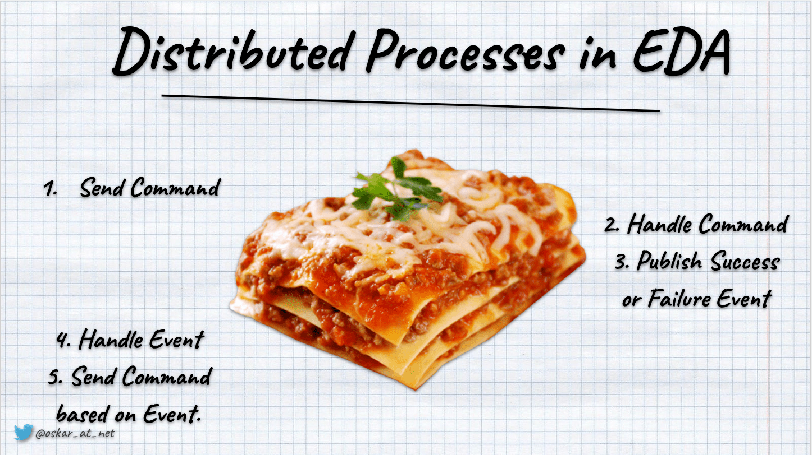
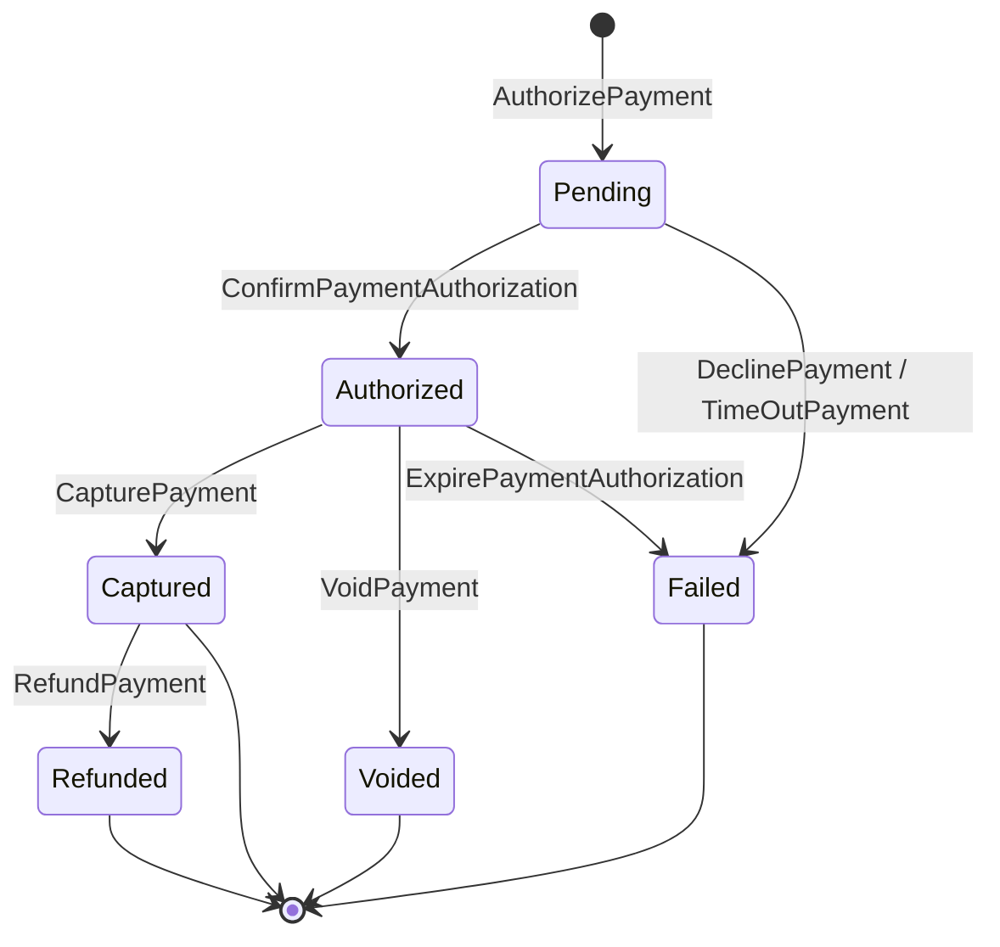
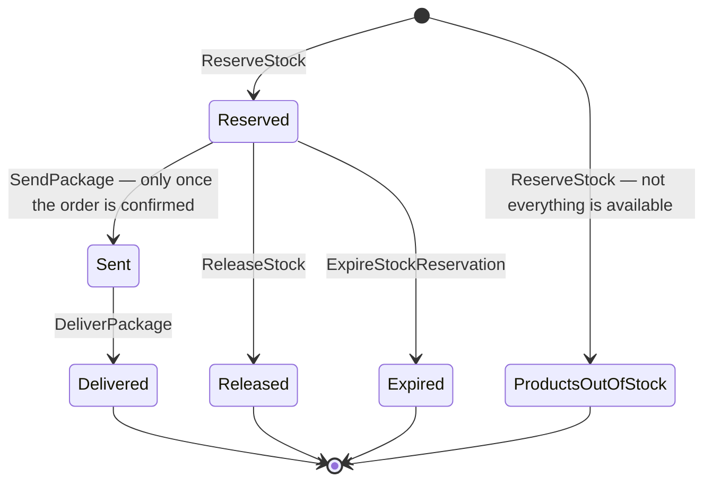
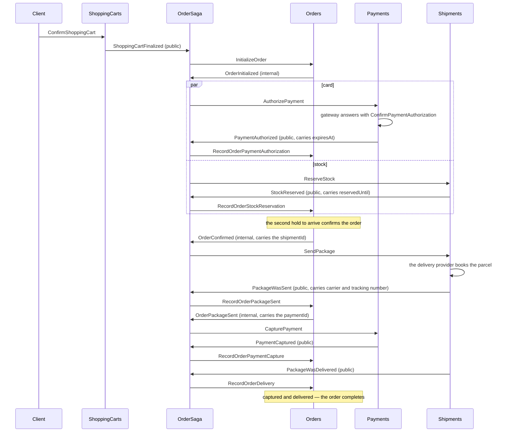
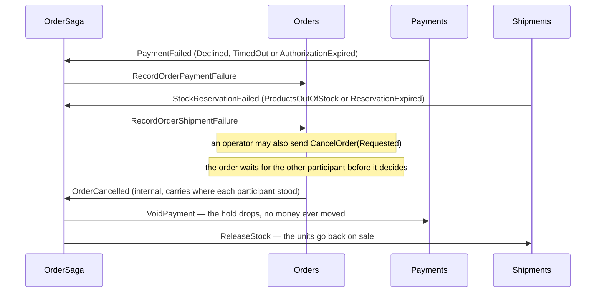

[](https://www.linkedin.com/in/oskardudycz/)  [](https://github.com/sponsors/oskardudycz/) [](https://event-driven.io/?utm_source=event_sourcing_jvm) [](https://www.architecture-weekly.com/?utm_source=event_sourcing_jvm) 

 

# Distributed process with Event Sourcing

- [Distributed process with Event Sourcing](#distributed-process-with-event-sourcing)
  - [Batch operations](#batch-operations)
  - [Cross-module processes with compensation](#cross-module-processes-with-compensation)
    - [Two holds, then two commits](#two-holds-then-two-commits)
    - [Where this flow comes from](#where-this-flow-comes-from)
    - [Compensation](#compensation)
    - [The order decides, the saga only translates](#the-order-decides-the-saga-only-translates)
    - [Why the saga stays stateless](#why-the-saga-stays-stateless)
    - [Internal events and the published contract](#internal-events-and-the-published-contract)
    - [The read side that feeds the contract](#the-read-side-that-feeds-the-contract)
    - [Appending is publishing](#appending-is-publishing)
    - [The two settlement seams](#the-two-settlement-seams)
    - [When things go wrong](#when-things-go-wrong)
    - [Where the code lives](#where-the-code-lives)
    - [What this sample doesn't cover](#what-this-sample-doesnt-cover)

Those samples present how you can tackle handling distributed processes in Event Sourcing. For more background, check my articles [Saga and Process Manager - distributed processes in practice](https://event-driven.io/en/saga_process_manager_distributed_transactions?utm_source=event_sourcing_jvm) and [No, it can never happen!](https://event-driven.io/en/no_it_can_never_happen/?utm_source=event_sourcing_jvm). 

Distributed processes with an event-driven approach embrace the impossibility of the two-phase commit in distributed transactions. Instead of trying to make a big transaction across modules and databases, it does a sequence of _microtransactions_. Each operation is handled by the module that's the source of truth and can make autonomous decisions. The distributed process is triggered by the event registered and published in the system, e.g. shopping cart confirmed. Then another module can subscribe to it and take it from there. It knows what should be the next operation, e.g. initiating the order process. It sends a command that is handled, and business logic creates another event. This event is the trigger for the next step of the workflow. Such _lasagne_ of event/command/event/command continues until the process is finished (with success or failure).



## Batch operations

A common example of the distributed process is handling batch operations—for instance, group guests checkout in the hotel. So someone selects the set of guest accounts and clicks "check out". After that, the process tries to check out all of them. If the whole process fails, there's no compensation, but you could rerun the checkout after resolving the issues.

The Group checkout saga can look as:

```java
public class GroupCheckoutSaga {
  private final CommandBus commandBus;

  public GroupCheckoutSaga(CommandBus commandBus) {
    this.commandBus = commandBus;
  }

  public void on(GroupCheckoutInitiated groupCheckoutInitiated) {
    for (var guestAccountId : groupCheckoutInitiated.guestStayAccountIds()) {
      commandBus.send(
        new CheckoutGuestAccount(guestAccountId, groupCheckoutInitiated.groupCheckoutId())
      );
    }
    commandBus.send(
      new RecordGuestStayInitiation(groupCheckoutInitiated.groupCheckoutId(), groupCheckoutInitiated.guestStayAccountIds())
    );
  }

  public void on(GuestStayAccountEvent.GuestAccountCheckoutCompleted guestCheckoutCompleted) {
    if (guestCheckoutCompleted.groupCheckoutId() == null)
      return;

    commandBus.send(
      new RecordGuestCheckoutCompletion(
        guestCheckoutCompleted.groupCheckoutId(),
        guestCheckoutCompleted.guestStayAccountId(),
        guestCheckoutCompleted.completedAt()
      )
    );
  }

  public void on(GuestStayAccountEvent.GuestAccountCheckoutFailed guestCheckoutFailed) {
    if (guestCheckoutFailed.groupCheckoutId() == null)
      return;

    commandBus.send(
      new RecordGuestCheckoutFailure(
        guestCheckoutFailed.groupCheckoutId(),
        guestCheckoutFailed.guestStayAccountId(),
        guestCheckoutFailed.failedAt()
      )
    );
  }
}
```

See more in [GroupCheckoutSaga.java](./src/main/java/io/eventdriven/distributedprocesses/hotelmanagement/saga/groupcheckout/GroupCheckoutSaga.java)

Saga, sens commands through command bus, storing commands durable and using outbox pattern to ensure that they're delivered. The example command bus using ESDB and its subscriptions can look like this:

```java
public class ESDBCommandBus implements CommandBus {
  private static final String commandStreamId = "_commands-all";
  private final EventStoreDBClient eventStoreDBClient;
  private final EventStore eventStore;
  private final RetryPolicy retryPolicy;
  private final Supplier<String> currentCorrelationId;
  private final Supplier<String> currentCausationId;

  public ESDBCommandBus(
    EventStoreDBClient eventStoreDBClient,
    EventStore eventStore,
    RetryPolicy retryPolicy,
    Supplier<String> currentCorrelationId,
    Supplier<String> currentCausationId
  ) {
    this.eventStoreDBClient = eventStoreDBClient;
    this.eventStore = eventStore;
    this.retryPolicy = retryPolicy;
    this.currentCorrelationId = currentCorrelationId;
    this.currentCausationId = currentCausationId;
  }

  @Override
  public <Command> EventStore.AppendResult send(Command command) {
    return retryPolicy.run(ack -> {
      var result = eventStore.append(
        commandStreamId,
        new CommandEnvelope<>(command, new CommandMetadata(currentCorrelationId.get(), currentCausationId.get()))
      );

      if (!(result instanceof EventStore.AppendResult.UnexpectedFailure))
        ack.accept(result);
    });
  }

  @Override
  public void subscribe(Consumer<CommandEnvelope<Object>>... handlers) {
    subscribeToStream(eventStoreDBClient, commandStreamId, (subscription, resolvedEvent) -> {
      var commandEnvelope = deserializeCommand(resolvedEvent);

      if (commandEnvelope.isEmpty()) {
        return;
      }

      for (var handler : handlers) {
        handler.accept(commandEnvelope.get());
      }
    });
  }
}
```

See more in [ESDBCommandBus.java](./src/main/java/io/eventdriven/distributedprocesses/core/commands/ESDBCommandBus.java)

The business logic of the saga processing is delegated to aggregate. Thanks to that, we have a clear split of responsibility between coordination (saga) and business logic (aggregate). Thanks to that, the saga is lightweight and much easier to maintain than merging both into Process Manager.

See the in [GroupCheckout](./src/main/java/io/eventdriven/distributedprocesses/hotelmanagement/saga/groupcheckout/GroupCheckout.java) aggregate.

We can check out the guest account if the balance is settled. If it's not, then it will store the failure event: 

```java
public void checkout(@Nullable UUID groupCheckoutId, OffsetDateTime now) {
  if (status != Status.Open || balance != 0) {
    enqueue(new GuestAccountCheckoutFailed(id(), groupCheckoutId, OffsetDateTime.now()));
  }
  enqueue(new GuestAccountCheckoutCompleted(id(), groupCheckoutId, now));
}
```

See more in [GuestStayAccount](https://github.com/oskardudycz/EventSourcing.JVM/blob/distributed_processes/samples/distributed-processes/src/main/java/io/eventdriven/distributedprocesses/hotelmanagement/gueststayaccount/GuestStayAccount.java#L48) aggregate.

We should use a retry policy in the command handler/application service to ensure that we won't fail because of random transient errors.

```java
public ETag handle(CheckoutGuestAccount command) {
    return retryPolicy.run(ack -> {
      var result = store.getAndUpdate(
        current -> current.checkout(
          command.guestStayAccountId(),
          OffsetDateTime.now()
        ),
        command.guestStayAccountId()
      );
      ack.accept(result);
    });
  }
```

See more in [GuestStayAccountService](./src/main/java/io/eventdriven/distributedprocesses/hotelmanagement/saga/gueststayaccount/GuestStayAccountService.java#L60)

As an alternative to the retry policy, we could do a [Pokémon exception handling](https://www.dodgycoder.net/2011/11/yoda-conditions-pokemon-exception.html) in the command handler and then publish the failure event.

## Cross-module processes with compensation

The group checkout stayed inside one module. Every event it stored was also every event its saga reacted to, because there was nobody else to talk to. That stops working once a process spans modules: what a module writes down for itself and what it tells the rest of the system become two different things, and the ones it tells the others turn into a contract it has to keep.

The ecommerce sample shows that on a single order going through four modules: [shopping carts](./src/main/java/io/eventdriven/distributedprocesses/ecommerce/shoppingcarts/), [orders](./src/main/java/io/eventdriven/distributedprocesses/ecommerce/orders/), [payments](./src/main/java/io/eventdriven/distributedprocesses/ecommerce/payments/) and [shipments](./src/main/java/io/eventdriven/distributedprocesses/ecommerce/shipments/). Each owns a piece of the purchase, and none of them can reach inside the others.

### Two holds, then two commits

A purchase touches two systems that can't roll each other back: the money sits with the payment provider, the goods with the warehouse. Shops deal with that by taking two reversible holds first, one on the card and one on the stock, and committing them only once both are in place:

```
authorise the card  ──┐
                      ├──> both holds good ──> pick, pack, send ──> capture the funds
reserve the stock   ──┘
```

What makes a hold safe is that it expires on its own. Stripe says an online card authorisation is "usually valid for 7 days", and if it expires before you capture, "the funds are released and the payment status changes to `canceled`". The warehouse works the same way: Shopify calls stock that has been set aside **committed**, "units that are set aside and can't be sold, such as units in an unfulfilled order".

The capture comes last on purpose. Shops that sell physical goods charge when the goods leave, not when the order is placed: Amazon charges the card when the item ships, and Shopify can capture on fulfilment. The customer is never charged for something that didn't ship, and an order that fails before shipping only has to drop its holds. No money moved, so there is nothing to refund.

The awkward case is a payment that fails after the goods have been prepared. With holds, nothing has shipped at that point, because nothing ships before both holds are in, so undoing the work is a matter of releasing the reservation and dropping the card hold.

### Where this flow comes from

The names below come from the providers' own documentation. Each command is an operation you can actually call, and each state is one a provider actually reports, so the diagrams should line up with what you find in their docs.

**The card.** A payment service splits *authorising*, which checks that the funds are there and puts a hold on them, from *capturing*, when the money actually moves. Stripe calls the split [place a hold on a payment method](https://docs.stripe.com/payments/place-a-hold-on-a-payment-method) and switches it on with `capture_method: manual`; Adyen calls the second half [capture](https://docs.adyen.com/online-payments/capture) and supports delaying it. Both let you drop the hold before any money moved, which is the operation this sample calls `VoidPayment`.



| Ours | Stripe | Adyen |
|---|---|---|
| `AuthorizePayment` | create a PaymentIntent with `capture_method: manual` | authorise |
| `CapturePayment` | capture the PaymentIntent | capture |
| `VoidPayment` | cancel the PaymentIntent | cancel |
| `RefundPayment` | refund the charge | refund |
| `ExpirePaymentAuthorization` | the authorisation lapses and the funds are released | the transaction expires |

There's no single answer to how long the hold lasts. Stripe lists around 7 days for the common card-not-present case, and [Adyen's per-scheme table](https://docs.adyen.com/online-payments/adjust-authorisation) shows the spread: Mastercard 7 days for a final authorisation and 30 for a pre-authorisation, Visa 5 to 30 depending on the merchant category, JCB up to a year. That's why `expiresAt` travels on the event. The module records the deadline it was actually granted, rather than everyone downstream agreeing on a number that isn't true for every card.

**The stock.** The warehouse side is the same idea with different words. Shopify's [inventory states](https://help.shopify.com/en/manual/products/inventory/managing-inventory-quantities/inventory-states) separate *available* from *committed*, where committed units "can't be sold"; a warehouse management system calls the step *allocation*, and a reservation that nobody acts on has to lapse so the units go back on sale.



Both diagrams end up with the same shape: a hold, a commit, and two ways to let the hold go. The order sits on top of them and waits until each side has answered.



The order completes on delivery rather than on dispatch, so the process stays open while the parcel is in transit. The goods move before the money does: `recordPaymentCapture` acts only once the package was sent, and `recordPackageSent` only while the card hold is still `Authorized`, so nothing leaves the warehouse against a hold that has already lapsed.

The diagram shows what the process reacts to, not everything that is published. The order also publishes `OrderConfirmed`, `OrderShipped`, `OrderCompleted` and `OrderCancelled` for whoever outside wants them — see [Internal events and the published contract](#internal-events-and-the-published-contract).

### Compensation



A failed payment doesn't cancel the order on its own. At that point the order still doesn't know what there is to undo: whether a stock reservation needs releasing depends on the shipment, and the shipment may not have answered yet. So the order records the failure and waits for the other participant. That wait also covers the happy path, where both modules answer at once — the two holds can arrive in either order, and the order comes out the same.

Choosing the reversal isn't the process's job either. The internal `OrderCancelled` carries `paymentState` and `shipmentState`, and the saga's compensation only reads them:

| state | the saga sends |
|---|---|
| `paymentState = Authorized` | `VoidPayment` |
| `shipmentState = Reserved` | `ReleaseStock` |
| anything else | nothing — there is no hold to undo |

There's no refund in that table, because an order can only be cancelled before it ships, and nothing is captured before it ships. Once the parcel has left, cancelling is a return, and returns are a process of their own. `RefundPayment` stays in the payments module for that. A chargeback is another reversal, but not one we can send: the issuer starts it, on the customer's word.

The states stay inside the orders module. The public `OrderCancelled` carries a `Reason` — `ProductsOutOfStock`, `PaymentFailed` or `Requested` — because that is what someone outside can act on; whether a hold was still open is the order's business.

Read more about why compensation matters in [What texting your Ex has to do with Event-Driven Design?](https://event-driven.io/en/what_texting_ex_has_to_do_with_event_driven_design?utm_source=event_sourcing_jvm).

### The order decides, the saga only translates

`Order` holds one state per participant, just as `GroupCheckout` holds one status per guest stay:

| Participant | States |
|---|---|
| payment | `Pending` → `Authorized` → `Captured` (only after `Sent`), or `Failed` |
| shipment | `Pending` → `Reserved` → `Sent` → `Delivered`, or `Failed` |

The record that completes a phase appends a second event in the same batch: `OrderConfirmed` once both holds are in, `OrderCompleted` once the capture and the delivery are both in, `OrderCancelled` otherwise. There's no `CompleteOrder` or `ConfirmOrder` command, because nobody outside the order is in a position to know that the order moved on.

Every method is idempotent. A command that arrives twice, or too late, appends nothing and returns:

```java
public void recordPaymentAuthorization(PaymentId paymentId, OffsetDateTime authorizedAt) {
  if (status != Status.Opened || payment != PaymentProgress.Pending)
    return;

  enqueue(new OrderPaymentAuthorized(id, paymentId, authorizedAt));

  progress(authorizedAt);
}
```

Idempotency also keeps the process moving. A handler that throws inside an asynchronous process blocks it: the message becomes poison and the workflow hangs behind it. So orders, payments and shipments stay quiet about messages they can't use. `ShoppingCart` still throws, because its commands come from a person over HTTP, where a rejected action has to reach the caller as an error instead of vanishing.

### Why the saga stays stateless

The whole process is one class, [OrderSaga](./src/main/java/io/eventdriven/distributedprocesses/ecommerce/orders/OrderSaga.java), with its handlers grouped by phase: hold, commit and compensation. It should be a "stupid" dispatcher: it waits for an event and sends a command built from that event's data alone. That takes some care, because an event doesn't always carry what the next command needs.

`PackageWasSent` doesn't know which payment is waiting on it, and it shouldn't: the shipments module has never heard of a payment. Looking the payment up inside the saga would work, at the price of giving it a store and a state to keep. The sample routes it through the order instead — the saga records the dispatch, and the order answers with its own `OrderPackageSent`, carrying the `paymentId` it already knows. That's the event the capture is sent from:

```java
public void on(ShipmentExternalEvent.PackageWasSent event) {
  commandBus.send(
    new RecordOrderPackageSent(
      new OrderId(event.referenceId()),
      event.carrier(),
      event.trackingNumber(),
      event.sentAt()
    )
  );
}

// The shipment does not know the payment. The order does, and names it here.
public void on(OrderEvent.OrderPackageSent event) {
  commandBus.send(new PaymentCommand.CapturePayment(event.paymentId()));
}
```

Note which `OrderPackageSent` that is: the internal one. The saga belongs to the orders module, so it reads the order's own events straight from its store and the other modules' events from the integration bus. A module that drove its own process through its public events would have to publish whatever that process needs — a `paymentId` here, a `shipmentId` there, the internal states on a cancellation — and the contract would turn into a dump of its internals.

The saga ends up with no state, no store, no clock and no id supplier; its only field is the command bus. Identifiers are derived rather than generated: the order id comes from the cart id, the payment and shipment ids from the order id. Handling the same event twice therefore sends two identical commands, and the modules no-op on the second.

### Internal events and the published contract

If a module exposed its internal events, every other module would end up coupled to its private vocabulary — the leaking abstraction described in [Events should be as small as possible, right?](https://event-driven.io/en/events_should_be_as_small_as_possible?utm_source=event_sourcing_jvm). So each module keeps two vocabularies, and a forwarder turns one into the other:

| Module | What it publishes | Who it is for |
|---|---|---|
| shopping carts | `ShoppingCartFinalized` | orders |
| orders | `OrderConfirmed`, `OrderShipped`, `OrderCompleted`, `OrderCancelled` | customer notifications, finance, anyone outside |
| payments | `PaymentAuthorized`, `PaymentCaptured`, `PaymentFailed` | orders, through a `referenceId` |
| shipments | `StockReserved`, `PackageWasSent`, `PackageWasDelivered`, `StockReservationFailed` | orders, through a `referenceId` |

Each module publishes a `sealed interface <Module>ExternalEvent`, so the contract is one type you can switch over exhaustively.

Payments and shipments are generic services: they know a `referenceId` and an amount or a list of items, never an order. Their contracts are what any client of such a service needs. The orders module is the other way round. Nobody in this sample reacts to its public events, so they are designed for the consumers a shop would have — the order's milestones, each carrying the client, the items and the total, and `OrderShipped` carrying the carrier and the tracking number the customer will ask for. `OrderInitialized` and the order's record of the capture are not published: they are steps of its own process, and only that process needs them.

Two of those names cover more than one internal event. `PaymentFailed` carries a `Reason` of `Declined`, `TimedOut` or `AuthorizationExpired`, and `StockReservationFailed` carries `ProductsOutOfStock` or `ReservationExpired`. Internally those stay separate events, because the module needs to tell them apart. Outside, the only thing anyone does with them is release the other hold, so publishing them separately would ask every consumer to learn a distinction it has no use for.

A published event usually needs more than the internal event that triggered it. `ShoppingCartConfirmed` carries the cart id and a timestamp, but `ShoppingCartFinalized` has to carry the client, the items and the total, because the order module cannot call back into the cart to ask. The same is true of `PaymentAuthorized`, which internally is an id and two timestamps.

So the forwarder reads that data from somewhere. It could load the aggregate, and an earlier version of this sample did. Each module keeps a projection instead:

```java
public void on(ShoppingCartConfirmed event) {
  var cart = summaries.get(event.shoppingCartId())
    .orElseThrow(() -> new IllegalStateException("Cannot enrich event, as shopping cart with id '%s' was not found".formatted(event.shoppingCartId())));

  eventBus.publish(new ShoppingCartExternalEvent.ShoppingCartFinalized(
    event.shoppingCartId(),
    cart.getClientId(),
    cart.getProductItems(),
    cart.getTotalPrice(),
    event.confirmedAt()
  ));
}
```

The aggregate's job is to decide, and the state it keeps is whatever those decisions need — no more. Reading it back to fill a published event makes every field the contract wants a field the aggregate has to expose, and the two drift into each other. `Order` is the clearest case: it exposes no state at all, and nothing here made it start.

And several internal events aren't published at all — a void, a refund and a stock release finish compensations that nobody is waiting for.

### The read side that feeds the contract

A projection is a set of event handlers over a view, in the shape the [introduction-to-event-sourcing](../../workshops/introduction-to-event-sourcing/) workshop builds up:

```java
public void onConfirmed(EventEnvelope<OrderConfirmed> event) {
  database.getAndUpdate(OrderSummary.class, event.data().orderId(), event.metadata().streamPosition(),
    summary -> {
      summary.setStatus(Order.Status.Confirmed);
      return summary;
    });
}
```

The stream position comes along because the internal bus can deliver an `EventEnvelope` as well as a bare event — `subscribeWithMetadata` rather than `subscribe`. A view records the position it last applied, so an event delivered twice is skipped rather than counted twice.

Each module wires its projections before its forwarder, and the bus dispatches in subscription order, so the forwarder reads a view that already includes the event it is forwarding.

Besides the summaries, the modules keep views that exist to answer a question nobody can answer from an aggregate, because the question spans many of them:

| View | Answers |
|---|---|
| `PendingPayments` | which authorisation requests the gateway never answered |
| `AuthorizedPayments` | which card holds have passed `expiresAt` |
| `StockReservations` | which stock holds have passed `reservedUntil` |
| `PendingOrders` | which orders are still in flight — the operator's TODO list, and what time-based cancellation will read |

The first three are what the expiry workers poll. `PendingOrders` has no worker yet; the view comes first, and cancelling on age is the next step.

### Appending is publishing

The in-memory event store follows the one in the [introduction-to-event-sourcing](../../workshops/introduction-to-event-sourcing/) workshop: appending to a stream dispatches the events. There's no gap between storing and publishing to get wrong, and no facade has to call a bus. In memory that comes for free; against a real database it's what an outbox is for. Either way, if you find yourself writing `store.getAndUpdate(...)` followed by `bus.publish(...)`, you're working around the store instead of using it.

That store is the module's internal channel. The integration bus is a separate object, and only forwarders write to it. The order saga listens to both: to the order's own internal events, and to the other modules' public ones. It never sees another module's internals.

The two are separate *interfaces* — `InternalEventBus` has no `publish` at all, because publishing a module's own events is appending them. One in-memory class happens to implement both here; in production they would be different transports.

[ECommerceConfig](./src/main/java/io/eventdriven/distributedprocesses/ecommerce/ECommerceConfig.java) is the composition root. It configures the four modules on one command bus, one store and one integration bus, then wires the order saga last: it sends commands to payments and shipments, so those modules have to handle them first, and each module's forwarder has to be subscribed before them, so that a public event goes out before the steps it causes. [ECommerceTests](./src/test/java/io/eventdriven/distributedprocesses/ecommerce/ECommerceTests.java) drives whole orders through it and checks the commands and the public events in the order they happen.

### The two settlement seams

The card and the courier both sit behind an interface:

```java
public interface PaymentGateway {
  void authorize(PaymentId paymentId, double amount);
  void capture(PaymentId paymentId, double amount);
  void voidAuthorization(PaymentId paymentId);
  void refund(PaymentId paymentId);
}

public interface DeliveryProvider {
  ParcelBooking book(ShipmentId shipmentId, ProductItem[] productItems);
}
```

The gateway is called by small clients that react to the payment's own internal events: [authorisation](./src/main/java/io/eventdriven/distributedprocesses/ecommerce/payments/authorization/AuthorizationGatewayClient.java) and [capture](./src/main/java/io/eventdriven/distributedprocesses/ecommerce/payments/capture/CaptureGatewayClient.java). In production the gateway would answer the authorisation later through a webhook. In the sample the test double answers by sending a command back, which keeps settling a command rather than a return value. Only the authorisation answers back at all, since that's the step where a real gateway says no.

The delivery provider is different, because the answer the shipment needs comes at once. Booking a parcel with a carrier's label API returns the carrier and the tracking number in the same call, so `Shipment.send` books before it records `PackageWasSent`, and the event carries both. The delivery confirmation still comes back later, as `DeliverPackage`. If the booking fails, nothing is recorded: the shipment stays reserved until someone sends it again or the reservation expires.

### When things go wrong

Three things keep the process from getting stuck.

**1. Failure events instead of exceptions.** `AuthorizationGatewayClient` calls the gateway inside a try/catch and sends `DeclinePayment(UnexpectedError)` if it throws. A charge that didn't go through is a business outcome; rethrowing it would only leave the payment pending forever.

**2. Timeouts, as three workers.** Nothing in the process is allowed to wait indefinitely:

| Worker | Watches | Sends |
|---|---|---|
| `PaymentTimeoutWorker` | a gateway that never answers | `TimeOutPayment` |
| `AuthorizationExpiryWorker` | `expiresAt` on the card hold | `ExpirePaymentAuthorization` |
| `ReservationExpiryWorker` | `reservedUntil` on the stock hold | `ExpireStockReservation` |

The first watches a request, the other two watch a hold. A hold that can only be freed by compensation leaks whenever the release message is lost: the units stay unsellable and the customer's funds stay blocked. Each worker ends at the order, as `PaymentFailed` or `StockReservationFailed`, so the order is never left waiting for a message that isn't coming. Production would run them on a schedule; tests call `run(now)` with a chosen instant.

**3. Manual compensation.** An operator cancels a stuck order by sending `CancelOrder(orderId, Requested)` on the same command bus, with no special path to maintain. The `OrderCancelled` that follows carries where each participant stood, so the money and the goods come back through the same commands as every other cancellation. Once the parcel has left, `CancelOrder` does nothing: what remains is a return.

**4. Late failures stay visible.** A card hold can still lapse after the parcel left but before the capture went through. The order records `OrderPaymentFailed` and stays open; it doesn't cancel, because the goods are gone, and it doesn't complete, because nobody was charged. That's where a person has to step in, as shops do: Shopify's merchants collect the payment again, and Amazon asks the customer to revise the payment method.

### Where the code lives

Each module keeps its aggregate, its events, its commands, its facade and its `Config` at the top of its package, and the orders module keeps `OrderSaga` there too. The `sealed` interfaces have to stay there, since without a `module-info.java` a sealed type's records must share its package. Everything else is grouped by what it does in the business:

| Module | Packages |
|---|---|
| orders | `pending` (`PendingOrders`, for orders that got stuck), `external` |
| payments | `authorization` (the gateway call, the timeout and the hold expiry), `capture`, `external` |
| shipments | `reservation` (the reservation expiry), `delivery` (the provider), `external` |
| shopping carts | `pricing`, `productitems`, `external` |

`external` holds the module's contract, its forwarder and the summary projection the forwarder reads, since that projection exists only to feed the contract.

### What this sample doesn't cover

- **Capture cannot fail.** Only the authorisation makes a gateway round-trip. Modelling three more callbacks would repeat what the authorisation already shows.
- **A lapsed hold before shipping cancels the order.** Real shops usually ask the customer to pay again first — Shopify's "collect payment", Amazon's "revise payment" — and cancel only if that fails. Modelling that is one more step with its own deadline, and it would teach nothing the authorisation doesn't.
- **A payment failure after shipping is left to a person.** The order stays open, and nothing reminds anyone that it does.
- **A sent package has no return path.** Returns and refunds are a process of their own.
- **Partial reservations do not exist.** A reservation covers every line or none.
- **The infrastructure is in memory.** The ESDB implementations exist but are not wired. The projection `Database` is a `HashMap` behind a store/get/getAndUpdate/find API, so swapping it for a real one is a change in one class.
- **A view can be resurrected by a replay.** `Database.getAndUpdate` skips an event a view has already applied, but `store` and `delete` carry no such guard. Replay a `StockReserved` after its `PackageWasSent` and the reservation comes back. Nothing breaks downstream — the expiry worker sends `ExpireStockReservation` and the aggregate no-ops on it — but a versioned delete would close it properly.
- **`core/messaging` duplicates the older `core/commands` and `core/events`.** Both stay, because `hotelmanagement` still depends on the older pair.

Each module could instead publish its external events to a dedicated event store stream, such as `shopping_carts__external-events`, and the others could subscribe to it — a concept close to Kafka's topics.
