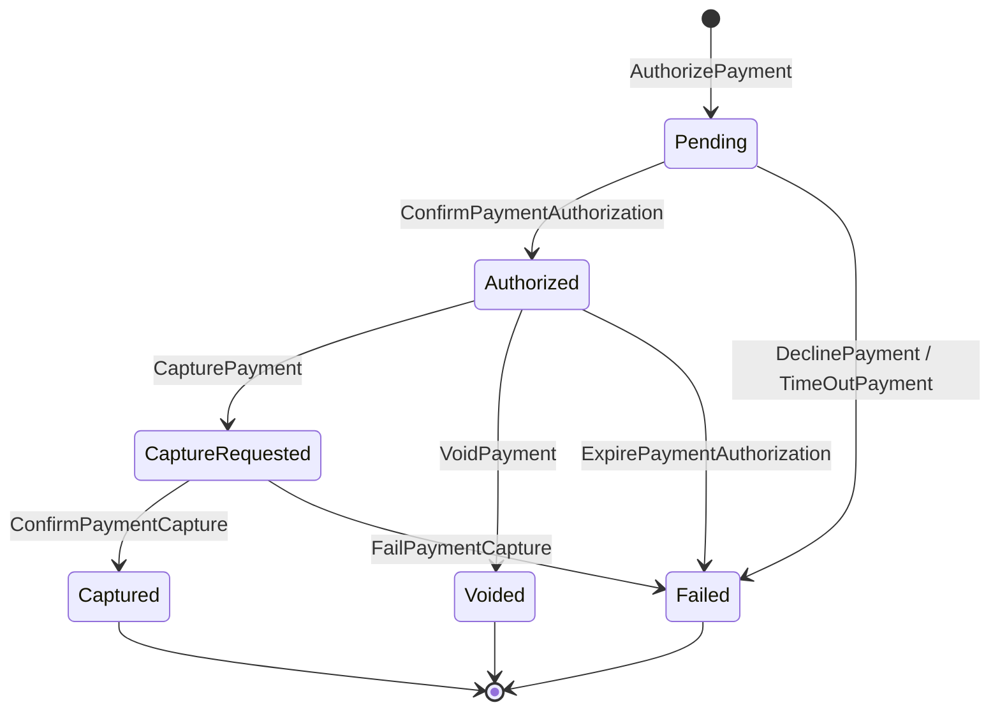
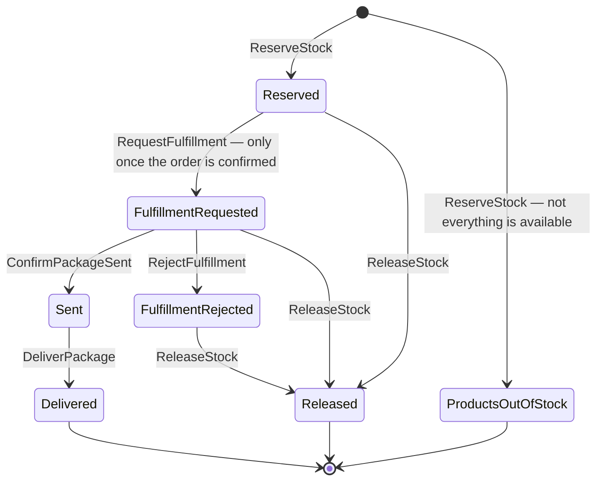
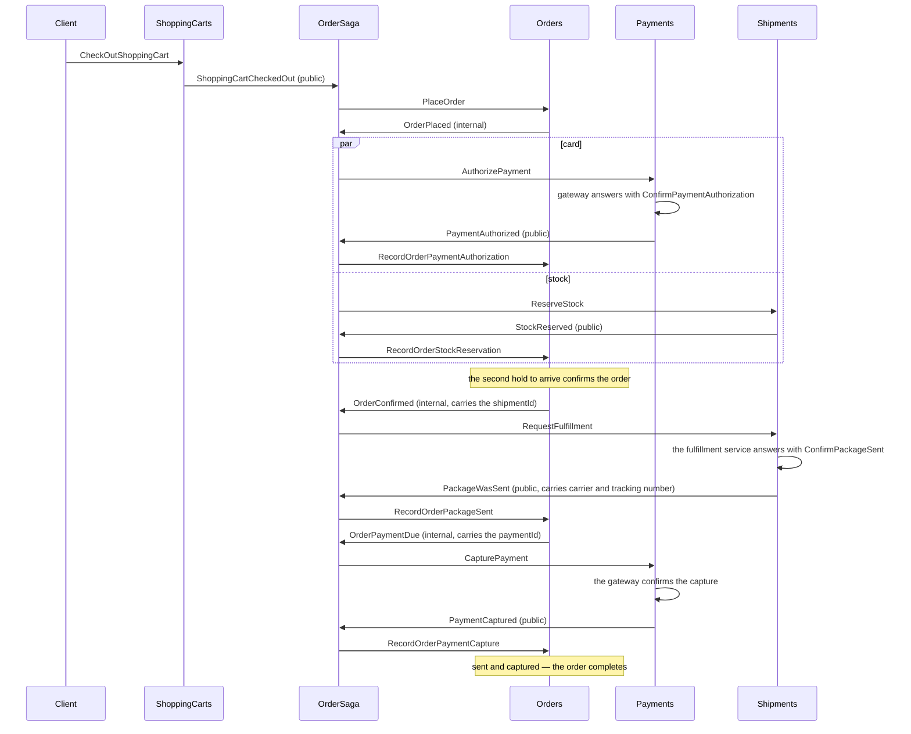
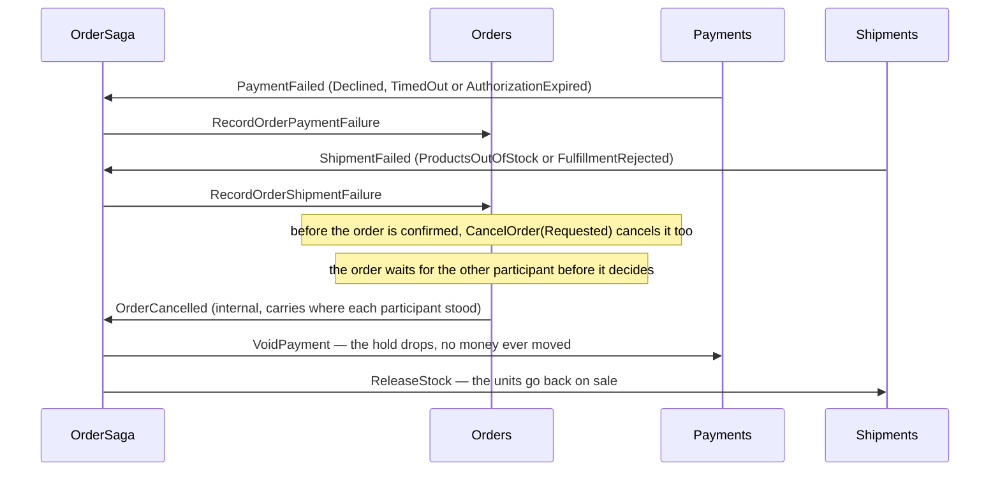

[](https://www.linkedin.com/in/oskardudycz/)  [](https://github.com/sponsors/oskardudycz/) [](https://event-driven.io/?utm_source=event_sourcing_jvm) [](https://www.architecture-weekly.com/?utm_source=event_sourcing_jvm) 

 

# Distributed process with Event Sourcing

- [Distributed process with Event Sourcing](#distributed-process-with-event-sourcing)
  - [Batch operations](#batch-operations)
  - [Cross-module processes with compensation](#cross-module-processes-with-compensation)
    - [Two holds, then two commits](#two-holds-then-two-commits)
    - [Where this flow comes from](#where-this-flow-comes-from)
    - [Compensation](#compensation)
    - [The order decides, the saga only translates](#the-order-decides-the-saga-only-translates)
    - [Why the saga stays stateless](#why-the-saga-stays-stateless)
    - [Internal events and the published contract](#internal-events-and-the-published-contract)
    - [The read side that feeds the contract](#the-read-side-that-feeds-the-contract)
    - [The event store is the outbox](#the-event-store-is-the-outbox)
    - [The two settlement seams](#the-two-settlement-seams)
    - [When things go wrong](#when-things-go-wrong)
    - [Where the code lives](#where-the-code-lives)
    - [What this sample doesn't cover](#what-this-sample-doesnt-cover)

Those samples present how you can tackle handling distributed processes in Event Sourcing. For more background, check my articles [Saga and Process Manager - distributed processes in practice](https://event-driven.io/en/saga_process_manager_distributed_transactions?utm_source=event_sourcing_jvm) and [No, it can never happen!](https://event-driven.io/en/no_it_can_never_happen/?utm_source=event_sourcing_jvm). 

Distributed processes with an event-driven approach embrace the impossibility of the two-phase commit in distributed transactions. Instead of trying to make a big transaction across modules and databases, it does a sequence of _microtransactions_. Each operation is handled by the module that's the source of truth and can make autonomous decisions. The distributed process is triggered by the event registered and published in the system, e.g. shopping cart checked out. Then another module can subscribe to it and take it from there. It knows what should be the next operation, e.g. initiating the order process. It sends a command that is handled, and business logic creates another event. This event is the trigger for the next step of the workflow. Such _lasagne_ of event/command/event/command continues until the process is finished (with success or failure).


## Batch operations

A common example of the distributed process is handling batch operations—for instance, group guests checkout in the hotel. So someone selects the set of guest accounts and clicks "check out". After that, the process tries to check out all of them. If the whole process fails, there's no compensation, but you could rerun the checkout after resolving the issues.

The Group checkout saga can look as:

```java
public class GroupCheckoutSaga {
  private final CommandBus commandBus;

  public GroupCheckoutSaga(CommandBus commandBus) {
    this.commandBus = commandBus;
  }

  public void on(GroupCheckoutInitiated groupCheckoutInitiated) {
    for (var guestAccountId : groupCheckoutInitiated.guestStayAccountIds()) {
      commandBus.send(
        new CheckoutGuestAccount(guestAccountId, groupCheckoutInitiated.groupCheckoutId())
      );
    }
    commandBus.send(
      new RecordGuestStayInitiation(groupCheckoutInitiated.groupCheckoutId(), groupCheckoutInitiated.guestStayAccountIds())
    );
  }

  public void on(GuestStayAccountEvent.GuestAccountCheckoutCompleted guestCheckoutCompleted) {
    if (guestCheckoutCompleted.groupCheckoutId() == null)
      return;

    commandBus.send(
      new RecordGuestCheckoutCompletion(
        guestCheckoutCompleted.groupCheckoutId(),
        guestCheckoutCompleted.guestStayAccountId(),
        guestCheckoutCompleted.completedAt()
      )
    );
  }

  public void on(GuestStayAccountEvent.GuestAccountCheckoutFailed guestCheckoutFailed) {
    if (guestCheckoutFailed.groupCheckoutId() == null)
      return;

    commandBus.send(
      new RecordGuestCheckoutFailure(
        guestCheckoutFailed.groupCheckoutId(),
        guestCheckoutFailed.guestStayAccountId(),
        guestCheckoutFailed.failedAt()
      )
    );
  }
}
```

See more in [GroupCheckoutSaga.java](./src/main/java/io/eventdriven/distributedprocesses/hotelmanagement/saga/groupcheckout/GroupCheckoutSaga.java)

Saga, sens commands through command bus, storing commands durable and using outbox pattern to ensure that they're delivered. The example command bus using ESDB and its subscriptions can look like this:

```java
public class ESDBCommandBus implements CommandBus {
  private static final String commandStreamId = "_commands-all";
  private final EventStoreDBClient eventStoreDBClient;
  private final EventStore eventStore;
  private final RetryPolicy retryPolicy;
  private final Supplier<String> currentCorrelationId;
  private final Supplier<String> currentCausationId;

  public ESDBCommandBus(
    EventStoreDBClient eventStoreDBClient,
    EventStore eventStore,
    RetryPolicy retryPolicy,
    Supplier<String> currentCorrelationId,
    Supplier<String> currentCausationId
  ) {
    this.eventStoreDBClient = eventStoreDBClient;
    this.eventStore = eventStore;
    this.retryPolicy = retryPolicy;
    this.currentCorrelationId = currentCorrelationId;
    this.currentCausationId = currentCausationId;
  }

  @Override
  public <Command> EventStore.AppendResult send(Command command) {
    return retryPolicy.run(ack -> {
      var result = eventStore.append(
        commandStreamId,
        new CommandEnvelope<>(command, new CommandMetadata(currentCorrelationId.get(), currentCausationId.get()))
      );

      if (!(result instanceof EventStore.AppendResult.UnexpectedFailure))
        ack.accept(result);
    });
  }

  @Override
  public void subscribe(Consumer<CommandEnvelope<Object>>... handlers) {
    subscribeToStream(eventStoreDBClient, commandStreamId, (subscription, resolvedEvent) -> {
      var commandEnvelope = deserializeCommand(resolvedEvent);

      if (commandEnvelope.isEmpty()) {
        return;
      }

      for (var handler : handlers) {
        handler.accept(commandEnvelope.get());
      }
    });
  }
}
```

See more in [ESDBCommandBus.java](./src/main/java/io/eventdriven/distributedprocesses/core/commands/ESDBCommandBus.java)

The business logic of the saga processing is delegated to aggregate. Thanks to that, we have a clear split of responsibility between coordination (saga) and business logic (aggregate). Thanks to that, the saga is lightweight and much easier to maintain than merging both into Process Manager.

See the in [GroupCheckout](./src/main/java/io/eventdriven/distributedprocesses/hotelmanagement/saga/groupcheckout/GroupCheckout.java) aggregate.

We can check out the guest account if the balance is settled. If it's not, then it will store the failure event: 

```java
public void checkout(@Nullable UUID groupCheckoutId, OffsetDateTime now) {
  if (status != Status.Open || balance != 0) {
    enqueue(new GuestAccountCheckoutFailed(id(), groupCheckoutId, OffsetDateTime.now()));
  }
  enqueue(new GuestAccountCheckoutCompleted(id(), groupCheckoutId, now));
}
```

See more in [GuestStayAccount](https://github.com/oskardudycz/EventSourcing.JVM/blob/distributed_processes/samples/distributed-processes/src/main/java/io/eventdriven/distributedprocesses/hotelmanagement/gueststayaccount/GuestStayAccount.java#L48) aggregate.

We should use a retry policy in the command handler/application service to ensure that we won't fail because of random transient errors.

```java
public ETag handle(CheckoutGuestAccount command) {
    return retryPolicy.run(ack -> {
      var result = store.getAndUpdate(
        current -> current.checkout(
          command.guestStayAccountId(),
          OffsetDateTime.now()
        ),
        command.guestStayAccountId()
      );
      ack.accept(result);
    });
  }
```

See more in [GuestStayAccountService](./src/main/java/io/eventdriven/distributedprocesses/hotelmanagement/saga/gueststayaccount/GuestStayAccountService.java#L60)

As an alternative to the retry policy, we could do a [Pokémon exception handling](https://www.dodgycoder.net/2011/11/yoda-conditions-pokemon-exception.html) in the command handler and then publish the failure event.

## Cross-module processes with compensation

The group checkout stayed inside one module. Every event it stored was also every event its saga reacted to, because there was nobody else to talk to. That stops working once a process spans modules: what a module writes down for itself and what it tells the rest of the system become two different things, and the ones it tells the others turn into a contract it has to keep.

The ecommerce sample shows that on a single order going through four modules: [shopping carts](./src/main/java/io/eventdriven/distributedprocesses/ecommerce/shoppingcarts/), [orders](./src/main/java/io/eventdriven/distributedprocesses/ecommerce/orders/), [payments](./src/main/java/io/eventdriven/distributedprocesses/ecommerce/payments/) and [shipments](./src/main/java/io/eventdriven/distributedprocesses/ecommerce/shipments/). Each owns a piece of the purchase, and none of them can reach inside the others.

### Two holds, then two commits

A purchase touches two systems that can't roll each other back: the money sits with the payment provider, the goods with the warehouse. Shops deal with that by taking two reversible holds first, one on the card and one on the stock, and committing them only once both are in place:

```
authorise the card  ──┐
                      ├──> both holds good ──> pick, pack, send ──> capture the funds
reserve the stock   ──┘
```

What makes the card hold safe is that it expires on its own. Stripe says an online card authorisation is "usually valid for 7 days", and if it expires before you capture, "the funds are released and the payment status changes to `canceled`". The stock is held differently: Shopify calls stock that belongs to a placed order **committed**, "units that are part of a placed order but aren't yet fulfilled". It has no timer. It stays committed until the order ships or is cancelled.

The capture comes last on purpose. Shops that sell physical goods charge when the goods leave, not when the order is placed: Amazon charges the card when the item ships, and Shopify can capture on fulfilment. The customer is never charged for something that didn't ship, and an order that fails before shipping only has to drop its holds. No money moved, so there is nothing to refund.

The awkward case is a payment that fails after the goods have been prepared. With holds, nothing has shipped at that point, because nothing ships before both holds are in, so undoing the work is a matter of releasing the reservation and dropping the card hold.

### Where this flow comes from

The names below come from the providers' own documentation. Each command is an operation you can actually call, and each state is one a provider actually reports, so the diagrams should line up with what you find in their docs.

**The cart.** In Shopify, WooCommerce, Amazon and Allegro, the client never opens a cart. The first "Add to cart" starts it, so the first event in a cart's stream is `ProductItemAddedToShoppingCart`. The sample assumes that the client is logged in, as on Allegro, where buying needs an account. Each cart is a short stream, `ShoppingCart-{clientId}-{n}`. A client has at most one open cart, and the first product after a checkout starts cart `n + 1`. The [ClientShoppingCarts](./src/main/java/io/eventdriven/distributedprocesses/ecommerce/shoppingcarts/ClientShoppingCarts.java) view knows which cart is the current one. If two requests start the same new cart, the slower append finds the stream already there, and its retry adds the product to the cart that the other request started.

The client chooses a product and a quantity, never a price. The price list gives the price when the product first enters the cart, and a later add of the same product keeps the line's price. The cart does not promise that price. Amazon's [cart](https://us.amazon.com/gp/cart/view.html) "reflects each item's most recent price", and Shopify's checkout can say ["Prices for these items have changed and are updated in your cart"](https://community.shopify.com/t/prices-for-these-items-have-changed-and-are-updated-in-your-cart/284837). So `CheckOutShoppingCart` reads the current prices. If one changed, the cart records `ProductItemPriceChanged` and stays open. That moved the cart to a new version, so the client has to look at the new prices and check out again with that version. If no price changed, the cart records `ShoppingCartCheckedOut`. The name is the one the shops use: "Proceed to checkout" on Amazon and WooCommerce, "Check out" on Shopify, "Do kasy" on Allegro. No shop has a "cancel cart" action, so the sample has none: a client leaves the cart, and nothing happens.

A price can still change between the check and the append. The shops accept that race: the price at the click is the price of the order. On Allegro, [the price stays as it was when the client clicked "Kup teraz"](https://spolecznosc.allegro.pl/t5/dyskusje-kupuj%C4%85cych/pytanie/m-p/705830). Amazon handles a wrong price after the order, by its [terms of sale](https://www.pinsentmasons.com/out-law/guides/amazons-pricing-error): it may contact the buyer or cancel. Locking the price list during checkout would need one transaction across pricing and the cart, which is the two-phase commit this sample avoids. The sources for the cart are collected in [real-world-flow.md](./plans/saga-and-outbox/real-world-flow.md#7-cart).

**The card.** A payment service splits *authorising*, which checks that the funds are there and puts a hold on them, from *capturing*, when the money actually moves. Stripe calls the split [place a hold on a payment method](https://docs.stripe.com/payments/place-a-hold-on-a-payment-method) and switches it on with `capture_method: manual`; Adyen calls the second half [capture](https://docs.adyen.com/online-payments/capture) and supports delaying it. Both let you drop the hold before any money moved, which is the operation this sample calls `VoidPayment`.



| Ours | Stripe | Adyen |
|---|---|---|
| `AuthorizePayment` | create a PaymentIntent with `capture_method: manual` | authorise |
| `CapturePayment` | capture the PaymentIntent | capture |
| `VoidPayment` | cancel the PaymentIntent | cancel |
| `ExpirePaymentAuthorization` | the authorisation lapses and the funds are released | the transaction expires |

There's no single answer to how long the hold lasts. Stripe lists around 7 days for the common card-not-present case, and [Adyen's per-scheme table](https://docs.adyen.com/online-payments/adjust-authorisation) shows the spread: Mastercard 7 days for a final authorisation and 30 for a pre-authorisation, Visa 5 to 30 depending on the merchant category, JCB up to a year. That's why `expiresAt` travels on the event. The module records the deadline it was actually granted, rather than everyone downstream agreeing on a number that isn't true for every card.

**The stock.** The cart holds no stock: on Allegro, putting a product in the cart [does not reserve it](https://spolecznosc.allegro.pl/t5/dyskusje-kupuj%C4%85cych/zmiana-cen-po-dodaniu-do-koszyka/td-p/657648). Placing the order takes the stock. Shopify's [inventory states](https://help.shopify.com/en/manual/products/inventory/managing-inventory-quantities/inventory-states) separate *available* from *committed*, and placing an order moves units from one to the other. WooCommerce [creates the order when the client clicks "Place order"](https://wordpress.org/support/?p=10149006), before the payment, and takes its stock. The committed stock has no timer of its own. WooCommerce's "Hold stock (minutes)" is a timer on the unpaid order: [when it runs out, the order is cancelled and the stock goes back](https://www.businessbloomer.com/woocommerce-automatically-cancel-orders/). The sample does the same through the payment: an authorisation that does not come in time cancels the order, and the stock is released.

Shipping is a request to a warehouse service, which answers later. Shopify's [fulfillment request](https://help.shopify.com/en/manual/fulfillment/fulfilling-orders/app-fulfillment) is accepted or rejected by the service; a rejected one sends the order back to "Unfulfilled". This sample has no merchant step after a rejection, so a rejected request cancels the order.



Both diagrams end up with the same shape: a hold, a commit, and a way to let the hold go. The order sits on top of them and waits until each side has answered.



The order completes once the package was sent and the payment captured, which is what Shopify and commercetools call fulfilled and paid; neither waits for the delivery. The shipment still records `PackageWasDelivered`, but nothing outside it reacts. The goods move before the money does: `recordPaymentCapture` acts only once the package was sent, and `recordPackageSent` only while the card hold is still `Authorized`, so nothing leaves the warehouse against a hold that has already lapsed.

The order itself publishes nothing. No module in this sample reacts to its milestones — see [Internal events and the published contract](#internal-events-and-the-published-contract).

### Compensation



A failed payment doesn't cancel the order on its own. At that point the order still doesn't know what there is to undo: whether a stock reservation needs releasing depends on the shipment, and the shipment may not have answered yet. So the order records the failure and waits for the other participant. That wait also covers the happy path, where both modules answer at once — the two holds can arrive in either order, and the order comes out the same.

Choosing the reversal isn't the process's job either. The internal `OrderCancelled` carries `paymentStatus` and `shipmentStatus`, and the saga's compensation only reads them:

| status | the saga sends |
|---|---|
| `paymentStatus = Authorized` | `VoidPayment` |
| `shipmentStatus = Reserved` | `ReleaseStock` |
| anything else | nothing — there is no hold to undo |

There's no refund in that table, because an order can only be cancelled before it ships, and nothing is captured before it ships. Once the parcel has left, cancelling is a return, and returns are a process of their own, refund included. A chargeback is another reversal, but not one we can send: the issuer starts it, on the customer's word.

The statuses stay inside the orders module, which publishes no events.

Read more about why compensation matters in [What texting your Ex has to do with Event-Driven Design?](https://event-driven.io/en/what_texting_ex_has_to_do_with_event_driven_design?utm_source=event_sourcing_jvm).

### The order decides, the saga only translates

`Order` holds one status per participant, just as `GroupCheckout` holds one status per guest stay:

| Participant | Statuses |
|---|---|
| payment | `Pending` → `Authorized` → `Captured` (only after `Sent`), or `Failed`; after `Sent`, `Failed` → `Retrying` → `Authorized` |
| shipment | `Pending` → `Reserved` → `Sent`, or `Failed` (out of stock), or `Rejected` (the stock is still held) |

The record that completes a phase appends a second event in the same batch: `OrderConfirmed` once both holds are in, `OrderCompleted` once the payment is captured after the dispatch, `OrderCancelled` otherwise. Recording the dispatch also appends `OrderPaymentDue`, which names the payment to capture. There's no `CompleteOrder` or `ConfirmOrder` command, because nobody outside the order is in a position to know that the order moved on.

Every method is idempotent. A command that arrives twice, or too late, appends nothing and returns:

```java
public void recordPaymentAuthorization(PaymentId paymentId, OffsetDateTime authorizedAt) {
  if (status != Status.Opened || payment != PaymentProgress.Pending)
    return;

  enqueue(new OrderPaymentAuthorized(id, paymentId, authorizedAt));

  progress(authorizedAt);
}
```

Idempotency also keeps the process moving. A handler that throws inside an asynchronous process blocks it: the message becomes poison and the workflow hangs behind it. So orders, payments and shipments stay quiet about messages they can't use. `ShoppingCart` still throws, because its commands come from a person over HTTP, where a rejected action has to reach the caller as an error instead of vanishing.

Two handlers can also append to the same stream at the same moment. A message handler passes no expected version, so `AggregateStore` retries the conflict: it reads the stream again and decides again, up to three times. That is safe because the aggregates are idempotent. Without the retry, the handler would throw, and the event store would deliver the event again only on its next append, which may never come. A person's command passes the version the person saw, so its conflict is not retried. It goes back to the caller.

### Why the saga stays stateless

The whole process is one class, [OrderSaga](./src/main/java/io/eventdriven/distributedprocesses/ecommerce/orders/OrderSaga.java), with its handlers grouped by phase: hold, commit and compensation. It should be a "stupid" dispatcher: it waits for an event and sends a command built from that event's data alone. That takes some care, because an event doesn't always carry what the next command needs.

`PackageWasSent` doesn't know which payment is waiting on it, and it shouldn't: the shipments module has never heard of a payment. Looking the payment up inside the saga would work, at the price of giving it a store and a state to keep. The sample routes it through the order instead — the saga records the dispatch, and the order answers with its own `OrderPaymentDue`, carrying the `paymentId` it already knows. That's the event the capture is sent from, and the same event comes again when the client pays a second time:

```java
public void on(ShipmentExternalEvent.PackageWasSent event) {
  messageBus.publish(List.of(
    new RecordOrderPackageSent(
      new OrderId(event.referenceId()),
      event.carrier(),
      event.trackingNumber(),
      event.sentAt()
    )
  ));
}

// The shipment does not know the payment. The order does, and names it here.
public void on(OrderEvent.OrderPaymentDue event) {
  messageBus.publish(List.of(new PaymentCommand.CapturePayment(event.paymentId())));
}
```

`OrderPaymentDue` is an internal event. The saga belongs to the orders module, so it reads the order's own events straight from its store and the other modules' public events from the message bus. A module that drove its own process through its public events would have to publish whatever that process needs — a `paymentId` here, a `shipmentId` there, the internal states on a cancellation — and the contract would turn into a dump of its internals.

The saga ends up with no state, no store, no clock and no id supplier; its only field is the message bus. Identifiers are derived rather than generated: the order id comes from the cart id, the payment and shipment ids from the order id, and a payment made again from the order id and the attempt number. Handling the same event twice therefore sends two identical commands, and the modules no-op on the second.

### Internal events and the published contract

If a module exposed its internal events, every other module would end up coupled to its private vocabulary — the leaking abstraction described in [Events should be as small as possible, right?](https://event-driven.io/en/events_should_be_as_small_as_possible?utm_source=event_sourcing_jvm). So each module that others react to keeps two vocabularies, and a forwarder turns one into the other:

| Module | What it publishes | Who it is for |
|---|---|---|
| shopping carts | `ShoppingCartCheckedOut` | orders |
| payments | `PaymentAuthorized`, `PaymentCaptured`, `PaymentFailed` | orders, through a `referenceId` |
| shipments | `StockReserved`, `PackageWasSent`, `ShipmentFailed` | orders, through a `referenceId` |

Each of them publishes a `sealed interface <Module>ExternalEvent`, so the contract is one type you can switch over exhaustively.

Payments and shipments are generic services: they know a `referenceId` and an amount or a list of items, never an order. Their contracts are what any client of such a service needs. The orders module publishes nothing. No module in this sample reacts to its milestones, and a contract without a consumer is only a guess at what someone might need. Its events are read by its own process and its own views.

Two of those names cover more than one internal event. `PaymentFailed` stands for `PaymentDeclined`, `PaymentTimedOut`, `PaymentAuthorizationExpired` and `PaymentCaptureFailed`, and carries no reason, because the order treats all four the same. `ShipmentFailed` stands for `ProductWasOutOfStock` and `FulfillmentRejected`, and carries which one it was, because the order cancels with a different reason and, after a rejection, still has stock to release. Internally those stay separate events, because the module needs to tell them apart.

Each public event carries only what its consumer reads. The order needs the `referenceId` to find itself, the ids it passes on, the time and, for a shipment, the carrier and tracking number. Amounts, items and deadlines stay inside the module that owns them.

A published event usually needs more than the internal event that triggered it. The internal `ShoppingCartCheckedOut` carries the cart id and a timestamp, but the public `ShoppingCartCheckedOut` has to carry the client, the items and the total, because the order module cannot call back into the cart to ask. The same is true of `PaymentAuthorized`: internally it has no `referenceId`, and the order needs one.

So the forwarder reads that data from somewhere. It could load the aggregate, and an earlier version of this sample did. Each module keeps a projection instead:

```java
public void onCheckedOut(EventEnvelope<ShoppingCartEvent.ShoppingCartCheckedOut> envelope) {
  var event = envelope.data();
  var cart = summaries.get(event.shoppingCartId())
    .filter(summary -> summary.getVersion() >= envelope.metadata().streamPosition())
    .orElseThrow(() -> new IllegalStateException("Summary has not reached the event yet"));

  messageBus.publish(List.of(new ShoppingCartExternalEvent.ShoppingCartCheckedOut(
    event.shoppingCartId(),
    cart.getClientId(),
    cart.getProductItems(),
    cart.getTotalPrice(),
    event.checkedOutAt()
  )));
}
```

The aggregate's job is to decide, and the state it keeps is whatever those decisions need — no more. Reading it back to fill a published event makes every field the contract wants a field the aggregate has to expose, and the two drift into each other. `Order` is the clearest case: it exposes no state at all, and nothing here made it start.

And several internal events aren't published at all — a void and a stock release finish compensations that nobody is waiting for.

### The read side that feeds the contract

Each projection extends [Projection](./src/main/java/io/eventdriven/distributedprocesses/core/projections/Projection.java), in the shape of the to-do list in the [event-driven architecture](../../workshops/event-driven-architecture/) workshop. It says which events it handles, which document each event belongs to, and how the event changes that document. Returning no document deletes it:

```java
public class PaymentSummaries extends Projection<PaymentSummary> {
  @Override
  public List<Class<?>> canHandle() {
    return List.of(PaymentAuthorizationRequested.class);
  }

  @Override
  protected EntityId getDocumentId(Object event) {
    return switch (event) {
      case PaymentAuthorizationRequested e -> e.paymentId();
      default -> throw new IllegalArgumentException("Unexpected event %s".formatted(event));
    };
  }

  @Override
  protected @Nullable PaymentSummary evolve(@Nullable PaymentSummary current, Object event) {
    return switch (event) {
      case PaymentAuthorizationRequested e -> new PaymentSummary(e.referenceId());
      default -> current;
    };
  }
}
```

The base class reads and stores the document, so no projection touches the database. The stream position comes along because a subscriber of the event store gets an `EventEnvelope`, not a bare event. The document records the position it last applied, so an event delivered twice is skipped rather than counted twice.

A summary keeps only what its forwarder adds to the internal events, and handles only the events that change it: `PaymentSummary` holds the `referenceId`, because only the authorisation request carries it. The shipments module needs no summary, because its internal events carry the `referenceId` themselves.

The projection and the forwarder are separate subscribers, and each keeps its own checkpoint. If the projection fails on an event and the forwarder does not, the forwarder would enrich from a view that has not seen that event. So the forwarder checks that the view has what it needs. If it does not, the forwarder throws: the store keeps its checkpoint and delivers the event again on the next append, after the projection has caught up. For payments, the reference is fixed once it is there, so the forwarder only checks that the summary exists. The cart's items change with every add, remove and price change, so the cart forwarder also checks that the summary's version has reached the event's stream position.

Besides the summaries, the modules keep views that exist to answer a question nobody can answer from an aggregate, because the question spans many of them:

| View | Answers |
|---|---|
| `PendingPayments` | which authorisation requests the gateway never answered |
| `AuthorizedPayments` | which card holds have passed `expiresAt` |
| `OrdersAwaitingPayment` | which sent orders are still unpaid, and since when |
| `PendingOrders` | which orders are still in flight |
| `ClientShoppingCarts` | which cart is the client's current one, and how many carts the client has had |

`PendingPayments`, `AuthorizedPayments` and `OrdersAwaitingPayment` are the to-do lists the workers read. `PendingOrders` has no worker. `ShoppingCartFacade` reads `ClientShoppingCarts` to choose the cart for the client's next product.

### The event store is the outbox

Appending only writes: to the stream, and to one global log. Every subscriber — projections, forwarders, the saga, the provider clients — reads that log from its own checkpoint. [InMemoryEventStore](./src/main/java/io/eventdriven/distributedprocesses/core/esdb/InMemoryEventStore.java) delivers once the outermost append is done, entry by entry, to every subscriber that is behind. An event appended by a subscriber is delivered after the one it is handling, never in the middle of it.

A subscriber that throws keeps its checkpoint. It gets nothing more in that run, and the next append delivers the same event to it again, before anything newer. The append itself does not fail: the event is stored, and it is the subscriber that has to catch up. That is at-least-once delivery, and it is why every handler has to be idempotent.

So there's no gap between storing and publishing to get wrong, and no facade calls a bus. If you find yourself writing `store.getAndUpdate(...)` followed by `bus.publish(...)`, you're working around the store instead of using it. Against EventStoreDB, [ESDBEventStore](./src/main/java/io/eventdriven/distributedprocesses/core/esdb/ESDBEventStore.java) subscribes to `$all`, filtered by event type. It starts from the beginning every time; a production version would store the checkpoint.

Commands and public events travel on one [MessageBus](./src/main/java/io/eventdriven/distributedprocesses/core/messaging/MessageBus.java), in the same shape as in the [event-driven architecture](../../workshops/event-driven-architecture/) workshop. A command and an event differ in intent, not in transport. Only forwarders publish events on it, so no module sees another module's internal events. The order saga listens to both sides: to the order's own events from the store, and to the other modules' public events from the bus.

[ECommerceConfig](./src/main/java/io/eventdriven/distributedprocesses/ecommerce/ECommerceConfig.java) is the composition root. It configures the four modules on one store and one bus, then wires the order saga last. The store delivers each event to its subscribers in the order they subscribed, so each module's forwarder runs before the saga, and a public event goes out before the steps it causes. [ECommerceTests](./src/test/java/io/eventdriven/distributedprocesses/ecommerce/ECommerceTests.java) drives whole orders through it and checks the commands and the public events in the order they happen.

### The two settlement seams

The card and the courier both sit behind an interface:

```java
public interface PaymentGateway {
  void authorize(PaymentId paymentId, double amount);
  void capture(PaymentId paymentId, double amount);
  void voidAuthorization(PaymentId paymentId);
}

public interface FulfillmentService {
  void request(ShipmentId shipmentId, ProductItem[] productItems);
}
```

The gateway is called by small clients that react to the payment's own internal events: [authorisation](./src/main/java/io/eventdriven/distributedprocesses/ecommerce/payments/authorization/AuthorizationGatewayClient.java) and [capture](./src/main/java/io/eventdriven/distributedprocesses/ecommerce/payments/capture/CaptureGatewayClient.java). In production the gateway would answer the authorisation and the capture later through a webhook. In the sample the test double answers by sending a command back, `ConfirmPaymentAuthorization` or `ConfirmPaymentCapture`, which keeps settling a command rather than a return value. A void does not answer back: a hold that is not voided lapses on its own. When an authorisation times out, the client voids it at the gateway too, so a late answer from the provider does not leave a hold behind.

The fulfillment service is the warehouse company that ships the order. [FulfillmentServiceClient](./src/main/java/io/eventdriven/distributedprocesses/ecommerce/shipments/fulfillment/FulfillmentServiceClient.java) sends it the request when the shipment records `FulfillmentRequested`. The service answers later, in the sample by sending a command back: `ConfirmPackageSent` with the carrier and the tracking number, or `RejectFulfillment`, and later `DeliverPackage`. If the call itself fails, nothing is recorded, and the order is cancelled when the card hold expires.

### When things go wrong

Four things keep the process from getting stuck.

**1. Failure events instead of exceptions.** `AuthorizationGatewayClient` calls the gateway inside a try/catch and sends `DeclinePayment(UnexpectedError)` if it throws; `CaptureGatewayClient` sends `FailPaymentCapture(UnexpectedError)` in the same way. A charge that didn't go through is a business outcome; rethrowing it would only leave the payment pending forever.

**2. Timeouts, as three workers.** Nothing in the process is allowed to wait indefinitely:

| Worker | Watches | Sends |
|---|---|---|
| `PaymentTimeoutWorker` | a gateway that never answers | `TimeOutPayment` |
| `AuthorizationExpiryWorker` | `expiresAt` on the card hold | `ExpirePaymentAuthorization` |
| `UnpaidOrdersWorker` | a sent order still unpaid at the end of the retry period | `CloseUnpaidOrder` |

The first watches a request, the second a hold, the third the client. The payment workers end at the order as `PaymentFailed`, so the order is never left waiting for a message that isn't coming. Each worker has `handle(now)` and a `Scheduled` variant whose `@Scheduled handleAll()` calls it with the current time, as in the workshop's to-do lists. The modules expose the `Scheduled` variant; tests move the clock and call `handleAll()`.

**3. Cancelling by request.** `CancelOrder(orderId, Requested)` on the same message bus cancels an order that is not confirmed yet, with no special path to maintain. The `OrderCancelled` that follows carries where each participant stood, so the money and the goods come back through the same commands as every other cancellation. Once the order is confirmed, `CancelOrder` does nothing: the fulfillment request is on its way to the warehouse, as Shopify allows cancelling only before fulfilment starts.

**4. Paying again after shipping.** A card hold can still lapse after the parcel left but before the capture went through, or the capture itself can fail. Both arrive as `PaymentFailed`. The order records `OrderPaymentFailed` and stays open: it can't cancel, because the goods are gone, and it can't complete, because nobody was charged. The client pays again, as Amazon asks the customer to revise the payment method:

- `RetryOrderPayment` makes the order record `OrderPaymentRetried` with a new `paymentId`, derived from the order id and the attempt number, because the failed `Payment` ignores every command;
- the saga sends `AuthorizePayment` for it, and the authorisation makes the order record `OrderPaymentDue`, so the capture follows at once;
- the capture completes the order, and a failed retry waits for the client again.

If the order is still unpaid when the retry period ends, `UnpaidOrdersWorker` sends `CloseUnpaidOrder`, and the order ends with `OrderClosedUnpaid`. Collecting the money after that is outside the sample.

### Where the code lives

Each module keeps its aggregate, its events, its commands, its facade and its `Config` at the top of its package, and the orders module keeps `OrderSaga` there too. The `sealed` interfaces have to stay there, since without a `module-info.java` a sealed type's records must share its package. Everything else is grouped by what it does in the business:

| Module | Packages |
|---|---|
| orders | `pending` (`PendingOrders`, for orders that got stuck), `unpaid` (the orders waiting for the client to pay again) |
| payments | `authorization` (the gateway call, the timeout and the hold expiry), `capture`, `external` |
| shipments | `fulfillment` (the fulfillment service), `external` |
| shopping carts | `pricing`, `productitems`, `external` |

`external` holds the module's contract, its forwarder and the summary projection the forwarder reads, since that projection exists only to feed the contract.

### What this sample doesn't cover

- **There is no web API.** The cart's commands come from a person, so a web API would call `ShoppingCartFacade` directly, as [event-sourcing-esdb-aggregates](../event-sourcing-esdb-aggregates/) does. The facade already returns the cart's new version as an `ETag`. Only `ShoppingCartCheckedOut` goes on the message bus, to the saga.
- **Carts are never anonymous.** The client is logged in from the first product, as on Allegro. Shopify and WooCommerce also let a guest fill a cart and merge it into the account's cart at login.
- **A lapsed hold before shipping cancels the order.** Real shops usually ask the customer to pay again first — Shopify's "collect payment", Amazon's "revise payment" — and cancel only if that fails. Modelling that is one more step with its own deadline, and it would teach nothing the authorisation doesn't.
- **A rejected fulfillment request cancels the order.** A real shop gives the order back to the merchant, who can try another warehouse.
- **The order does not wait for the delivery.** A delivery that never happens has no consequence for the order.
- **A sent package has no return path.** Returns and refunds are a process of their own.
- **Partial reservations do not exist.** A reservation covers every line or none.
- **The infrastructure is in memory.** The ESDB implementations exist but are not wired. The projection `Database` is a `HashMap` behind a store/get/delete/find API, so swapping it for a real one is a change in one class.
- **A view can be resurrected by a replay.** `Projection.handle` skips an event a stored document has already applied, but a deleted document keeps no version. Replay an `OrderPackageSent` after its `OrderCompleted` and the order is listed as awaiting payment again. Nothing breaks downstream — it never gets an `unpaidSince`, so the worker never closes it — but a versioned delete would close it properly.
- **`core/messaging` duplicates the older `core/commands` and `core/events`.** Both stay, because `hotelmanagement` still depends on the older pair.

Each module could instead publish its external events to a dedicated event store stream, such as `shopping_carts__external-events`, and the others could subscribe to it — a concept close to Kafka's topics.
