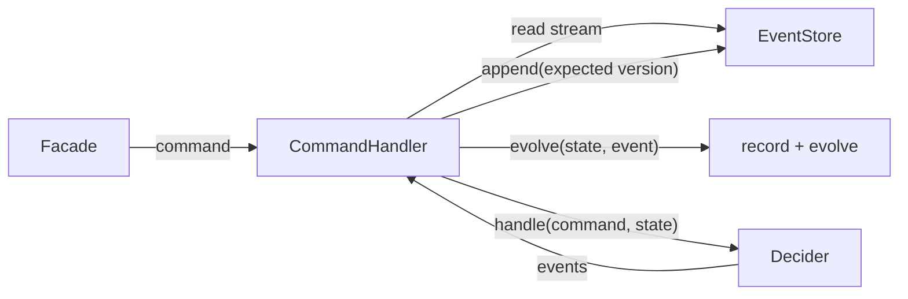

# Alignment and cleanup of samples/distributed-processes

Revision: 13

## Problem Statement

The sample teaches distributed processes with Event Sourcing. Readers compare it with the build-your-own-event-store workshop, the event-driven-architecture workshop, the other samples and Emmett, and they learn from its code as it is. A review of commit `4ef4a2d3` ([review/findings.md](review/findings.md)) found that the code drifted from those references and from itself:

- The PostgreSQL event store was not copied from the workshop. It runs several statements from Java, locks the stream row, inserts one event at a time and updates the stream after the inserts.
- Type names have four formats: registered names on the bus, class names encoded with `_` in KurrentDB and PostgreSQL, plain class names in memory, and a class-name fallback on read. The stores use a static `EventTypeMapper` and `EventSerializer` bound to the KurrentDB client; the buses use another serializer.
- The `EventStore` interface exposes KurrentDB client types, so the in-memory and PostgreSQL stores depend on the KurrentDB client.
- The message type names live in one central list, while the workshop registers them per module.
- Unused KurrentDB command and event buses and a naive stream subscription are left from the hotel examples' core.
- Payments and shipments return the requester's id in two different ways.
- There are bugs: the running application has no tracing bridge, the order accepts a failure of a payment that is no longer current, the in-memory event store and the price calculator are not thread-safe, the shop can show a 404 right after checkout, Grafana and EventCatalog share port 3000, a test can't fail, and more.
- Names, packages, dead code, copied test helpers and docs are inconsistent.
- One `ECommerceApplicationConfig` and a static composition root build all four modules, and each module declares its channels and queues by calling the bus, while the workshop gives each module its own Spring configuration with beans (Q14).
- Tests wait fixed times to prove that nothing more arrives (about 60 bus tests wait 2 seconds each), the bus tests record handled messages as strings, and the 109 test classes run one after another: CI takes 14.5 minutes (Q13, Q14).

The goal is one consistent sample, close to the references, with the bugs fixed, in as few steps as possible (Q1).

## Solution

The sample keeps what it teaches and changes how it is built.

**Event stores.** The three stores (in-memory, KurrentDB, PostgreSQL) implement one `EventStore` interface with the sample's own small types: an expected version (no stream, any, stream exists, an exact number), the stream version as a plain number counted from 0 as KurrentDB does, and a global position that also holds the PostgreSQL transaction id (Q2, Q3). Only the KurrentDB store converts to the client's types. The PostgreSQL store is raw JDBC over a HikariCP pool, as in the workshop, and appends through one SQL function in Emmett's shape: it moves the stream's version only if it still equals the expected one, then writes all events with one insert. One append is one round trip (Q4).

**Type names.** As in the event-driven-architecture workshop's business process solution: the type name is the Java class name as Spring writes it (`Class.getName()`), each module registers its own `MessageMapping` for its package, and a mapping gives a class an explicit name or maps an old name to the current class with a transformation (Q5, Q6). The brokers use Spring's JSON serializers with the type mapper, as the workshop does; the event stores use the same names through one `MessageSerializer`.

**Command handlers and immutable entities.** Every entity in the four shop modules becomes a record with a static `evolve`, and its rules move into a `<Name>Decider` with `handle(command, state)` functions that return events, as in `samples/event-sourcing-kurrentdb-simple`. One generic `CommandHandler` reads the stream, folds it, calls the decider and appends with the expected version (Q7).

**Hotel examples.** The hotel examples are not changed. The core classes they use stay in their packages and change only where the shop's core changes force it (Q11).

**Requester's id.** Payments and shipments follow one rule: a module's internal events record only its own facts. The requester's id is stored once, in the event that records the request, and each module's summary projection gives it to the forwarder, which puts it on the external events (Q8).

**Messaging stays as agreed**, with the workshop's pieces put back where the sample rewrote them: RabbitMQ retries through Spring AMQP, routes per module by package, one `publish` for commands and events (Q5, Q7).

**Modules configured on their own.** Each module is configured like a separate service: its own Spring `@Configuration` declares its beans, its routes, its type mapping, its channels and its queues, and subscribes its own handlers. The bus gets the routes, channels and queues injected and creates them on the broker. `ECommerceApplicationConfig` keeps only the shared infrastructure. Running each module as a separate application is a follow-up (Q14).

**Waiting on catch-up, not on time.** As Emmett's consumers do, a bus can be awaited until it has handled everything published before the call, and a store subscription until it has handled a given checkpoint. Tests wait on those, never on a fixed time, and check the handled messages with the workshop's `MessageCatcher`. The test classes run in two JVMs (Q13, Q17).

**Bugs, names, dead code, tests and docs** are fixed as listed below.

## Acceptance criteria

1. A developer runs the sample with the default start, so that they see the purchase in Grafana.
   1.1. GIVEN the main runtime classpath WHEN the application starts THEN the tracer is the OpenTelemetry tracer, and the trace tests pass without a test-only copy of the tracing bridge.
   1.2. GIVEN the HOWTO WHEN the reader follows its Grafana steps THEN it tells how to find a purchase's `correlationId` and says that a purchase forms two traces, split at "Pay now".

2. A module appends events to a stream, so that the stream records them once and in order, on every store.
   2.1. GIVEN no stream WHEN a module appends two events expecting no stream THEN the result has the next version 1 and the events' global position, and reading the stream returns both events with versions 0 and 1.
   2.2. GIVEN a stream at version 1 WHEN a module appends expecting no stream THEN the result says the stream already exists and nothing is written.
   2.3. GIVEN a stream at version 1 WHEN a module appends expecting version 0 THEN the result is a conflict with the expected and the actual version, and nothing is written.
   2.4. GIVEN a stream at version 1 WHEN a module appends expecting any version, or expecting that the stream exists THEN the events are written at versions 2 and up.
   2.5. GIVEN no stream WHEN a module appends expecting that the stream exists THEN the result is a conflict and nothing is written.
   2.6. GIVEN an unknown stream WHEN a module reads it THEN the result says the stream doesn't exist.
   2.7. GIVEN a stream with an event whose type no module maps or trusts WHEN a module reads the stream THEN the read fails and names the type, instead of skipping the event.
   2.9. GIVEN an append of three events WHEN it succeeds THEN the result holds the checkpoint (transaction id and global position) of the third event, on every store.
   2.8. GIVEN two appends to one stream that both expect version 1 WHEN they run at the same time THEN exactly one succeeds and the other gets a conflict, on each store, the in-memory store included.

3. The PostgreSQL store appends in one round trip, so that it works like the workshop and Emmett.
   3.1. GIVEN a new stream `Order-<id>` WHEN a module appends three events THEN one call of the append function writes the stream row with type `Order` and version 2, and three message rows with versions 0-2, kind `E`, the type name (for example `io.eventdriven.distributedprocesses.ecommerce.orders.OrderEvent$OrderPlaced`), schema version 1, one transaction id and increasing global positions.
   3.2. GIVEN an append whose version check fails WHEN the function runs THEN no message row is written and the stream row is unchanged.

4. A subscription reads stored events, so that each subscriber handles each event once, in order.
   4.1. GIVEN a PostgreSQL subscription for one event type and many later events of other types WHEN one more event of the subscribed type is appended THEN the subscription handles it. This criterion protects existing behaviour; the rescan fix (no type filter in SQL, the cursor moves over the whole batch) is checked by the step review.
   4.2. GIVEN a stored event whose type name maps to a subscribed class but whose data can't be read WHEN the subscription reaches it THEN it treats it as a handler failure and retries with back-off, and its checkpoint doesn't move past the event.
   4.3. GIVEN a stored event whose type name maps to no class WHEN a subscription reads past it THEN the subscription passes over it and handles the next event of its types.
   4.4. GIVEN an event stored under an old name that a module maps to the current class WHEN a subscription to the current class reads it THEN the subscription handles it as the current class.

5. A module names its message types, so that stores and brokers read them back as the right class.
   5.1. GIVEN `PaymentExternalEvent.PaymentAuthorized` with no explicit name WHEN it is published or stored THEN its type name is `io.eventdriven.distributedprocesses.ecommerce.payments.external.PaymentExternalEvent$PaymentAuthorized`, on both brokers and all three stores, and a reader in the orders module trusts it.
   5.2. GIVEN a module's mapping that gives a class an explicit name WHEN the message is published or stored THEN that name is used, and readers map it back to the class.
   5.3. GIVEN a module's mapping of an old name to the current class with a transformation WHEN a message with the old name is read from a bus or a store THEN the reader gets the current class.
   5.4. GIVEN a message whose class name is outside the modules' packages WHEN a bus reads it THEN it is dead-lettered as unreadable.
   5.5. GIVEN two modules that map the same explicit name to different classes WHEN the application starts THEN the start fails and names both classes.

6. A facade handles a command, so that the entity's rules decide the new events.
   6.1. GIVEN a shopping cart opened with one product (version 0) WHEN `AddProductItemToShoppingCart` is handled THEN the decider gets the cart with one product, `ProductItemAddedToShoppingCart` is appended expecting version 0, and the next version is 1.
   6.2. GIVEN a command that arrives late or twice WHEN it is handled THEN the decider returns no events, nothing is appended, and nothing is thrown.
   6.3. GIVEN a concurrent append between the read and the append WHEN a command without a client version is handled THEN it is read and decided again, up to 3 attempts in all, and the third conflict fails the command.
   6.4. GIVEN a client version in `If-Match` that is not the current one WHEN the command is handled THEN the API answers 412, as today.
   6.5. GIVEN a cart opened with one product WHEN the client reads it THEN the ETag is `W/"0"`, and after one more product `W/"1"`, as today.

8. The order process handles payment answers, so that a stale answer can't fail the current payment.
   8.1. GIVEN a failed first payment and a retry with a second payment that is still pending WHEN the failure of the first payment arrives again THEN the order records nothing.
   8.2. GIVEN a confirmed order paid with the second payment WHEN the failure of the first payment arrives THEN the order records nothing and is not canceled.
   8.3. GIVEN an order whose current payment is the second one WHEN a capture of the first payment arrives THEN the order records nothing.

9. Payments and shipments answer the requester, so that both follow one rule.
   9.1. GIVEN a shipment requested for an order WHEN stock is reserved, the fulfillment is requested or rejected, the package is sent or delivered, or stock is released THEN only the event that records the request (`StockReserved` or `ProductWasOutOfStock`) stores the requester's id.
   9.2. GIVEN a shipment whose package was sent WHEN the forwarder publishes `PackageWasSent` THEN the external event carries the requester's id, read from the shipment summary.
   9.3. GIVEN a shipment summary that hasn't caught up WHEN the forwarder handles an event THEN it throws, and the event is delivered again after the summary catches up, as for payments.

10. Many users use the shop at once, so that shared state stays correct.
    10.1. GIVEN many requests that price the same new product at the same time WHEN the calculator prices it THEN every request gets the same price and none fails.

11. A customer checks out in the shop, so that they never see an error page while the order is placed.
    11.1. GIVEN a checkout whose order isn't placed yet WHEN the customer is redirected to the order page THEN the page says the order is being placed and refreshes until the order shows.

12. A developer runs the default stack and the event catalog, so that both work at once.
    12.1. GIVEN Grafana on port 3000 WHEN the developer runs `eventCatalogPreview` or `eventCatalogTest` THEN the catalog serves and is tested on port 3001.

13. A message fails on a broker, so that the dead-letter metric reads the same on both brokers.
    13.1. GIVEN a message dead-lettered from queue `orders-shopping_carts-external` WHEN the counter `messaging.dead_lettered` grows THEN its destination tag is the queue name on Kafka and on RabbitMQ.
    13.2. GIVEN a RabbitMQ handler that always fails WHEN a message arrives THEN it is retried with the configured interval and attempts through Spring AMQP's listener retry and then dead-lettered, as the message-broker spec's criteria require.

15. A step handles a message on the in-memory bus, so that all buses trace the same way.
    15.1. GIVEN a subscriber on the in-memory bus WHEN it handles a message THEN a step span named `handle <MessageType>` wraps the handler, as on Kafka and RabbitMQ.

16. A test waits for asynchronous handling, so that it doesn't depend on time (Q13).
    16.1. GIVEN messages published to queues that a bus consumes WHEN a caller waits for the bus to catch up THEN the wait returns once every one of them is handled or dead-lettered, on the in-memory bus, Kafka and RabbitMQ.
    16.2. GIVEN a Kafka or RabbitMQ bus whose handler doesn't finish WHEN a caller waits for it to catch up with a timeout THEN the wait fails after the timeout and names the queue or the consumer group.
    16.3. GIVEN a store subscription and an appended event of its types WHEN a caller waits for the event's checkpoint THEN the wait returns once the subscriber has handled it, on the three stores; with a timeout it fails instead of hanging.
    16.4. GIVEN the test suite WHEN it runs THEN no test waits a fixed time: no `Thread.sleep`, no Awaitility `during` or `pollDelay`.

17. A module is configured on its own, as a separate service would be (Q14).
    17.1. GIVEN the application WHEN it starts THEN its context holds the `MessageChannel` beans `shopping_carts-external`, `orders-internal`, `payments-requests`, `payments-responses`, `payments-internal`, `shipments-requests`, `shipments-responses` and `shipments-internal`, and the `MessageQueue` beans of the README's channel table (for example `orders-payments-responses` on `payments-responses` with `ecommerce.order.*`), each declared by the configuration class of the module that owns it, plus one `MessageRoutes` bean per module.
    17.2. GIVEN a module that binds a queue to another module's channel WHEN the application starts on Kafka or RabbitMQ THEN the queue receives the messages published to that channel, whichever module is configured first. (This replaces criterion 14 of r7, which asked Kafka's `bind` to create the channel topic.)
    17.3. GIVEN the in-memory store and bus WHEN a cart is checked out THEN `ShoppingCartCheckedOut` is published before `PlaceOrder`, because the forwarders subscribe before the saga. This protects existing behaviour (`ECommerceTests`).
    17.4. GIVEN the application WHEN it starts THEN its context holds one `MessageMapping` bean per module, declared by that module's configuration class, and the type mapper is built from those four.

## Implementation Decisions

**Event store contract (Q2, Q3).**
- `EventStore` uses the sample's own types: `ExpectedStreamVersion` (`noStream`, `any`, `streamExists`, `at(long)`), the stream version as `long` (first event 0, no stream -1), and `Checkpoint(long transactionId, long position)`, the existing record, as the one global-position type; it moves to `core/eventstore`. KurrentDB and in-memory put 0 into `transactionId`.
- `AppendResult`: `Success(long nextStreamVersion, Checkpoint lastEvent)` (the last appended event's checkpoint), `StreamAlreadyExists(long actual)`, `Conflict(ExpectedStreamVersion expected, long actual)`, `UnexpectedFailure`. `ReadResult`: `Success(events)`, `StreamDoesNotExist`, `UnexpectedFailure`. `NoEventsFound`, `DeleteResult`, `deleteStream` and `setStreamMaxAge` are deleted.
- `continueTraceOf` leaves the interface; `CommandHandler` takes `MessageContext` and opens the continuing scope itself.
- In the three `EventStore` implementations, a stream read that meets an event it can't map fails with `UnreadableMessageException`. A subscription passes over an event whose name maps to none of its classes, and treats an event whose name maps to one of its classes but whose data can't be read as a handler failure.
- `EventMetadata` keeps its fields and gains `transactionId`, so a subscriber gets the event's full checkpoint.
- Among the three `EventStore` implementations, only `KurrentDBEventStore` converts to `StreamState` and `Position`.
- Packages: `core/eventstore` (`EventStore`, its types, `InMemoryEventStore`), `core/eventstore/kurrentdb` (`KurrentDBEventStore`, `KurrentDBSubscriptionToAll`, renamed from `AllStreamSubscription`), `core/eventstore/postgresql` (`PostgreSQLEventStore`, `PostgreSQLSubscription`).

**PostgreSQL store (Q4).**
- Raw JDBC on a HikariCP `DataSource`, as now; no Spring JDBC helpers.
- Tables, in the projections database (no prefix; no view table uses these names):
  - `streams(stream_id text primary key, stream_position bigint not null, stream_type text not null)`;
  - `messages(stream_id, stream_position, global_position bigint default nextval(global sequence), transaction_id xid8, message_id uuid, message_kind char(1) default 'E', message_type text, message_schema_version int default 1, message_data jsonb, message_metadata jsonb, created timestamptz default now(), primary key (stream_id, stream_position))`, with an index on `(transaction_id, global_position)`.
- `stream_type` is the stream id's part before the first `-` (`Order` from `Order-...`).
- One function `append_to_stream(message ids, data, metadata, schema versions, types, kinds, stream id, stream type, expected kind, expected position)` returns success, the next stream position, the global positions and the transaction id. It takes `pg_current_xact_id()` once. For an exact version it runs `UPDATE streams SET stream_position = expected + count WHERE stream_id = ? AND stream_position = expected`; for "stream exists" the same without the position condition; for "no stream" an `INSERT` that reports "already exists" on a key violation; for "any" an insert-or-update. No changed row means a conflict, reported with the actual position. Then one `INSERT INTO messages ... SELECT ... FROM unnest(...) WITH ORDINALITY RETURNING global_position`. No `SELECT ... FOR UPDATE`.
- The sample writes schema version 1 for every message; versioning goes by type names and transformations (Q5, Q6).
- The poll reads `transaction_id < pg_snapshot_xmin(pg_current_snapshot()) AND (transaction_id, global_position) > (?, ?)` ordered by both, without a type filter; it filters types in Java and moves its in-memory cursor over the whole batch; it stores a checkpoint only for handled events. The constructor doesn't read the checkpoint; the first poll does.
- Java holds the transaction id as `long`; SQL converts with `::text::xid8` and back.

**Subscriptions and checkpoints.**
- Package `core/subscriptions`: `SubscriptionCheckpoint` (the JPA entity), `SubscriptionCheckpointRepository`, `SubscriptionCheckpoints` (renamed from `ProcessorCheckpoint`, `ProcessorCheckpointRepository`, `ProcessorCheckpoints`). The table `processor_checkpoints` and its columns stay, as the message-broker spec agreed.
- One word: subscription.
- A projections database belongs to one event store type; the HOWTO says so.

**Type names and serialization (Q5, Q6).**
- The type name is `Class.getName()`, as Spring writes it in `__TypeId__` (with `$` for nested records), on both brokers and all three stores.
- Each module config has a static `mapping()` returning its `MessageMapping`, exposed as a bean by its configuration (Q14): the packages it trusts (its package and every sub-package that holds a message class, listed one by one, because Spring AMQP's `DefaultClassMapper` matches trusted packages exactly), explicit names, and transformations of old names. A transformation names the class it produces (`register(oldName, OldClass, CurrentClass, transform)`, and the `JsonNode` variant likewise), a small change to the workshop's signature, so the mapper knows every name of a class. No central list: `ECommerceMessages` is deleted.
- `MessageTypeMapper` merges the module mappings (the workshop's `MessageMappingRegistry` role): name to class (explicit name, old name, else class name in a trusted package), class to name (explicit name, else class name), and class to all its names. the shared messaging configuration builds it from the injected `MessageMapping` beans before it creates the serializer, the buses and the stores; the bus tests build it from the mappings they need through `TestMessages`. Two different classes under one explicit name fail the start.
- One `JsonMapper` bean with `FAIL_ON_UNKNOWN_PROPERTIES=false`, `WRITE_DATES_AS_TIMESTAMPS=false` and `ADJUST_DATES_TO_CONTEXT_TIME_ZONE=false`, so every store and broker keeps an `OffsetDateTime`'s offset as written; the in-memory store's own mapper (with field visibility ANY) goes. Spring's broker serializers get the same mapper, as in the workshop.
- `MessageSerializer` is one bean on that mapper: it writes a message's bytes and type name and reads bytes by type name, applying transformations. All three stores use it, the in-memory store included, so a message round-trips the same everywhere.
- Kafka: Spring's `JacksonJsonSerializer` and `JacksonJsonDeserializer` with `DefaultJacksonJavaTypeMapper` (type id first, the mapper's names, the modules' packages trusted); RabbitMQ: Spring's JSON message converter with `DefaultClassMapper` configured the same way; old names through `VersionedMessageConverter` and `MessageTransformations`, as in the workshop. The `__TypeId__` header replaces the `messageType` header; the dead-letter counter's `message.type` tag reads it.
- Derived message ids use the type name. A published message's id is derived only from a real handled message id; with none (a `continuing` scope without baggage), it is random.
- Store subscriptions filter on the type names of their classes (current, explicit and old names): KurrentDB keeps its server-side filter, PostgreSQL filters names in Java after reading a batch. An event with an unknown name is passed over; an event whose name maps to a subscribed class but whose data can't be read is a handler failure and is retried.
- `serialization/EventTypeMapper` and `serialization/EventSerializer` are deleted.

**Command handlers and immutable entities (Q7).**
- In the four shop modules, each entity is a record with a static `initial()` and `evolve(state, event)`; its rules live in a `<Name>Decider` with `handle(command, state)` functions returning an array of events (some shop commands record more than one fact; arrays, as `EventSourcedSpecification` and the hotel deciders use). As in `event-sourcing-kurrentdb-simple` (`new ShoppingCartDecider(productPriceCalculator)`), a decider is an instance when it needs dependencies (the price calculator, the clock, payment validity and terms); otherwise its functions are static. The rule that late or repeated commands produce no events and don't throw stays.
- `core/commands/CommandHandler<State, Command, Event>` takes the event store, the message context, the stream id mapping, `initial`, `evolve` and the decider function. It reads the stream, folds it, decides, and appends with the version read. Without a client version it retries a conflict with a new read as `AggregateStore` does today; with a client version it appends with that version and reports a conflict, which the API turns into 412. It returns the next version for the ETag. For the commands that continue a trace today, it opens the continuing scope from the last event. `get(id)` returns the folded state, for the facade methods that only read (`PaymentFacade.createCheckoutSession`, `ShoppingCartFacade.isCheckedOut`). A conflict without a client version is retried up to 3 attempts in all, with no delay, through Spring Framework's `RetryTemplate` (`RetryPolicy` with `includes(ConcurrentModificationException.class)`, `maxRetries(2)`, `delay(Duration.ZERO)`), called with `invoke`, which rethrows the last `ConcurrentModificationException`, as the hotel services use it (Q16). `CommandHandler` throws `ConcurrentModificationException` for `AppendResult.Conflict`, as `AggregateStore` does, so `ApiExceptionHandler` keeps answering 412.
- Facades call command handlers.
- The shop no longer uses `AbstractAggregate`, `Aggregate` and `AggregateStore`; they stay in core because the hotel process manager style uses them (Q11), adapted to the new event store types only; `AggregateStore`'s hand-written retry loop becomes the same `RetryTemplate` (Q16), with the same 3 attempts. The test helper `AggregateSpecification` is deleted.
- The shop's API builds ETags with Spring's `org.springframework.http.ETag`; the sample's own `core/http/ETag` stays for the hotel (Q16). `CommandHandler` and the shop facades return the next stream version as a `long`; the controller writes `new ETag(String.valueOf(version), true).formattedTag()` (`W/"0"`, as today) and reads `If-Match` with `ETag.parse`, taking the first tag's number; an empty or non-numeric `If-Match` throws `IllegalArgumentException`, which `ApiExceptionHandler` answers with 400, as today.

**Hotel examples (Q11).**
- No hotel class changes. The core classes they use stay in their packages: `CommandBus`, `CommandEnvelope`, `CommandMetadata`, `EventBus`, `core/events/EventEnvelope` and `EventMetadata`, `EntityStore`, `AbstractAggregate`, `Aggregate`, `AggregateStore`, `AbstractProcessManager`, `ETag`.
- They change only where the shop's core forces it: `CommandBus` and `EventBus` refer to the moved `EventStore` and its new `AppendResult`; `AggregateStore` uses `ExpectedStreamVersion` and the new results, and loses `getAndUpdateContinuingTrace`, which only the shop used, so it no longer calls `continueTraceOf`; `get(id)`, `getAndUpdate(id, handle)` and `getAndUpdate(id, expectedVersion, handle)` stay, the last one adapted to `ExpectedStreamVersion`. `EntityStore` takes a `MessageSerializer` in its constructor instead of using the deleted `EventSerializer`; it keeps its raw KurrentDB client, its own `StreamState` conversion and its current read behaviour (it passes over events it can't read).
- Deleted, because nothing uses them: `KurrentDBCommandBus`, `KurrentDBEventBus`, `KurrentDBSubscription`, `SubscribeToAllOptionsFactory`, and the old `core/commands/CommandHandler`, which the new `CommandHandler` replaces. This closes follow-up F1 of the message-broker plan (option A).

**Requester's id (Q8).**
- Shipment internal events keep `referenceId` only in `StockReserved` and `ProductWasOutOfStock`. `FulfillmentRequested`, `FulfillmentRejected`, `PackageWasSent`, `PackageWasDelivered` and `StockReleased` lose it.
- A `ShipmentSummary` projection holds the shipment id and the requester's id, and the shipment forwarder reads it with the same "summary has caught up" check as the payment forwarder.
- External events don't change.

**Messaging (agreed design kept; workshop pieces back, Q5, Q7).**
- Routes per module by package with `inPackage`, as in the workshop. `MessageRouter`'s unused convention function and `firstRecordComponent` are deleted (the message-broker spec forbids reflection on fields).
- One `publish`.
- RabbitMQ retries through Spring AMQP's listener retry with the `MessageFailureStrategy` as the retry predicate and a recoverer that counts and rejects, as the workshop's `RabbitConfig`. The hand-written loop and `Thread.sleep` go.
- Kafka and RabbitMQ stay separate classes with no shared base.
- The Kafka dead-letter counter tags the queue. `close()` closes the routing producer too. The in-memory bus opens the step span with `consuming`.

**Module configuration (Q14).**
- `ShoppingCartsConfig`, `OrdersConfig`, `PaymentsConfig` and `ShipmentsConfig` become Spring `@Configuration` classes in their packages. Each declares its facade, projections, forwarder, workers and their repositories, and subscribes its handlers on the bus and its subscriptions on the store when its beans are created, as the workshop's module configurations do.
- Each also declares, with static `@Bean` methods so that the bus can be built before the module: its `MessageRoutes` (as the workshop's `HotelFinancialMessageRoutes`), its `MessageMapping`, its channels as `MessageChannel(name)` beans and its queues as `MessageQueue(name, channel, routingPattern)` beans.
- The bus gets the lists of `MessageRoutes`, `MessageChannel` and `MessageQueue` in its constructor and creates them before it starts: exchanges, quorum queues, bindings and dead-letter destinations on RabbitMQ; topics, consumer groups and routing consumers on Kafka; maps in memory. All channels exist before any queue is bound, so the order of the modules doesn't matter. `routes`, `channel` and `bind` leave `MessageBus`.
- No module configuration uses another module's beans; modules share only the bus, the store, and the other modules' external event classes and the names of the channels they publish to others (`ShoppingCartsConfig.external`, `PaymentsConfig.responses`, `ShipmentsConfig.responses`, public constants as today).
- The order saga subscribes after all other subscriptions, because the in-memory store delivers in subscription order and each forwarder has to run before the saga: `OrdersConfig` subscribes it from a `SmartInitializingSingleton` bean, which Spring calls once all singletons exist. Test wiring in plain Java calls the same method last.
- `ECommerceConfig` and `ECommerceModule` go. `ECommerceApplicationConfig` keeps the shared infrastructure: the store, the bus, the projections database, the serializer and observability.
- The hotel examples don't use `channel`, `bind` or `routes`, so they don't change.

**No hand-written retries (Q16).**
- Retries and waits on a condition use Spring Framework's `RetryTemplate`, Spring AMQP's listener retry or Spring Kafka's error handler, never a hand-written loop with `Thread.sleep`. The event stores keep their own schedulers for polling and for resubscribing after a delay (plain Java, Q4), because `RetryTemplate` blocks.

**Catch-up waits (Q13).
- `MessageBus.awaitCaughtUp(Duration timeout)` returns once the queues the bus consumes have handled or dead-lettered every message published before the call, and fails with the queue or consumer group name after the timeout. A bus that isn't running returns at once. In memory it returns at once, because `publish` delivers synchronously. Kafka waits for the routing consumers and then the queue consumers, each until its group's committed offsets reach the end offsets read when the wait starts; Kafka can't announce that, so the bus checks again every 50 ms through a `RetryTemplate` with that fixed delay and a timeout of the time left: one deadline for the whole wait, shared by all consumer groups. "Not caught up yet" is an `IllegalStateException` naming the consumer group and topic; `invoke` rethrows it when the time is up. RabbitMQ sends a probe to each queue and waits until its consumer takes it, because a queue's one consumer handles messages in order.
- `EventStore.subscribe` returns a `Subscription` (callers that chain `subscribe` today call it once per statement; no hotel class chains it) with `awaitProcessed(Checkpoint checkpoint, Duration timeout)`, which returns once the subscription has handled the event at that checkpoint or a later one, and fails after the timeout. The checkpoint is one of an event of the subscription's types, usually from an append result. Checkpoints are ordered by transaction id, then position, as the PostgreSQL poll orders them; KurrentDB and in-memory put 0 into the transaction id, so they order by position.
- A test that proves an event was not delivered (a type the subscription doesn't take, a failed append) appends one more event of the subscribed type, waits for its checkpoint, then asserts once. A test with a handler that always fails asserts once after `close()` returns, because `close()` returns only after the subscription has stopped.

**Bugs.**
- `micrometer-tracing-bridge-otel` becomes an `implementation` dependency; the `testImplementation` copy goes.
- `RecordOrderPaymentFailure` and `RecordOrderPaymentCapture` carry the `PaymentId`; the order ignores them for any payment other than its current one. The order's first payment id is set when the order is placed, with the same derivation the saga uses.
- `InMemoryEventStore` guards append, subscribe, middleware and dispatch with one lock and keeps delivery after the outermost append. Its middleware is a plain list, called before subscribers, as in `InMemoryMessageBus`.
- `RandomProductPriceCalculator` uses a `ConcurrentHashMap` and one random generator.
- The shop's order page shows "Your order is being placed" and refreshes every 2 seconds while the order status has no row.
- EventCatalog preview, the Playwright config, README and HOWTO use port 3001.
- `ShoppingCartTests` is deleted; the shared store tests cover appending twice to a new stream.

**Names and settings.**
- `PaymentCanceled.voidedAt` becomes `canceledAt`; "authorisation" becomes "authorization".
- `kurrentdb.connectionstring` stays, as in every other sample.
- `spring.sql.init.platform`, `hibernate.jdbc.lob.non_contextual_creation` and `spring.jpa.generate-ddl` are removed. The CI workflow drops `-Pci=true`. The two `configurations {}` and the two test-task blocks in `build.gradle` are merged. `logs/test.log` is rewritten on each run.

**Dead code deleted.** `core/processing/HandlerWithAck`, `HandlerWithAckProcessor`, `core/async/SyncProcessor`, `ShoppingCartId.derivedFrom`; `ECommerceModule` and the per-module `ShoppingCartsModule`, `OrdersModule`, `PaymentsModule` and `ShipmentsModule` go with the module configuration (Q14).

**Docs.** README and HOWTO describe the modules' own configurations (the "Channels and queues" section and the composition root paragraph are rewritten), the catch-up waits, the shop's deciders and command handlers instead of aggregates, the type names, the PostgreSQL store and the summaries of both payments and shipments (the README's "The forwarder could load the aggregate" reason is rewritten for immutable entities). README Java blocks are copies of the code, with `// ...` where code is left out; line anchors are fixed. The HOWTO says that stored type names changed, so old KurrentDB and PostgreSQL data is removed once with `docker compose down -v`, and it names `playwrightInstallDeps`. The dev-container Kafka note lives in AGENTS.md, and README and HOWTO link to it.

**Generated documents.** The AsyncAPI documents and the EventCatalog copies are regenerated.

## Testing Decisions

- Tests describe behaviour from the caller's side, Given/When/Then, AssertJ, no mocks, real databases through `TestDatabases`, new ids per test (AGENTS.md).
- Seams (Q9): deciders through `EventSourcedSpecification`; stores through the shared `EventStoreTests` (criteria 2, 4); buses through the shared `MessageBusTests`, its broker base and the broker failure tests (criteria 5, 13, 15, 16.1, 16.2, 17.2); the API and shop pages through `ApiSpecification` and the shop page tests (criteria 6.4, 6.5, 11); flows through `ECommerceTests`, the purchase trace tests (criterion 1). No new seam: criterion 17.1 runs in the started application (`@SpringBootTest`), and tests that build modules without Spring call the module configuration's bean methods as plain Java (Q9).
- Criterion 1.1 has no new test: removing the test-only bridge makes the existing trace tests fail when the main build lacks it.
- Criterion 3 runs in the PostgreSQL store's own tests against a real PostgreSQL. Criterion 6 runs in a new `CommandHandlerTests` on the in-memory store. `AggregateStoreTests` stays, adapted to the new store types. Tests with their own test-only message classes (such as `AggregateStoreTests` and `CommandHandlerTests`) build a `MessageMapping` through `TestMessages` that trusts the test's own package.
- Checked by the step review, with no test: the PostgreSQL poll has no type filter and moves its cursor over the batch; `KafkaMessageBus.close()` closes the routing producer; `PostgreSQLSubscription`'s constructor doesn't read the checkpoint; derived message ids use the type name, and a published message's id is random when there is no handled message id; the in-memory store's middleware runs before subscribers and its failure is not retried as a subscriber's; `src/test` has no `Thread.sleep`, `during(` or `pollDelay` (criterion 16.4).
- The store-neutral tests of `InMemoryEventStoreTests` move into `EventStoreTests`; the six scenarios copied into `KafkaMessageBusTests` and `RabbitMQMessageBusTests` move into a shared base of the Kafka and RabbitMQ bus tests; `PurchaseOnKafkaTraceTests`, and `PurchaseOnRabbitMQTraceTests` share one purchase helper and use `PurchaseRestBuilder.paid()`; the Kafka and RabbitMQ redelivery tests get one abstract base, as `MessageBusTests` has.
- Test infrastructure: the RabbitMQ dead-letter test checks the interval like the Kafka one; `TestTracing` has one exporter per instance; `LgtmApi` throws on HTTP errors other than "not found"; `ApiSpecification` compares strings with `equals`; `TestDatabases.newKafkaContainer()` and the image and timeout constants are used everywhere; one way to count RabbitMQ messages, and `RabbitMQQueues.receiveAll` waits with Awaitility until the expected number of messages arrived and fails with Awaitility's timeout instead of returning a shorter list; its callers assert that number anyway (Q16); the OTLP and server property blocks become helpers; test names use sentences and the `Tests` suffix.
- The domain tests of the four shop modules move from `AggregateSpecification` to `EventSourcedSpecification` and keep their scenarios. The hotel tests stay as they are.
- Tests check the sample's own code, its integration with the brokers, stores and databases, and the flows end to end; never the behaviour of the tools themselves (Q17). Test containers use the same settings as `docker-compose.yml` where they change timing, such as Kafka's consumer group join delay of 0.
- No test waits a fixed time (Q13). A test that proves something does not happen waits for the bus or the subscription to catch up, then asserts once. Awaitility's `atMost` stays only as the limit of a wait on a condition.
- The bus tests check handled messages with `MessageCatcher`, copied from the workshop into `testing/`, after `awaitCaughtUp`; the string `log` lists and `awaitLog` go (Q14).
- Tests that build modules without the web application call the module configuration's bean methods as plain Java, as they call the static `configure` functions today, and subscribe the saga last.
- A test that waits for the end of a chain of messages (a projection row, a published message) waits on that last observable result with Awaitility `atMost`; the catch-up waits serve the checks that nothing more happens on one bus or one subscription. On the in-memory store and bus the whole chain runs before `publish` or `append` returns.
- The test task runs test classes in two JVMs (`maxParallelForks = 2`, Q17). Only one Gradle test run runs at a time.

## Out of Scope

- `ReserveStock` keeps the order's routing key (message-broker spec r15).
- A separate `send` for commands; the bus keeps one `publish` (workshop `MessageBus`).
- RabbitMQ `bootRun` still starts Kafka through the `sample` profile (message-broker spec).
- A shared base class for the broker buses or the stores.
- A separate schema or table prefix for the event store tables.
- 1-based stream versions.
- Projections database shared by two event store types.
- Any change to the hotel examples and their tests (Q11), including findings about them: `EntityStore` reading a stream twice, the nested retry in `GroupCheckoutService`, the process manager's failed-guest handling, nothing running the process manager style, test names.
- Routing by registration order with `inPackage` (the workshop's router works the same way).
- RabbitMQ's `mandatory` flag chosen by channel name suffix (the outcome is agreed in message-broker criterion 9).
- The order reading shipment progress from the cancellation reason (a domain change no answer asked for).
- The fulfillment client logging a failed call instead of recording it (the README documents it).
- The low findings in review/findings.md that this spec doesn't name.
- Each module as a separate application with its own `@SpringBootApplication` (Q14 option B): follow-up F3.
- A negative client version in `If-Match` and appending zero events (step 2 review): follow-ups F1 and F2, for Oskar ("fix stuff you can leaving blockers as the follow up for me"); later steps keep today's behaviour for both.

## Further Notes

- Research: [review/findings.md](review/findings.md). Q&A: [qa.md](qa.md).
- Follow-ups for Oskar: [follow-ups.md](follow-ups.md).
- The plan should group the work into as few steps as possible (Q1, Q9), each ending with the folder's CI command.
