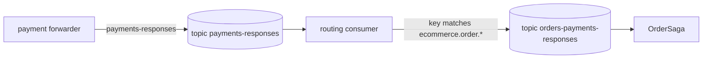

# Real message brokers, event stores and observability for the e-commerce sample

Revision: 23

## Problem Statement

The e-commerce part of `samples/distributed-processes` runs only in memory. The message bus, the event store and the projections' `Database` are in-memory classes. The sample explains channels, queues, routing keys and the event store as outbox, but a reader cannot see them work on real infrastructure. `KurrentDBEventStore` exists but is not wired. Step 8 of the saga-and-outbox plan ("Real infrastructure") is still to do.

The event-driven architecture workshop already runs a saga on Kafka and on RabbitMQ, with retries, dead letters, message versioning, and traces and metrics in Grafana LGTM. That code lives in the workshop's tests, in two copies, one per broker. A review of it found four unsafe settings (see `broker-setup-review/findings.md`).

The goal: the sample runs the same purchase on real infrastructure, chosen by config, and shows the whole purchase as one trace in Grafana. The code builds on the workshop, with the review's fixes. The workshop stays as it is.

## Solution

### Three switches

The application has three independent choices. Config selects each one:

| Choice | Implementations | Default for `bootRun` |
|---|---|---|
| Message bus | in-memory, Kafka, RabbitMQ | Kafka |
| Event store | in-memory, KurrentDB, PostgreSQL | KurrentDB |
| Projections database | H2, PostgreSQL (both through JPA) | PostgreSQL |

The in-memory implementations stay. One setting switches all three choices to in memory and needs no Docker.

### Running the application

`./gradlew bootRun` starts the sample's Docker Compose services through Spring Boot's Docker Compose support: Kafka, KurrentDB, PostgreSQL and Grafana LGTM. If they already run, it uses them. RabbitMQ starts only when the bus is set to RabbitMQ. The application connects to them and runs the purchase on Kafka, KurrentDB and PostgreSQL. Grafana then shows the purchase: its trace in Tempo, its logs in Loki, its metrics in Prometheus, and a dashboard for the purchase flow.

### The bus on a broker

The modules don't change. They still call `routes`, `bind`, `subscribe` and `publish` on one `MessageBus`. The broker carries every channel, the `<module>-internal` channels included.

- **RabbitMQ:** a channel is a durable topic exchange. A queue is a durable quorum queue. `bind` is a binding with the same pattern. RabbitMQ matches `*` and `#` itself.
- **Kafka:** a channel is a topic. A queue that is bound with `#` is a consumer group named after the queue, which reads the channel's topic. Kafka has no pattern binding, so a queue bound with a narrower pattern gets its own topic. A routing consumer reads the channel, matches each key against the queue's pattern, and writes the matching messages to the queue's topic. For example, it reads `payments-responses`, matches `ecommerce.order.*`, and writes to `orders-payments-responses`.

### Failure handling and versioning

The brokers get the workshop's failure handling: a failed handler is retried with back-off, and a message that still fails, or can't be read, goes to the dead-letter destination of its queue. The `messaging.dead_lettered` counter counts it. The brokers also get the workshop's message versioning: each message type has a stable name, and old versions are transformed to the current one when they are read. The in-memory bus keeps its behaviour: a failing handler fails the publish, and the event store delivers the event again.

### One trace for the whole purchase

One trace represents the whole purchase, with one span per step. Each message and each stored event carries five values:

- `messageId`: the ID of this message. For a stored event, it is the event's ID. A message that a handler publishes gets an ID derived from the handled message, so a redelivered copy keeps the same ID.
- `correlationId`: groups the whole flow, as in Emmett. A step that starts with nothing to inherit, such as the checkout, generates it. Every message and event that follows inherits it.
- `causationId`: the `messageId` of the message whose handler caused this one, the business parent step. A step with no cause uses its own `correlationId`, as in Emmett.
- `traceId` and `spanId`: the trace context.

The values travel in the broker's message headers and in the event metadata. A subscriber of the event store continues the trace from the event. A handler that reacts after a wait, such as the payment provider's webhook or the fulfillment service's answer, continues the trace stored with the events of the payment or the shipment that it changes. So Tempo shows one trace for the whole purchase, also across the waits.

The code uses the plain names above. `KurrentDBEventStore` maps them to KurrentDB's names when it writes the metadata and back when it reads it: `$correlationId`, `$causationId`, `$traceId`, `$spanId`. KurrentDB's `$by_correlation_id` projection and the client's subscription tracing then work. The event ID is KurrentDB's own event ID.

### Projections on JPA

The projections use JPA the idiomatic way: each view is a JPA entity with a Spring Data JPA repository, and views query through repository methods. It runs on PostgreSQL by default and on H2 when config selects in memory.

### Tests

The business tests run once, in memory. `ECommerceTests` keeps its scenarios and runs on H2 through JPA, and the API tests run with the in-memory setting. Each implementation of a seam passes one shared set of tests against its real server. A few application tests run one purchase on each broker and check the trace. One test checks that Grafana LGTM receives the trace, the logs and the metrics, and loads the dashboard. Tests use the Docker Compose services when they run, and Testcontainers when they don't.

## Acceptance criteria

### Choosing the setup

1. A developer runs the application with no config, so that they see the purchase on real infrastructure.
   1.1. GIVEN Docker runs AND the sample's Docker Compose services don't run WHEN the developer runs `./gradlew bootRun` THEN Spring Boot starts Kafka, KurrentDB, PostgreSQL and Grafana LGTM AND doesn't start RabbitMQ AND the application uses Kafka, KurrentDB and PostgreSQL.
   1.2. GIVEN the sample's Docker Compose services already run WHEN the developer runs `./gradlew bootRun` THEN the application uses the running services AND starts no second copy.
2. A developer selects the in-memory setting, so that they can run the sample without Docker.
   2.1. GIVEN Docker doesn't run WHEN the developer runs `./gradlew bootRun` with the in-memory setting THEN the application starts AND uses the in-memory bus, the in-memory event store and H2 AND starts no Docker Compose service.
3. A developer selects RabbitMQ as the bus, so that they see the same purchase on the other broker.
   3.1. GIVEN Docker runs WHEN the developer starts the application with the bus set to RabbitMQ THEN Spring Boot also starts RabbitMQ AND the customer can buy, pay and receive the order as with Kafka.
4. A developer selects PostgreSQL as the event store, so that they see the same purchase on the other store.
   4.1. GIVEN the Docker Compose services run WHEN the developer starts the application with the event store set to PostgreSQL THEN the customer can buy, pay and receive the order as with KurrentDB.
5. A developer sets an unknown value for a switch, so that a typo is found at once.
   5.1. GIVEN `messaging.bus`, `eventstore.type` or `projections.database` is set to a value outside its allowed values (for example `messaging.bus=kafak`) WHEN the application starts THEN the start fails with an error that names the setting and its allowed values, for each of the three settings.

### The bus on a broker

6. A module publishes a command to a channel, so that the queue bound to the channel handles it.
   6.1. GIVEN a queue bound to `payments-requests` with `#` AND a subscriber for `AuthorizePayment` WHEN the saga publishes `AuthorizePayment` THEN the subscriber handles it once, on each broker.
7. A module publishes a response with a routing key, so that only the requester whose pattern matches gets it.
   7.1. GIVEN `orders-payments-responses` bound to `payments-responses` with `ecommerce.order.*` AND another queue bound with `ecommerce.invoice.*` WHEN payments publishes `PaymentAuthorized` with the key `ecommerce.order.42-1` THEN only `orders-payments-responses` gets it, on each broker.
8. A module publishes a message of a type that the queue has no subscriber for, so that nothing breaks.
   8.1. GIVEN a queue bound to a channel AND no subscriber for `PaymentFailed` in that queue WHEN `PaymentFailed` reaches the queue THEN no handler runs AND the next message in the queue is handled.
9. A forwarder publishes an external event that no queue is bound to, so that the forwarder doesn't stop.
   9.1. GIVEN no queue is bound to `shopping_carts-external` WHEN the cart forwarder publishes `ShoppingCartCheckedOut` THEN the publish succeeds AND the forwarder's next event is published.
   9.2. GIVEN RabbitMQ AND no queue is bound to `payments-requests` WHEN the saga publishes `AuthorizePayment` THEN the publish fails, because `requests` channels publish with `mandatory`.
10. A module publishes to a channel that no route or topology declares, so that a wrong channel name is found at once.
    10.1. GIVEN Kafka with automatic topic creation switched off WHEN a message is published to a channel that is not declared THEN the publish fails AND no topic is created.
11. The broker is not reachable, so that the outbox keeps the message.
    11.1. GIVEN the broker is down WHEN a forwarder publishes an external event THEN the publish fails within the publish timeout AND the forwarder's checkpoint in the projections database doesn't move AND the event is published again after the broker is back.
12. A new queue joins a channel that already has messages, so that it doesn't skip them.
    12.1. GIVEN messages already in a Kafka channel topic AND a new consumer group for a queue WHEN the queue's consumer starts THEN it reads the channel from the earliest offset.
13. The application restarts, so that the queues keep their bindings and messages.
    13.1. GIVEN messages waiting in a RabbitMQ queue WHEN the application restarts THEN the exchanges, queues and bindings still exist AND the waiting messages are handled.
    13.2. GIVEN the RabbitMQ connection is lost after the start WHEN it comes back THEN the bindings made by `bind` exist again.
14. The Kafka routing consumer forwards a response, so that the requester gets it with all its data.
    14.1. GIVEN a response on `payments-responses` with a key, a type, a trace and the five metadata values WHEN the routing consumer writes it to `orders-payments-responses` THEN the copy has the same key, type, headers and body.
    14.2. GIVEN the routing consumer fails after it reads a response and before it writes it WHEN it restarts THEN it writes the response, because it commits the offset only after the write.
15. Every message type has an explicit route with a channel and a key, so that no message is dropped and Kafka keeps one entity's messages in order.
    15.1. GIVEN two messages about the same payment WHEN they are published to a Kafka channel THEN both have the payment's routing key as the record key AND reach the same partition.
    15.2. GIVEN the routes of the four modules WHEN each message type that the modules publish through the bus is routed THEN it gets a channel AND a routing key.
    15.3. GIVEN a message type with no route WHEN it is published THEN the publish fails with an error that names the message type, on in-memory, Kafka and RabbitMQ.

### Failure handling

16. A handler fails once, so that the message is handled on a later attempt.
    16.1. GIVEN a handler that fails on the first attempt and succeeds on the second WHEN its queue gets a message THEN the handler succeeds on the second attempt AND nothing goes to a dead-letter destination, on each broker.
17. A handler fails on every attempt, so that the message is kept for a person to look at.
    17.1. GIVEN a handler that always fails WHEN its queue gets a message THEN the message goes to the dead-letter destination of that queue after the last retry AND `messaging.dead_lettered` increases by one AND the other queues on the same channel don't get a copy.
    17.2. GIVEN a handler that always fails on Kafka WHEN the message goes to the dead-letter topic THEN the dead-letter publish has a span in the message's trace.
18. A queue gets a message it can't read, so that the queue doesn't block.
    18.1. GIVEN a message whose body is not valid JSON WHEN it reaches the queue THEN it goes to the queue's dead-letter destination without retries AND the next message is handled.
19. A queue gets a message whose type name is unknown or outside the sample's package, so that no unexpected class is created.
    19.1. GIVEN a message whose type header names a class outside the sample's package WHEN it reaches the queue THEN no instance of that class is created AND the message goes to the dead-letter destination.
20. RabbitMQ can't take a dead letter, so that it is not lost.
    20.1. GIVEN a quorum queue with at-least-once dead-lettering AND the dead-letter queue can't take the message WHEN a message is dead-lettered THEN it stays in the source queue until the dead-letter queue confirms it.
21. A publisher is blocked by a RabbitMQ resource alarm, so that consumers keep working.
    21.1. GIVEN publishing is blocked WHEN a queue has messages THEN its consumers still receive them, because publishers use their own connection.

### Message versioning

22. A consumer reads a message under its stable name, so that renaming a Java class doesn't break the contract.
    22.1. GIVEN a message published with its stable type name WHEN the consumer reads it THEN the consumer maps the name to the current class.
23. A consumer reads an old version of a message, so that a producer can evolve the message.
    23.1. GIVEN a message published in an old version AND a transformation registered for it WHEN the consumer reads it THEN the handler gets the current version.

### Event stores

24. A module appends events and reads them back, so that each store behaves the same.
    24.1. GIVEN an empty stream WHEN events are appended and the stream is read THEN the events come back in order, on in-memory, KurrentDB and PostgreSQL.
25. Two writers append with the same expected revision, so that only one wins.
    25.1. GIVEN a stream at revision 2 WHEN one writer appends with expected revision 2 AND another with expected revision 2 THEN one append succeeds AND the other returns a conflict AND appends nothing, on each store.
26. A subscriber fails on an event, so that it gets the event again.
    26.1. GIVEN a subscriber that fails on an event WHEN the next append happens THEN the store delivers the same event to it again before newer events, on each store.
    26.2. GIVEN a subscriber that fails on an event WHEN the application restarts THEN the subscription gets that event again, on KurrentDB and PostgreSQL.
27. A subscriber is added after events exist, so that it catches up.
    27.1. GIVEN events in the store WHEN a subscriber is added THEN it gets the existing events from the start of the log, on each store.
    27.2. GIVEN two PostgreSQL transactions that append, where the one with the lower `global_position` commits last WHEN the subscriber polls THEN it gets both events, the one that committed last included.
    27.3. GIVEN a subscription that handled events WHEN the application restarts THEN it continues after the last event it handled AND doesn't publish the earlier ones again, on KurrentDB and PostgreSQL.
    27.4. GIVEN a projection that fails to store its checkpoint WHEN the transaction ends THEN its document change is rolled back too.
    27.5. GIVEN a stored checkpoint already past a batch WHEN the same batch is handled again THEN the checkpoint doesn't change AND the batch's changes are rolled back.
28. A module appends an event inside a traced step, so that the metadata is stored with the event.
    28.1. GIVEN a current span AND a `correlationId` and a `causationId` WHEN an event is appended THEN reading it back gives the same `messageId`, `correlationId`, `causationId`, `traceId` and `spanId`, on each store.
    28.2. GIVEN an event appended to KurrentDB WHEN its raw metadata is read with the KurrentDB client THEN it has `$correlationId`, `$causationId`, `$traceId` and `$spanId`.

### Projections

29. A projection stores and changes a document, so that the view works on JPA.
    29.1. GIVEN no document WHEN the first event arrives THEN the document is stored at the event's stream position, on PostgreSQL and on H2.
    29.2. GIVEN a stored document WHEN an event that the document already applied is delivered again THEN the document doesn't change, on PostgreSQL and on H2.
    29.3. GIVEN a stored document WHEN `evolve` returns no document THEN the document is deleted, on PostgreSQL and on H2.
    29.4. GIVEN documents of one view WHEN the view queries them through its repository THEN it gets only the matching documents, on PostgreSQL and on H2.

### Metadata and the trace

30. A customer checks out, so that the purchase starts one trace.
    30.1. GIVEN a cart with products WHEN the customer checks out THEN `CheckOutShoppingCart` starts the trace AND every message and event that follows carries the same `correlationId`.
31. A handler publishes the next message, so that the business parent step is known.
    31.1. GIVEN the saga handles `ShoppingCartCheckedOut` with `messageId` X WHEN it publishes `PlaceOrder` THEN `PlaceOrder` has `causationId` X AND the same `correlationId` AND the same `traceId`.
32. A subscriber of the event store publishes, so that the trace crosses the store.
    32.1. GIVEN an event stored inside a span WHEN the forwarder publishes the external event for it THEN the publish span is in the same trace AND the external event's `causationId` is the stored event's `messageId`.
33. A step after a wait starts outside the purchase, from the payment provider's webhook, so that the trace continues.
    33.1. GIVEN a purchase waiting for the customer to pay WHEN `ConfirmPaymentAuthorization` arrives with no trace context THEN the step that handles it is in the purchase's trace AND has the purchase's `correlationId`.
34. The fulfillment service answers after a wait, so that the trace continues.
    34.1. GIVEN a shipment waiting for the warehouse WHEN `ConfirmPackageSent` arrives with no trace context THEN the step that handles it is in the purchase's trace AND has the purchase's `correlationId`.
35. An event is delivered twice, so that its copies are the same message.
    35.1. GIVEN an event delivered again after a failure WHEN the forwarder publishes it again THEN both copies have the same `messageId`.
    35.2. GIVEN the saga handles `OrderPlaced` AND publishes `AuthorizePayment` and `ReserveStock` WHEN `OrderPlaced` is delivered again THEN the saga publishes them again with the same two `messageId` values AND the two values differ from each other.
36. A developer runs one purchase on Kafka, so that the whole flow is proven on the broker.
    36.1. GIVEN Kafka, KurrentDB and PostgreSQL WHEN a customer checks out, pays and the package is sent THEN the order completes AND the step spans from the checkout to "Pay now" form one trace with one `correlationId`, AND the step spans from "Pay now" to the package sent form a second trace with a second `correlationId`, AND each step has the `messageId` of its parent as `causationId`.
37. A developer runs one purchase on RabbitMQ, so that the other broker is proven too.
    37.1. GIVEN RabbitMQ, PostgreSQL as the event store and PostgreSQL for projections WHEN a customer checks out, pays and the package is sent THEN the order completes AND the finished spans form one trace with the same rules as 36.1.

### Grafana

38. A developer opens Grafana after a purchase, so that they see the whole purchase.
    38.1. GIVEN a completed purchase WHEN the developer searches Tempo by the `correlationId` of the purchase's first flow (checkout to "Pay now") THEN Tempo shows that flow's trace with one span per step, AND each KurrentDB append as a `streams.append` span inside its step.
39. A developer follows a span to its logs, so that they see why a step failed.
    39.1. GIVEN a span of a failed handler WHEN the developer opens its logs THEN Loki shows the log lines with that span's `traceId`.
40. A developer opens the dashboard, so that they see the purchase flow at a glance.
        40.1. GIVEN Grafana LGTM started from the sample's Docker Compose WHEN the developer opens the dashboard THEN it shows messages published, handled and failed per channel, dead letters and HTTP requests AND each panel links to the traces.
41. A test checks the export, so that a broken export is found in the build.
        41.1. GIVEN Grafana LGTM in Testcontainers WHEN a purchase runs THEN Tempo has its trace AND Loki has its logs AND Prometheus has the bus's listener and template timers and `http_server_requests` AND Grafana has loaded the dashboard.
42. Grafana LGTM doesn't run, so that the application and the tests still work.
    42.1. GIVEN no OTLP endpoint WHEN the application runs or the tests run THEN they pass AND the exporters log no connection errors.

### Documentation and CI

43. A reader opens the AsyncAPI document, so that they see where the channels live.
    43.1. GIVEN the application runs WHEN the reader opens Springwolf UI THEN the document lists the servers of Kafka and RabbitMQ next to the in-memory server.
44. A reader follows the HOWTO, so that they can run the sample on each setup.
    44.1. GIVEN the HOWTO WHEN the reader follows it THEN it explains the default Docker Compose start, the three switches, the in-memory setting and where to look in Grafana.
45. CI runs the folder's workflow, so that every implementation is proven.
    45.1. GIVEN no Docker Compose services in CI WHEN `./gradlew build` and `./gradlew eventCatalogTest` run THEN the shared tests start their servers with Testcontainers AND pass AND the generated AsyncAPI documents and the catalog match the code.

## Implementation Decisions

### Switches and composition

- Three settings choose the implementations: `messaging.bus` (`in-memory`, `kafka`, `rabbitmq`), `eventstore.type` (`in-memory`, `kurrentdb`, `postgresql`) and `projections.database` (`h2`, `postgresql`). The defaults are Kafka, KurrentDB and PostgreSQL (Q3, Q11, Q25).
- One Spring profile, `in-memory`, sets all three to in memory and switches off Docker Compose (Q11).
- Every test, and the `generateOpenApiDocs` run that `eventCatalogTest` uses, runs with the `in-memory` profile, unless it tests a broker or a store. The broker and store tests and the three end-to-end tests (criteria 36, 37, 41) run on real infrastructure (Q25).
- `ECommerceApplicationConfig` creates the `MessageBus` and the `EventStore` from the settings. Spring Boot creates the data source and the repositories. `ECommerceConfig.configure` and the modules' `Config` classes get the views' repositories in place of `Database`.
- Spring Boot's Docker Compose support starts the sample's `docker-compose.yml` on `bootRun` (Q11): Kafka, KurrentDB, PostgreSQL and Grafana LGTM. The application sets `spring.docker.compose.profiles.active=sample,${messaging.bus}`: Kafka and Grafana LGTM join the existing `sample` Compose profile with KurrentDB and PostgreSQL, and RabbitMQ is in a `rabbitmq` profile, so it starts only when the bus is set to RabbitMQ. Docker Compose support is skipped in tests, as Spring Boot does by default.

### Docker Compose

- The sample's `docker-compose.yml` gets Kafka, RabbitMQ and Grafana LGTM, with the images and settings of the workshop's Docker Compose (Kafka `confluentinc/confluent-local:8.4.1`, RabbitMQ `rabbitmq:4.4.0-management`, `grafana/otel-lgtm:0.41.0` with the workshop's Tempo config). Kafka gets automatic topic creation switched off (review U3). KurrentDB and PostgreSQL stay.
- Grafana LGTM gets the provisioned dashboard (Q13).

### The bus on RabbitMQ

- A channel is a durable topic exchange. A queue is a durable quorum queue with at-least-once dead-lettering and reject-publish overflow, and the default delivery limit (review U4). `bind` declares a binding with the same pattern.
- Bindings made at runtime survive a lost connection, because the bus's `RabbitAdmin` redeclares manual declarations after a reconnect (`setRedeclareManualDeclarations(true)`, review, mapping section; Q25, changed in step 10).
- One listener container per queue dispatches by the message's type to the queue's subscribers.
- Publishing waits for the publisher confirm, with the workshop's publish timeout. `mandatory` applies to `requests` and `internal` channels, and not to `external` and `responses` channels (review N6; criterion 9).
- Publishers use their own connection (review N7).
- Each queue has its own dead-letter queue, through a direct dead-letter exchange and the queue's name as the dead-letter routing key (review N5).

### The bus on Kafka

- Each channel is a topic. Each queue bound with a narrower pattern than `#` gets its own topic, named after the queue. The application declares every topic at start, with 3 partitions and 1 replica, as the workshop does. Its dead-letter topic is declared too.
- A queue bound with `#` is a consumer group named after the queue that reads the channel topic.
- The routing consumer reads each channel that has queues with a narrower pattern, matches the key against each queue's pattern with the same rules as `InMemoryMessageBus`, and writes the match to the queue's topic. It keeps the record key, all headers and the body. It sends synchronously and commits the offset only after the send (plan step 8; review, mapping section).
- The Kafka record key is the route's routing key. Every message type that the modules publish has an explicit route with a key: the routing key of the entity ID it carries, made with `Urns.routingKeyOf`, for example `.routeKey(CapturePayment.class, command -> Urns.routingKeyOf(command.paymentId().value()))`, and the `referenceId` for `ReserveStock`. The routing consumer matches the same key against the queue patterns, so the record key and the routing key are one value. Messages carry no key: no marker interface, no annotation, no reflection. The Kafka bus doesn't use `MessageRouter.firstRecordComponent` (review N4; Q17, Q27).
- A message with no route fails the publish with an error that names its type, on all three buses. `InMemoryMessageBus.publish` stops skipping it (Q20).
- `MessageBus` gets `channel(name)`. Each module declares the channels it publishes to with it, next to its routes. The brokers declare a topic or an exchange for each declared channel, also when no queue is bound to it. A publish to a channel that is not declared fails, on all three buses (criterion 10; Q25).
- Consumers start from `earliest` (review U1). Offsets are committed by the listener container after the handler, as Spring Kafka does by default.
- Producer settings keep the Kafka defaults (`acks=all`, idempotence). The delivery timeout and the max block time fit inside the bus's publish timeout (review N1).
- Each queue has its own dead-letter topic, `<queue>-dlt` (review N5). The dead-letter template is a Spring bean with the observation registry (review N2).

### Failure handling

- The brokers use the workshop's `MessageFailureStrategy` and `RetryBackOff`: retry with back-off for a failing handler, no retry for a message that can't be read, then the queue's dead-letter destination. The `messaging.dead_lettered` counter counts each dead letter (Q12).
- The in-memory bus keeps its behaviour: a failing handler fails the publish.

### Message versioning

- One broker-neutral versioning package, from the workshop's `MessageMappingRegistry`, `MessageMapping`, `MessageTransformations` and `MessageTransformer`, with a thin converter per broker (Q12, review N8).
- Every message type that crosses the bus has a stable type name in the mapping. Only classes in the sample's package are trusted (review U2). The workshop's `eventType` header fallback is not copied (review N8).

### Metadata and propagation

- `EventMetadata` gets `messageId`, `correlationId`, `causationId`, `traceId` and `spanId`, next to `streamId`, `streamPosition` and `logPosition` (Q7, Q10).
- `messageId` of a stored event is the event's ID in the store. A message that a handler publishes, a forwarder included, gets a name-based UUID made from the handled message's `messageId`, the published message's type and its position in the published list. A redelivery then publishes the same IDs, and two messages caused by one event get different IDs. A message with no handled message, such as an HTTP command or a worker's command, gets a random UUID (review N3; Q25).
- The IDs resolve as in Emmett's Almanac: `correlationId` comes from the handled message or the restored context, and a step with nothing to inherit generates one. `causationId` is the `messageId` of the handled message, and a step with no cause uses its own `correlationId`. There is no `conversationId` (Q26, Q27).
- A worker or a webhook that publishes outside a purchase generates a new `correlationId` for its message. The handler then restores the purchase's context by the rule below, so the events it appends carry the purchase's `correlationId` (Q7, Q27).
- One span per handler call is a step. The bus's consumer and the store's subscription open it around the handler, named after the message type, for example `handle AuthorizePayment`. Criteria 36.1 and 38.1 check these step spans (Q25).
- The broker headers carry the five values. `correlationId` and `causationId` travel as Micrometer baggage, as in the workshop (`remote-fields`, `tag-fields`, `correlation.fields`), so they are tags on every span.
- On append, each store writes the five values from the current context into the event's metadata. On delivery, each store's subscription continues the trace from the event and sets the baggage before the handler runs.
- A handler that handles a command with no trace context from the purchase (a webhook command, an answer from the fulfillment service) continues the trace from the last event of the stream it changes: its span's parent is that event's `traceId` and `spanId`, and the new events take that event's `correlationId` (Q7).
- "Pay now" (`CreateCheckoutSession`) and "Retry payment" (`RetryOrderPayment`) are plain facade calls on the HTTP request, with no step span of their own. They have nothing to inherit, so they start a new flow with a new `correlationId` and trace, as the Emmett rules say (Q27, Q33). The business flow doesn't depend on it.
- `KurrentDBEventStore` maps the plain names to `$correlationId`, `$causationId`, `$traceId` and `$spanId` and back (Q10). The KurrentDB client overwrites `$traceId` and `$spanId` on a sampled append with the current span's IDs; the trace ID stays the same (trace-propagation findings 2.3).
- The application doesn't register Spring Boot's `OpenTelemetry` as the global one: the KurrentDB Java client 1.2.1 builds its append span on its own thread with no parent, so it would start a new trace and overwrite the stored `$traceId` and `$spanId` (`kurrentdb-client-spans/findings.md`). Instead, `KurrentDBEventStore.append` wraps `appendToStream` in a Micrometer `Observation` named `streams.append` (`db.system=kurrentdb`, the stream name), so each write shows inside its step's trace (Q34).
- Tracing samples every trace (`management.tracing.sampling.probability=1.0`), as in the workshop. The KurrentDB client writes trace keys only for sampled spans (trace-propagation findings 2.6).

### Event stores

- `KurrentDBEventStore` is wired and passes the shared event store tests.
- A PostgreSQL event store is copied from the build-your-own-event-store workshop's `PostgreSQLEventStore` (events table with `stream_position`, `global_position` and a JSONB `metadata` column) and implements the sample's `EventStore`, `subscribe` included (Q3). It takes a `DataSource` connection pool, not one shared `Connection`. Its connection settings are separate from the projections' data source, so it also runs with projections on H2 (Q25).
- The PostgreSQL store delivers events by polling, as Emmett does: each event row also stores its transaction ID (`pg_current_xact_id()`), and the poller reads only rows from transactions older than `pg_snapshot_xmin(pg_current_snapshot())`, ordered by transaction ID and then `global_position`, and continues after the last transaction ID and position it handled. So it never passes a transaction that has not committed yet (Q21).
- Checkpoints work as in Emmett: they live where the side effects live, in the projections database, whichever event store runs (Q22). A JPA entity and a Spring Data repository map Emmett's `processor_checkpoints` table: `processor_id` (the subscription name), `last_processed_position`, and `last_processed_transaction_id` for the PostgreSQL store.
- A projection stores its document change and its checkpoint in one transaction, so a projection handles each event once. A forwarder or the saga publishes to the broker and then stores the checkpoint, so a crash between the two publishes the message again, which the idempotent handlers absorb.
- When the stored checkpoint is already at or past the new position, the event was handled, so the update is skipped and its transaction rolls back. For the PostgreSQL store, the check compares the transaction ID first and then the position, because positions can go down in transaction ID order. On start, a subscription continues after its checkpoint. Emmett's other result codes and its detection of a competing instance are not copied (Q22, Q25).
- A checkpoint needs a stable name, so there is one subscription per subscriber object (each projection, each forwarder, the saga, each client), with one name. `EventStore.subscribe` takes the name and the event types, for example `subscribe("payments-external-forwarder", List.of(PaymentAuthorized.class, PaymentCaptured.class), forwarder::handle)`. The modules group their `subscribe` calls per subscriber (Q22, Q25).
- With H2 as the projections database and KurrentDB or PostgreSQL as the event store, the checkpoints are gone after a restart, so the subscriptions replay from the start. The idempotent handlers make that safe. It is a known limit of that combination (Q25).
- A subscription whose handler fails stops and resubscribes from its checkpoint after the workshop's `RetryBackOff` (Q25).
- The in-memory store keeps no checkpoint and starts from the beginning, because its events are gone after a restart and a stored checkpoint would skip the new ones (Q22).
- The in-memory store keeps its behaviour and stores the five metadata values. The in-memory bus carries the five values too, so all buses behave the same (Q25).
- `EventStore.read` returns each event's metadata with it, on all three stores, so a handler continues the trace without a second read (Q25).

### Projections

- Each view's document is a JPA `@Entity` with its ID and a `version` column that holds the stream position (a plain column, not JPA's `@Version`), and each view has a Spring Data `JpaRepository` (Q4, Q18). The ten documents are already classes, so each one gets JPA annotations.
- `Projection` works on the view's repository: `findById`, `save` and `deleteById` replace `Database.get`, `store` and `delete`. `find(Predicate)` goes; each view declares the query methods it needs on its repository (Q18).
- `core/projections/Database` goes (Q4, Q18).
- JPA runs on PostgreSQL by default and on H2 when config selects in memory (Q4).
- The JPA, data source and repository auto-configuration exclusions in the application properties go.

### Observability

- Traces, metrics and logs go to Grafana LGTM over OTLP (Q13).
- Log4j2 sends logs over OTLP through OpenTelemetry's Log4j2 appender. Each log line carries the `traceId` and the `spanId` (Q13).
- The provisioned dashboard uses only metrics that exist: the bus's Spring Kafka or Spring AMQP listener and template timers, with their error tag, for messages published, handled and failed per channel; `messaging.dead_lettered` for dead letters; `http.server.requests` for HTTP requests. Each panel links to the traces. There is no retries panel and no business metric (Q13, Q25).
- If Grafana LGTM doesn't run, the exporters' connection errors are switched off in the logs, as in the workshop.

### AsyncAPI and documentation

- Springwolf documents the servers of Kafka and RabbitMQ next to the in-memory server (Q14). The channels don't change.
- The README and HOWTO describe the switches, the Docker Compose default, the in-memory setting and Grafana (Q14). The README's "What this sample doesn't cover" drops the item "The infrastructure is in memory". The README's Java blocks that show changed code are updated.
- Step 8 of `plans/saga-and-outbox/plan.md` links to this spec, and its open questions Q5 and Q7 are marked answered (Q14).

## Testing Decisions

- A good test describes one usage scenario from the caller's side and checks only what the caller can observe: messages handled, events read back, documents returned, spans finished, metrics counted. Test names describe the behaviour, not the method. No mocking library: fakes implement the real interface. Assertions use AssertJ. Each test uses new IDs.
- **Routes:** one test lists every message type that the four modules publish through the bus and checks that the modules' routes give each one a channel. The shared `MessageBus` test set checks that a publish without a route fails (criteria 15.2, 15.3; Q19, Q20).
- **`MessageBus`:** one shared test set, built from the broker-neutral tests of `InMemoryMessageBusTests`, runs for in-memory, Kafka and RabbitMQ (criteria 6-9, 15, 35). The tests that depend on synchronous delivery stay in `InMemoryMessageBusTests`: `deliversDepthFirstSoNestedPublishCompletesBeforeSubscriberReturns`, `runsMiddlewareForEveryMessageBeforeSubscribersInRegistrationOrder` and `deliversMessagesInTheOrderTheyWereGiven` (Q25). The brokers also run tests for retries, dead letters, unreadable and untrusted messages, the routing consumer, restarts and lost connections, built from the workshop's `KafkaErrorHandlingTest`, `RabbitMQErrorHandlingTest` and `KafkaPublishFailureTest` (criteria 10-14, 16-21). Versioning tests come from the workshop's `VersionedMessageConverterTest` (criteria 22-23). The rest of the workshop's solved checks are ported too: `KafkaMessageMetadataTest` and `RabbitMQMessageMetadataTest` (the five values in the broker headers), `KafkaMessageBaggageHandlerTest` and `RabbitMessageBaggageHandlerTest` (the handled `messageId` becomes the `causationId`), `RabbitMQPublishTest`, `MessageFailureStrategyTest` and `RetryBackOffTest` (Q8, Q28).
- **`EventStore`:** one shared test set, built from the broker-neutral tests of the 21 `InMemoryEventStoreTests`, runs for in-memory, KurrentDB and PostgreSQL, plus the metadata round trip (criteria 24-28). `runsMiddlewareForEveryEventBeforeItsSubscribers`, `appendFromInsideASubscriberIsDeliveredAfterTheEventBeingHandled` and `notifiesAllSubscribersOfTheTypeInRegistrationOrder` stay in `InMemoryEventStoreTests` (Q25). `KurrentDBEventStoreTests` folds into it.
- **Projections:** `ProjectionTests` and the view tests run on JPA with PostgreSQL and with H2 (criterion 29).
- **The application:** the existing API tests through `ApiSpecification` run with the `in-memory` profile. Two new purchase tests through `ApiSpecification` run on Kafka with KurrentDB and PostgreSQL, and on RabbitMQ with PostgreSQL for both store and projections. They check the order's outcome and read the spans from `InMemorySpanExporter`, as the workshop's `MessageMetadataPropagationTest` does (criteria 30-34, 36-37). Asynchronous results are awaited with Awaitility.
- **Grafana:** one test against Grafana LGTM in Testcontainers (`LgtmStackContainer`) runs one purchase and checks Tempo, Loki, Prometheus and the dashboard through their HTTP APIs (criteria 38-41).
- **`ECommerceTests`:** keeps its scenarios and runs with the `in-memory` profile, on H2 through JPA. `PaymentExternalEventForwarderTests` and `ShoppingCartExternalEventForwarderTests` get their repositories the same way (Q25). The view tests run on both databases, as the Projections line says.
- **Servers:** `TestDatabases` finds Kafka, RabbitMQ and PostgreSQL from the `eventsourcing` Docker Compose project, as it does for KurrentDB, and starts one shared Testcontainers container per server for the test run when they don't run.
- **Settings:** a test checks that an unknown switch value fails the start (criterion 5).
- **Starting the setup (criteria 1-4):** no new test. Criterion 2.1 is covered by the API tests with the `in-memory` profile, 3.1 by the RabbitMQ purchase test (37.1), and 4.1 by the same test, which runs on the PostgreSQL event store. The Docker Compose start (1.1, 1.2) has no automated test (Q28).

## Out of Scope

- Changes to the workshops. The event-driven architecture workshop stays as it is, including the four unsafe findings of the review (Q2, Q14).
- Contract tests with event versioning, with the tool Oskar called "strictland" (follow-up, Q5).
- Running every combination of the switches in the business tests (Q5).
- Production settings: replication, security, TLS, credentials.
- Linking the flow that "Pay now" or "Retry payment" starts to the purchase's first flow (follow-up, Q33).

## Further Notes

- Research: `broker-setup-review/findings.md` and `trace-propagation/findings.md` in this folder.
- Emmett's Almanac carries the same five values. Its `propagate` mode matches this design; its default is `links` (trace-propagation findings 4.4).
- The `EventStore` interface uses KurrentDB client types (`StreamState`, `Position`). The PostgreSQL store returns the same types.
