# Try the e-commerce sample

This guide takes you through one purchase in the sample shop, step by step. After it, you look at the same purchase from the inside: the web API in Swagger UI, the messages in Springwolf UI, and the whole system in EventCatalog. The [README](./README.md) explains what happens in each step and why.

- [Try the e-commerce sample](#try-the-e-commerce-sample)
  - [What you need](#what-you-need)
  - [1. Start the application](#1-start-the-application)
  - [2. Log in](#2-log-in)
  - [3. Add products to the cart](#3-add-products-to-the-cart)
  - [4. Check out](#4-check-out)
  - [5. Pay on the payment provider's page](#5-pay-on-the-payment-providers-page)
  - [6. See the completed order](#6-see-the-completed-order)
  - [7. Call the web API in Swagger UI](#7-call-the-web-api-in-swagger-ui)
  - [8. Read the messages in Springwolf UI](#8-read-the-messages-in-springwolf-ui)
  - [9. Make a payment fail](#9-make-a-payment-fail)
  - [10. Browse the catalog in EventCatalog](#10-browse-the-catalog-in-eventcatalog)
  - [11. Look at the purchase in Grafana](#11-look-at-the-purchase-in-grafana)
  - [12. Run the tests](#12-run-the-tests)

## What you need

- Java 22 or newer. The sample builds and tests with the JDK you start Gradle with. If that JDK is older than 22 (Gradle needs at least 17), Gradle uses an installed JDK 22 or downloads it.
- Docker. The application starts Kafka, KurrentDB, PostgreSQL and Grafana in it. The tests start their servers in it too. Without Docker you can still run the application with the `in-memory` profile (step 1).

You don't need Node.js. Gradle downloads it for the EventCatalog tasks.

Run all commands in this folder, `samples/e-commerce`.

## 1. Start the application

```shell
./gradlew bootRun
```

The application starts on port 8080. Spring Boot starts the sample's Docker Compose services first: Kafka, KurrentDB, PostgreSQL and Grafana LGTM. If they already run, it uses them. The first start pulls their images, which takes a few minutes. The application runs the shop's four modules (shopping carts, orders, payments and shipments), a payment provider and a warehouse. Kafka carries the messages between the modules, KurrentDB keeps their events, and PostgreSQL keeps the views of the events.

Three settings change that. Set them on the command line, for example `./gradlew bootRun --args='--messaging.bus=rabbitmq'`:

| Setting | Values | Default |
| --- | --- | --- |
| `messaging.bus` | `in-memory`, `kafka`, `rabbitmq` | `kafka` |
| `eventstore.type` | `in-memory`, `kurrentdb`, `postgresql` | `kurrentdb` |
| `projections.database` | `h2`, `postgresql` | `postgresql` |

With `messaging.bus=rabbitmq`, Spring Boot also starts RabbitMQ. If you ran an older version of the sample with RabbitMQ, remove its old queues once, because the queues now have dead-letter settings that the old ones lack: `docker compose --profile all down -v`, in this folder. This also removes the data of the other Compose services.

The PostgreSQL event store keeps its events in the tables `streams` and `messages`, and every event is stored under its Java class name (for example `io.eventdriven.ecommerce.orders.OrderEvent$OrderPlaced`). If your local PostgreSQL or KurrentDB volume holds an older version of the sample, which used the table `events` and short type names, reset both once with `docker compose --profile all down -v`, in this folder. This also removes the data of the other Compose services. A projections database belongs to one event store type, so do not point two event store types at the same projections database.

To run with no Docker and no database, use the `in-memory` profile. It sets all three settings to in memory and turns the Docker Compose support off. When you stop the application, its data is gone:

```shell
./gradlew bootRun --args='--spring.profiles.active=in-memory'
```

To stop the Docker Compose services, run `docker compose --profile all down` in this folder.

The payment provider and the warehouse are *sandboxes*: small stand-ins for the real services, built into the application. The sandbox payment provider shows a payment page like Stripe's and accepts Stripe's test card numbers. The sandbox warehouse sends every package at once. They let you go through a whole purchase without an account at a real provider.

## 2. Log in

Open <http://localhost:8080/shop>.

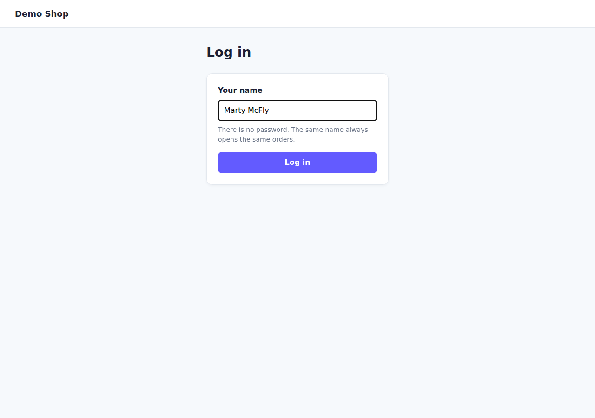

Type any name and click **Log in**. There is no password. The shop makes the customer id from the name, so the same name always gives you the same cart and the same orders. To start as a different customer, click **Log out** in the header and log in with another name.

## 3. Add products to the cart

The shop opens the **Products** page. The header has links to your **Products**, **Cart** and **Orders**, and to **Grafana**, where you can see what the shop did (step 11). It also shows your name.

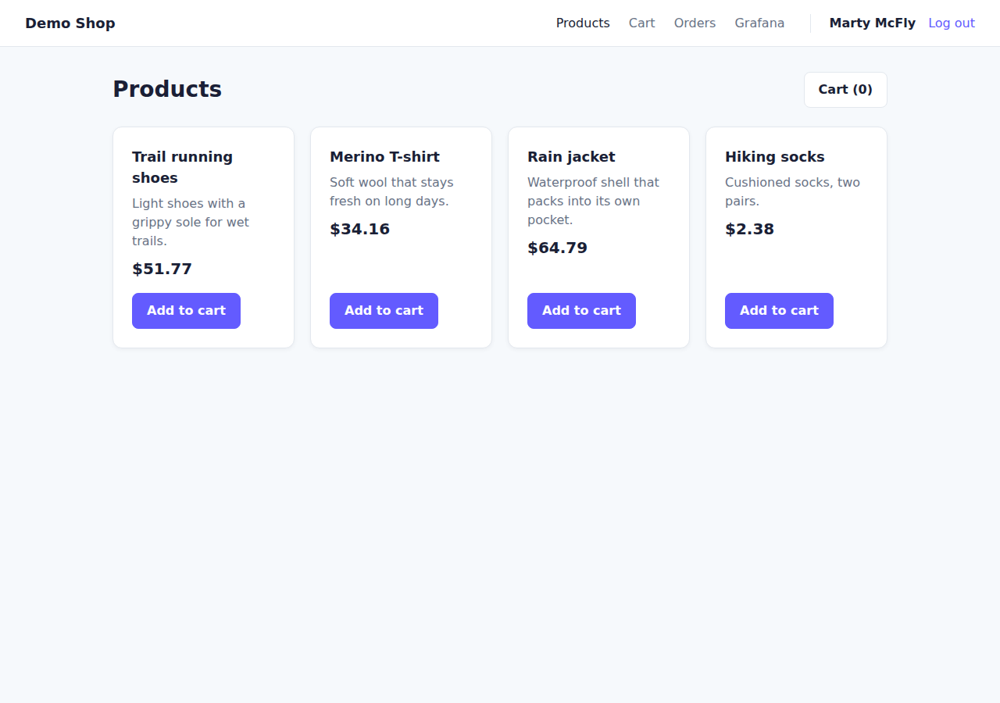

Click **Add to cart** on two products. After each click, the shop shows your cart. To add the second product, go back to **Products**.

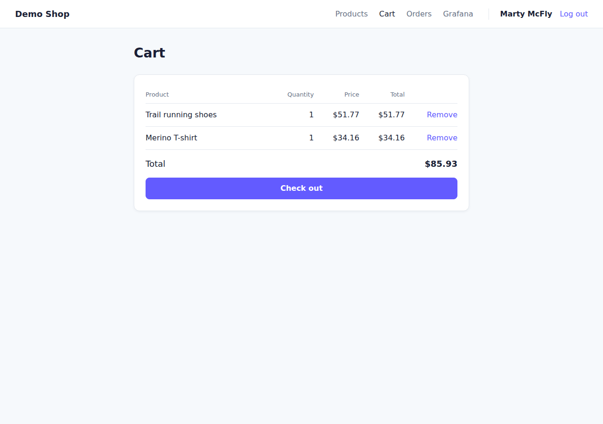

## 4. Check out

Click **Check out**. The shop opens the **Order status** page of your new order.

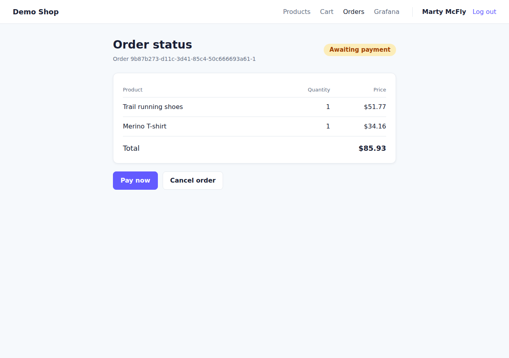

The order shows **Awaiting payment**. In the moment between the click and this page, the modules have exchanged messages:

1. The shopping carts module recorded that you checked out and told the orders module.
2. The orders module placed the order.
3. The orders module asked the payments module for a payment, and asked the shipments module to set aside your products in the warehouse.
4. The warehouse set the products aside and answered.

The payment can't go further without you. Only you can enter your card details.

## 5. Pay on the payment provider's page

Click **Pay now**. The shop sends you to the payment provider's page. This is the sandbox page.

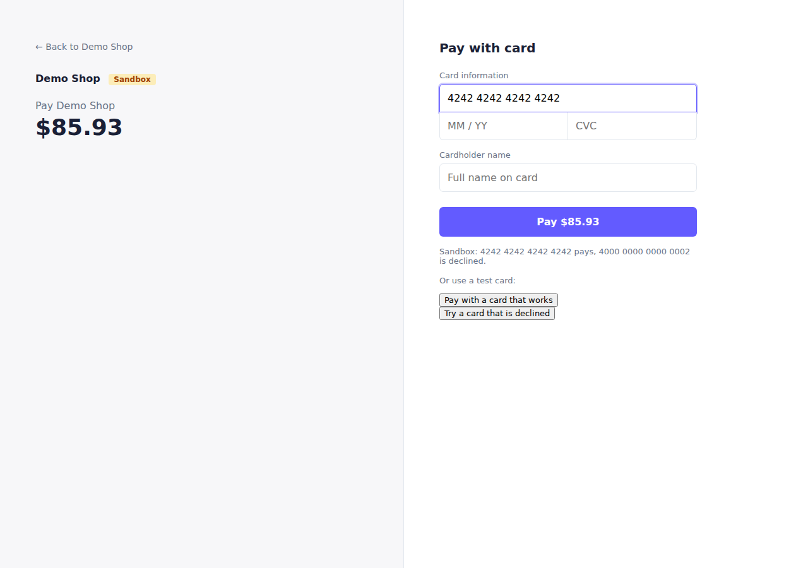

Type the card number `4242 4242 4242 4242` and click the **Pay** button, which shows the amount. You can leave the other fields empty. Or click **Pay with a card that works** under the form, which does the same in one click. **Try a card that is declined** uses `4000 0000 0000 0002`: the page says the card was declined and you can try again.

To see a declined card, use `4000 0000 0000 0002` instead. The page shows the decline and you can try again with another card, as on Stripe's page.

## 6. See the completed order

After the payment, the payment provider sends you back to the **Order status** page.

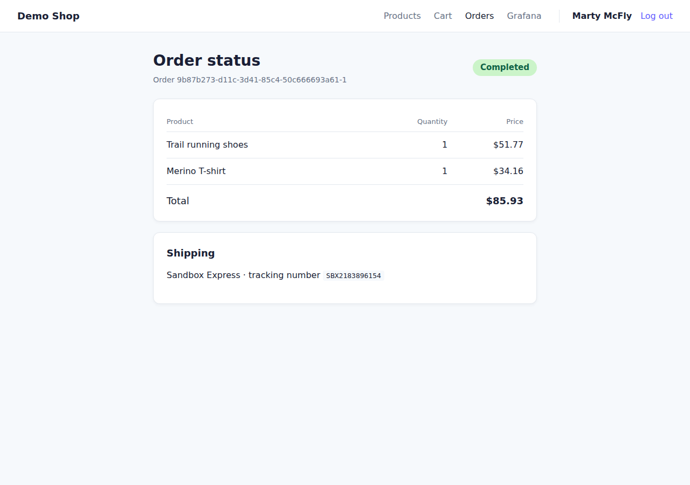

The order shows **Completed**, with the carrier and the tracking number. Again, the modules exchanged messages in the meantime:

1. The payment provider told the payments module that you authorized the payment. Authorized means that the provider keeps the amount for the shop, but doesn't charge you yet.
2. The payments module told the orders module. Because the products were already set aside, the order was confirmed.
3. The orders module asked the shipments module to send the products. The sandbox warehouse sent the package at once.
4. After the package left, the orders module asked the payments module to charge you. The payment provider confirmed the charge, and the order completed.

The **Orders** page lists all your orders.

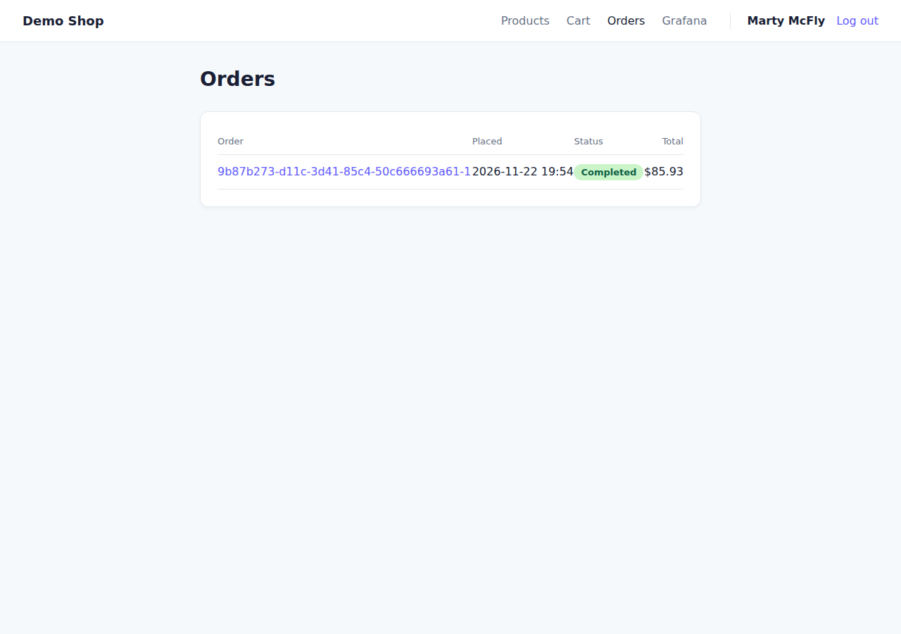

## 7. Call the web API in Swagger UI

The shop pages call the same code as the web API. Open Swagger UI at <http://localhost:8080/swagger-ui/index.html>.

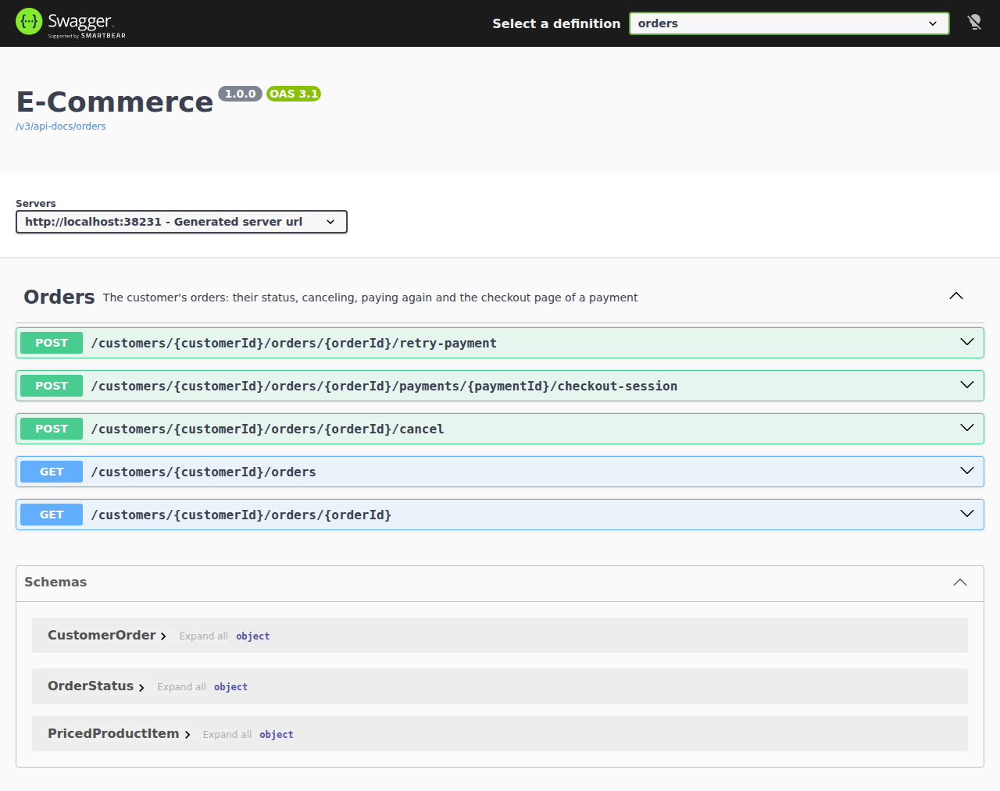

Each module with endpoints has its own OpenAPI document: a file that lists the module's endpoints, what they take and what they return. Choose it in **Select a definition**: `shopping_carts` or `orders`. To call an endpoint:

1. Open it and click **Try it out**.
2. For `customerId`, use your customer id. It is the part after `/customers/` in the address of any shop page.
3. Click **Execute**.

For example, `GET /customers/{customerId}/orders` returns the orders that you placed in the shop.

## 8. Read the messages in Springwolf UI

The modules talk through messages, which have no URLs to call. A module publishes its messages on named *channels*, such as `payments-internal`, and other modules receive them from there. An AsyncAPI document describes them: each channel, the messages on it, which module sends or receives them, and what each message means. Springwolf writes these documents from the code, and Springwolf UI shows them. [Documenting the messages](./README.md#documenting-the-messages) explains both. Open <http://localhost:8080/springwolf/asyncapi-ui.html>.

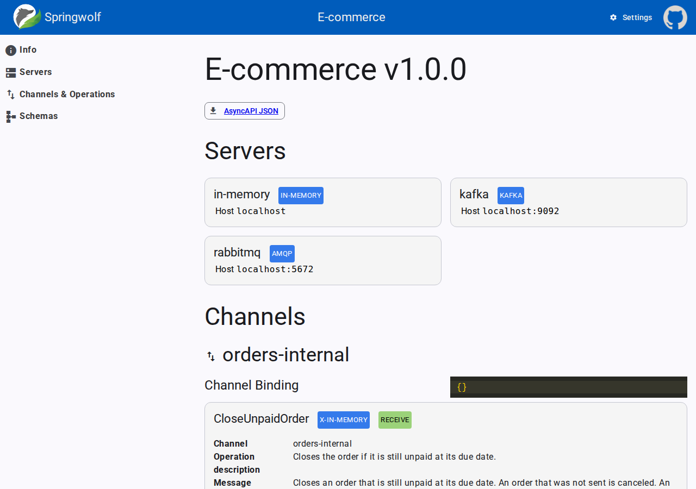

The page shows the document of the whole system. Each module also has its own document, at `/springwolf/docs/shopping_carts`, `/springwolf/docs/orders`, `/springwolf/docs/payments` and `/springwolf/docs/shipments`.

Each message on the page has a **Publish** button, which sends the message to the application's message bus. The module handles it like any other message. The next step uses it.

## 9. Make a payment fail

In a real shop, a payment fails when the customer doesn't pay in time. In the sample, that time is 24 hours. You can make it happen at once, by sending the message that the payments module sends itself when the time runs out.

1. Add a product to the cart and check out, but don't pay.
2. Copy the order's id from the **Order status** page. It looks like `b7313efd-c0b2-3d42-bdf9-3eb4c7a5c2af-1`. The payment has the same id.
3. Open Springwolf UI, as in [step 8](#8-read-the-messages-in-springwolf-ui), and find `TimeOutPayment` on the `payments-internal` channel.
4. In its example payload, set `paymentId` to `urn:ecommerce:payment:` followed by the order's id, and set `timedOutAt` to a date at least 24 hours later than now. The payment ignores a time-out that comes before its deadline.
5. Click **Publish**.

Reload the **Order status** page. The order now shows **Payment failed** and offers **Retry payment**. The order keeps your products set aside and waits for you to pay again.

## 10. Browse the catalog in EventCatalog

EventCatalog builds a website from the OpenAPI and AsyncAPI documents. To build and open it, run:

```shell
./gradlew eventCatalogPreview
```

Gradle starts a second copy of the application on port 18086, saves its documents to [eventcatalog/specs](./eventcatalog/specs/), and builds the catalog from them. Then open <http://localhost:3001>. The first run downloads Node.js and the catalog's packages, which takes a few minutes.

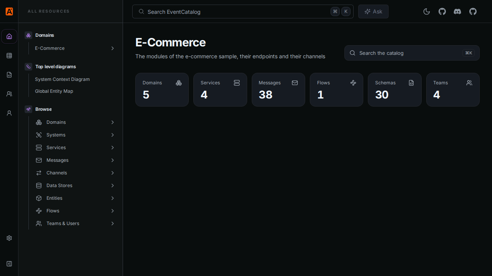

The catalog shows one domain, E-Commerce, with each module as a service. A service page shows what the module receives and sends, and which team owns it.

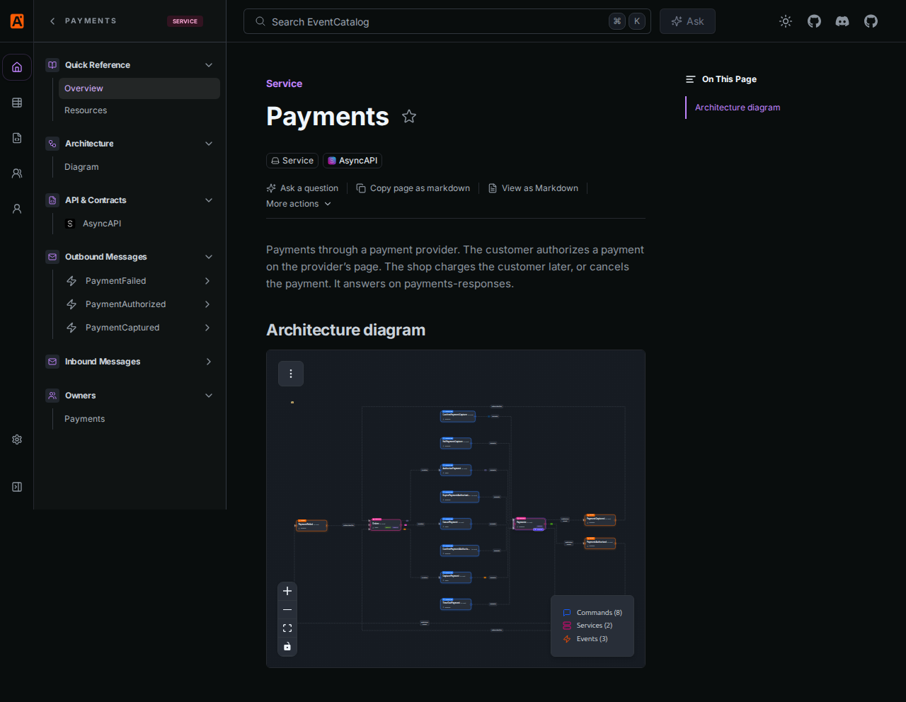

**Discover** lists all commands, events and queries. For each event, it shows which module produces it and which consumes it.

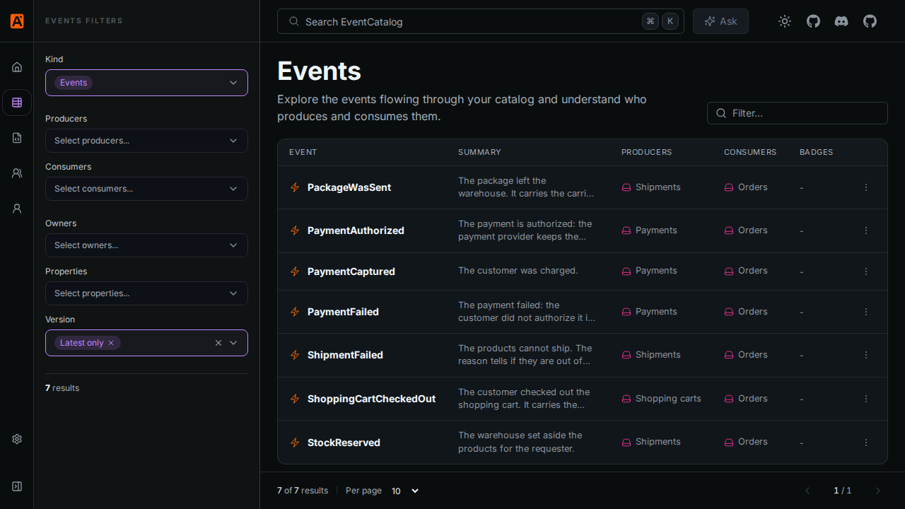

## 11. Look at the purchase in Grafana

The default start runs Grafana LGTM (Grafana with Tempo for traces, Loki for logs and Prometheus for metrics) with the other Docker Compose services. The `in-memory` profile doesn't start it, but it sends to it when it runs: start it with `docker compose --profile otel up -d`. After a purchase, open Grafana at <http://localhost:3000>. It needs no login.

1. Find the purchase's correlation id. Every step of a purchase carries it: the spans as the attribute `messaging.message.correlation_id`, the log lines as the field `correlationId`. Open **Explore**, choose the **Tempo** data source and search with TraceQL, for example `{ span.eventdriven.command.type = "PlaceOrder" }` for the orders placed, or `{ span.eventdriven.stream.name = "Order-<order id>" }` for one order.
2. Open the trace of the checkout. It goes from the HTTP request through every module: each `handle ...` span handles one message, and its `messaging.message.id`, `messaging.message.correlation_id` and `messaging.message.causation_id` say which message it was, which purchase it belongs to and which message caused it. Inside, a `command.handle` span shows the command (`eventdriven.command.type`), the stream, the versions before and after and the events it appended, and the `eventStore.readStream` and `eventStore.appendToStream` spans show the reads and appends. **Pay now** is a new HTTP request, so it starts a second trace with the same correlation id.
3. Open the **Logs** of a span, or choose the **Loki** data source in **Explore**. Each log line has the `traceId` of its span.
4. Open **Dashboards**. Three dashboards come with the sample, and each chart links to its traces in Tempo.

**Purchases** counts what customers do and what goes wrong, from the events the modules append: orders placed, completed, canceled and closed unpaid, the payments and shipments, and, under **Watch out**, the failed commands, append conflicts, timeouts, dead letters and failed message handlers.

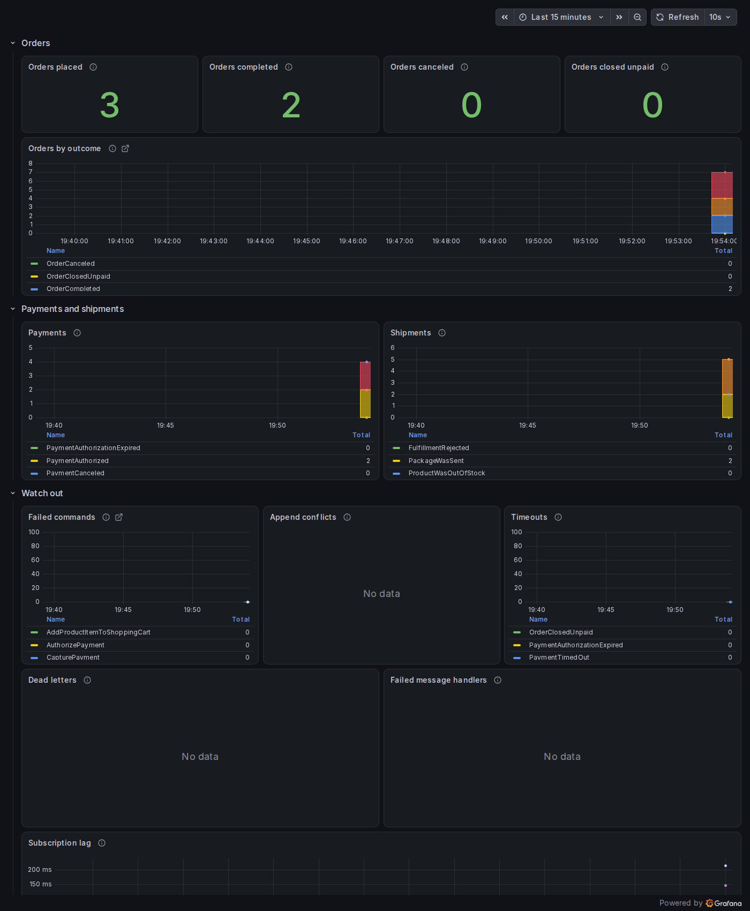

**Commands and event store** shows how the command handlers and the event store work: commands by type and status, their latency, and the reads and appends of the event store. It has the same shape as Emmett's dashboard.

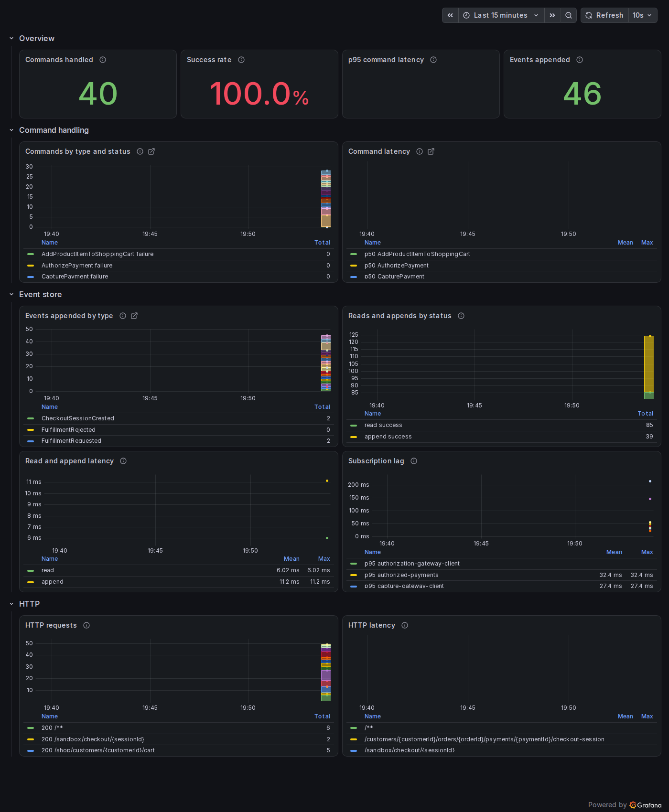

**Purchase flow** shows the messages published, handled and failed for each channel, and the dead letters.

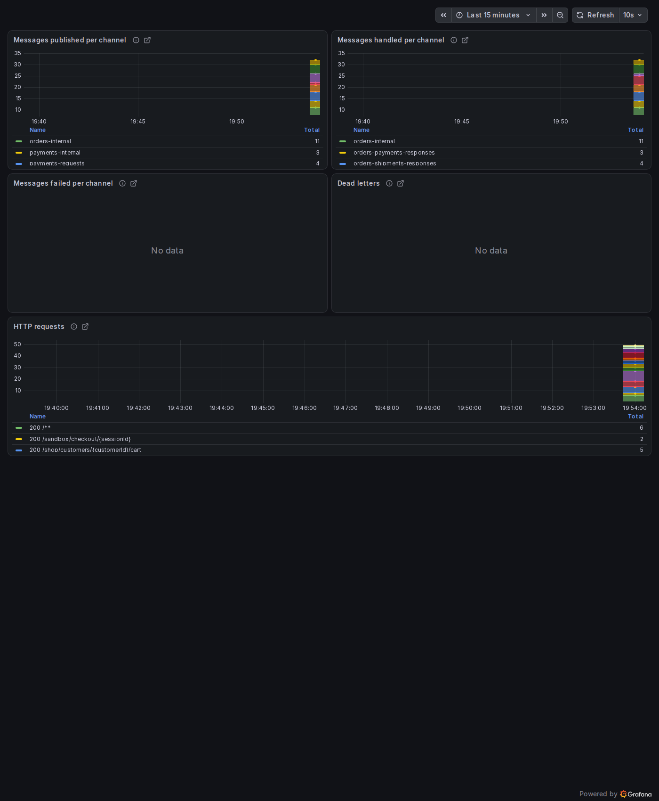

If Grafana doesn't run, the application works the same.

## 12. Run the tests

```shell
./gradlew build
```

The build runs all tests except the browser tests. The tests of the web API and the business logic use the `in-memory` profile. The tests of the Kafka, RabbitMQ, KurrentDB and PostgreSQL implementations, and the tests that run a purchase on real servers, use the Docker Compose services when they run, and start their own servers with Testcontainers when they don't. The same goes for Grafana LGTM: when the Docker Compose one runs, the tests send their traces, logs and metrics to it, so you can look at a test run there.

```shell
./gradlew e2eTest
```

The browser tests start the application and go through the purchase above in Chromium, which Playwright downloads on the first run. One of them shops on Kafka, KurrentDB and PostgreSQL, where the views catch up after the writes. It checks that the pages never show an error while they wait, that the order page updates in place until the order is completed, and that the purchase reaches Grafana as one trace, as metrics and as logs. On a Linux machine that lacks the system packages of Chromium, install them once with `./gradlew playwrightInstallDeps`, which uses `sudo`.

In a dev container, stop the Docker Compose Kafka with `docker compose --profile all down` before you run the Kafka tests. [AGENTS.md](../../AGENTS.md#build-environment) tells why.

```shell
./gradlew eventCatalogTest
```

This task builds the catalog and checks it in Chromium: each service lists what it sends and receives and shows its team, the listings have every command, event and query, and the browser reports no errors.

The screenshots in this guide come from the same tests. To take them again:

```shell
./gradlew howToScreenshots eventCatalogScreenshots
```
