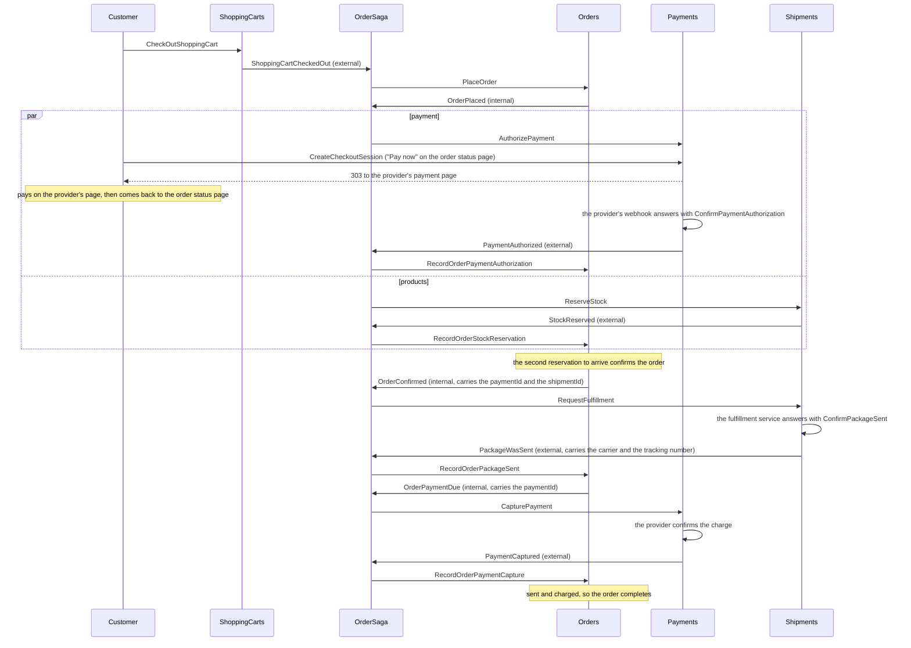
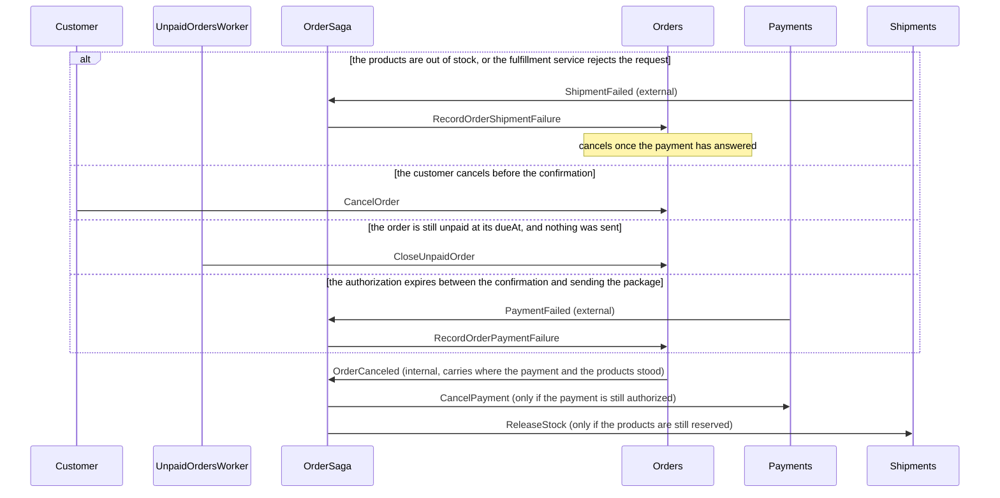

The purchase is a process across the four contexts. Orders runs it: its saga translates the other contexts' events into the order's commands, and the order decides the next step. The shop takes the money and the products on hold first, and charges only after the package left. When one step fails, the order undoes what the other one holds. The [README](https://github.com/oskardudycz/EventSourcing.JVM/tree/main/samples/e-commerce#cross-module-processes-with-compensation) explains each step.

<NodeGraph />

## The messages, in order

## When a step fails

Four kinds of failure cancel an order. In each of them, the order decides what to release:

The order's `OrderCanceled` carries where both participants stood, and the saga only reads it:

| Status | The saga sends |
|---|---|
| `paymentStatus = Authorized` | `CancelPayment` |
| `shipmentStatus = Reserved` | `ReleaseStock` |
| anything else | nothing, because there is nothing to release |

The [README](https://github.com/oskardudycz/EventSourcing.JVM/tree/main/samples/e-commerce#when-a-step-fails) explains the failures, paying again and the deadlines.
