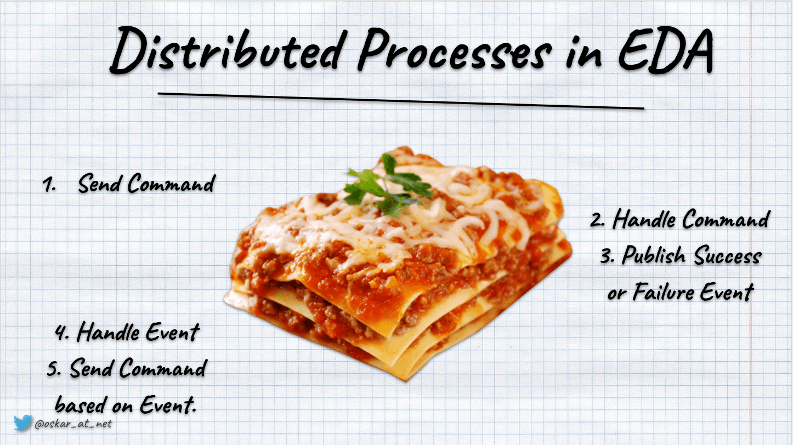

[](https://www.linkedin.com/in/oskardudycz/)  [](https://github.com/sponsors/oskardudycz/) [](https://event-driven.io/?utm_source=event_sourcing_jvm) [](https://www.architecture-weekly.com/?utm_source=event_sourcing_jvm) 

 

# Group checkout: a distributed process with Event Sourcing

This sample shows how to handle distributed processes with Event Sourcing. For more background, check my articles [Saga and Process Manager - distributed processes in practice](https://event-driven.io/en/saga_process_manager_distributed_transactions?utm_source=event_sourcing_jvm) and [No, it can never happen!](https://event-driven.io/en/no_it_can_never_happen/?utm_source=event_sourcing_jvm). 

An event-driven distributed process accepts that one transaction across modules and databases, a *two-phase commit*, is not possible. Instead of one big transaction, it runs a sequence of _microtransactions_. Each operation is handled by the module that's the source of truth and can make autonomous decisions. An event recorded and published in the system starts the process, e.g. shopping cart checked out. Then another module can subscribe to it and take it from there. It knows what should be the next operation, e.g. initiating the order process. It sends a command that is handled, and business logic creates another event. This event is the trigger for the next step of the workflow. Such _lasagne_ of event/command/event/command continues until the process is finished (with success or failure).



The sample checks out a group of hotel guests, one action on many records, and builds it in three styles: saga, process manager and choreography. To see a process that has to undo finished steps when a later one fails, check the [e-commerce sample](../e-commerce/README.md).

## Batch operations

A common example of a distributed process is a batch operation, for instance, the group checkout of hotel guests. Someone selects a set of guest accounts and clicks "check out". After that, the process tries to check out all of them. If the whole process fails, nothing undoes the checkouts that already succeeded, but you could rerun the checkout after resolving the issues.

The first style is a *saga*: a class that reacts to each event of the process and sends the next command, without business rules of its own. The group checkout saga can look like this:

```java
public class GroupCheckoutSaga {
    private final CommandBus commandBus;

    public GroupCheckoutSaga(CommandBus commandBus) {
        this.commandBus = commandBus;
    }

    public void on(GroupCheckoutInitiated groupCheckoutInitiated) {
        for (var guestAccountId : groupCheckoutInitiated.guestStayAccountIds()) {
            commandBus.schedule(new GuestStayAccountCommand.CheckOutGuest(
                    guestAccountId, groupCheckoutInitiated.groupCheckoutId(), groupCheckoutInitiated.initiatedAt()));
        }
        commandBus.schedule(new RecordGuestCheckoutsInitiation(
                groupCheckoutInitiated.groupCheckoutId(),
                groupCheckoutInitiated.guestStayAccountIds(),
                groupCheckoutInitiated.initiatedAt()));
    }

    public void on(GuestStayAccountEvent.GuestCheckedOut guestCheckoutCompleted) {
        if (guestCheckoutCompleted.groupCheckoutId() == null) return;

        commandBus.schedule(new RecordGuestCheckoutCompletion(
                guestCheckoutCompleted.groupCheckoutId(),
                guestCheckoutCompleted.guestStayAccountId(),
                guestCheckoutCompleted.completedAt()));
    }

    public void on(GuestStayAccountEvent.GuestCheckoutFailed guestCheckoutFailed) {
        if (guestCheckoutFailed.groupCheckoutId() == null) return;

        commandBus.schedule(new RecordGuestCheckoutFailure(
                guestCheckoutFailed.groupCheckoutId(),
                guestCheckoutFailed.guestStayAccountId(),
                guestCheckoutFailed.failedAt()));
    }
}
```

See more in [GroupCheckoutSaga.java](./src/main/java/io/eventdriven/hotelmanagement/saga/groupcheckout/GroupCheckoutSaga.java)

The saga sends commands through a *command bus* ([CommandBus.java](./src/main/java/io/eventdriven/core/commands/CommandBus.java)). The bus first stores each command and only then delivers it, so a crash between the two steps can't lose a command. That is the *outbox pattern*, described in [Delivering messages reliably](#delivering-messages-reliably).

The saga delegates the business logic to the group checkout *decider*: a function that takes a command and the current state, checks the business rules and returns the resulting events. That gives a clear split between coordination (the saga) and business logic (the decider), so the saga stays lightweight. It is much easier to maintain than a process manager that does both.

See the [GroupCheckoutDecider](./src/main/java/io/eventdriven/hotelmanagement/saga/groupcheckout/GroupCheckoutDecider.java) and [GroupCheckout](./src/main/java/io/eventdriven/hotelmanagement/saga/groupcheckout/GroupCheckout.java) state.

We can check out the guest account if the balance is settled. If it's not, the decider returns a failure event: 

```java
private static GuestStayAccountEvent handle(CheckOutGuest command, CheckedIn state) {
    if (state.balance() != 0) {
        return new GuestCheckoutFailed(
                state.id(), GuestCheckoutFailed.Reason.BalanceNotSettled, command.groupCheckoutId(), command.now());
    }

    return new GuestCheckedOut(command.guestStayAccountId(), command.groupCheckoutId(), command.now());
}
```

See more in [GuestStayAccountDecider](./src/main/java/io/eventdriven/hotelmanagement/saga/gueststayaccount/GuestStayAccountDecider.java#L51).

The command handler (the application service) should use a retry policy, so that a transient error does not fail the command.

```java
public Optional<ETag> handle(CheckOutGuest command) {
    return retryTemplate.invoke(() -> handle(command.guestStayAccountId(), command));
}
```

See more in [GuestStayAccountService](./src/main/java/io/eventdriven/hotelmanagement/saga/gueststayaccount/GuestStayAccountService.java#L35)

As an alternative to the retry policy, the command handler could use [Pokémon exception handling](https://www.dodgycoder.net/2011/11/yoda-conditions-pokemon-exception.html) (catch every exception) and then publish the failure event.

The same group checkout is also implemented as:

- [process manager](./src/main/java/io/eventdriven/hotelmanagement/processmanager/), where [GroupCheckoutProcessManager](./src/main/java/io/eventdriven/hotelmanagement/processmanager/groupcheckout/GroupCheckoutProcessManager.java) keeps the process state and decides about the next steps,
- [choreography](./src/main/java/io/eventdriven/hotelmanagement/choreography/), where [GroupCheckoutService](./src/main/java/io/eventdriven/hotelmanagement/choreography/groupcheckout/GroupCheckoutService.java) reacts to events and schedules commands itself, without a separate saga.
